# 케셰브vJ · 처음 실행하기

케셰브vJ는 로컬 PC에서 실행하는 보안 Agent 학습 앱입니다. 학생 영역의 기기·세션, 보안 기록, 패키지 조회와 추가한 PC 상태·Windows 기록 조회를 제공합니다. 이 저장소에는 기존 가상 메모 자료실 프로젝트도 함께 들어 있습니다.

## 프로젝트 폴더에서 실행

**Windows 일반 권한 PowerShell**을 사용합니다. 설치 프로그램 없이 프로젝트 코드를 실행하는 절차입니다.

1. 받은 프로젝트를 압축 해제한 폴더에서 `README.md`와 `on-client` 폴더가 함께 있는 위치를 엽니다. 기존 작업 폴더 위에 덮어쓰지 않습니다.
2. 파일 탐색기의 주소 표시줄에 `powershell`을 입력해 해당 폴더에서 창을 엽니다.
3. `node --version`으로 Node.js가 준비되어 있는지 확인합니다. 현재 실행 스크립트는 주 버전 22~24를 허용하고, 프로젝트에 기록된 수업 기준은 24.19.0입니다. 설치가 필요하면 [Node.js 공식 사이트](https://nodejs.org/)를 이용한 뒤 새 PowerShell 창을 엽니다. 이 학생 앱의 예제 실행에는 `npm install`이 필요하지 않습니다.
4. 아래 명령을 실행하고 창을 열어 둡니다.

```powershell
powershell -NoProfile -ExecutionPolicy Bypass -File .\on-client\tools\start-alekov.ps1 -Demo -Port 5196
```

5. 실행 창의 ‘케셰브vJ가 켜졌습니다’ 메시지를 확인하고 [http://127.0.0.1:5196/](http://127.0.0.1:5196/)을 엽니다. 포트가 사용 중이면 기존 프로그램을 종료하지 말고 다른 빈 번호를 명령과 주소에 함께 적용합니다. 포트 번호는 앱 버전이 아닙니다.
6. 첫 팝업의 **시작하기**로 PC 측정 버튼에 이동한 뒤 직접 **내 PC 상태 측정**을 누릅니다. 자동 측정하지 않습니다. **내 보안 현황**에서 대상별 다시 조회를 사용하고, **사용 안내** 탭에서 앱 목적·처음 할 일·탭별 세부 기능·결과 읽는 법을 확인합니다.

`-Demo`의 기기·세션·보안 기록은 설명용 예제입니다. PC 조회 버튼의 값은 실제 로컬 PC 조회 결과이며 시각·단위가 붙습니다. 실패는 ‘확인 불가’이고, SDP 연결 상태는 PC 조회 성공과 별개입니다. 패키지 미조회는 취약점 없음이 아닙니다.

종료는 이번에 실행한 창에서 `Ctrl+C`입니다. 같은 폴더·명령으로 다시 실행합니다. 자세한 준비·확인·오류 대응은 [현재 실행 안내](docs/STUDENT_RUNBOOK.md)를 따르세요. 루트의 `npm start`는 케셰브vJ 실행 명령이 아닙니다.

## 내 보안 현황 카드 (2026-10-27)

학생 영역을 기기·세션, 보안 기록, 패키지·취약점 카드로 구성했습니다. 요약·출처·원천 확인 시각·다시 조회 버튼은 바로 보이고 상세는 기본 접힘입니다. 재조회 후에도 상세 상태와 버튼 초점을 유지합니다. 원천 시각 누락은 제공되지 않음, 실패는 확인 불가와 다음 행동으로 표시합니다. 기존 PC 측정과 공통 화면은 변경하지 않았습니다.

위 실행 명령으로 시작한 뒤 보호 현황 → 학생 영역의 **내 보안 현황**에서 확인합니다. 이미 실행 중이면 새로고침합니다. 정상 응답의 출처·시각, 예제 구분, 실패 시 안내를 확인하고 Tab/Enter/Space로 재조회·상세 접기를 조작합니다. `node --test on-client/test/student-dashboard.test.mjs` 모의 검사 5개와 문법·변경 형식 검사가 통과했습니다. 설치본 반영은 아직 미검증입니다.

아래는 demo 예제의 카드 배치와 키보드 초점을 확인한 화면입니다. 실제 PC 측정값이나 실제 계정 정보가 아닙니다.

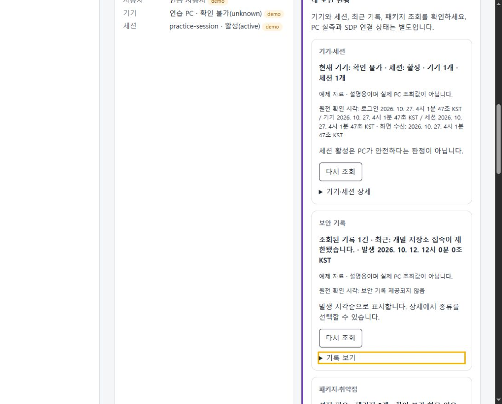

## 보안 기록과 조회 이력 저장점 (2026-10-27)

**이번에 받은 보안 기록**은 사건별 상세를 해당 기록 바로 아래에서 펼칩니다. **내가 조회한 이력**은 조회 시각별로 묶어 최신순으로 표시하고 종류 필터를 제공합니다. 조회 시각과 사건 발생 시각을 구분하며 저장된 행 수는 고유 사건 수나 공격 탐지 건수가 아닙니다. 기존 PC 측정 기능과 저장 형식은 유지했습니다.

위 프로젝트 실행 명령으로 실행한 뒤 **보안 기록 → 사건 상세 펼치기 → 내가 조회한 이력 → 조회 시각 묶음 펼치기** 순서로 확인합니다. 이미 실행 중이면 새로고침합니다. Tab/Enter로 접기·펼치기를 조작할 수 있습니다. 정상 응답은 출처와 시각을 표시하고 조회 실패는 오류 안내를 유지합니다. 삭제 확인 없이 이력 삭제가 실행되어서는 안 됩니다.

`node --test on-client/test/history-view.test.mjs on-client/test/student-dashboard.test.mjs`로 모의 UI 검사를 실행합니다. 브라우저에서 예제 기록의 접기·펼치기와 조회 묶음을 확인했으며 실제 이력 삭제와 설치본 반영은 시험하지 않았습니다.

아래는 설명용 예제 화면이며 실제 PC 측정값이나 실제 계정 정보가 아닙니다.

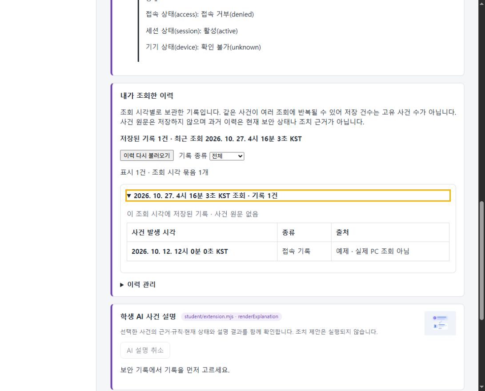

## 첫 사용자 안내와 보호 현황 배치 (2026-10-27)

첫 방문에는 앱 목적과 세 탭의 역할을 안내하는 팝업이 표시됩니다. ‘더 이상 보지 않기’를 선택하고 시작하기 또는 Esc로 닫으면 같은 브라우저·주소(포트 포함)에서 선택을 기억합니다. 저장소 사용 실패는 안내하며 조회 이력 저장 형식은 바꾸지 않습니다. 팝업을 숨겨도 보안 기록 아래 **사용 안내** 탭에서 기본 설명을 읽을 수 있습니다. 내 보안 현황의 기존 안내 버튼과 기본 설명은 제거하고 조회 대상별 버튼 이름은 유지했습니다.

보호 현황의 현재 로그인·내 기기·내 세션은 동일 너비 3열이며 학생 구현 표시는 다음 행 전체 너비입니다. 화면 너비 1,100px 이하에서는 세로 배치됩니다. 기존 PC 측정과 제출물은 보존했습니다.

위 프로젝트 실행 명령으로 시작한 뒤 새로고침 → 팝업 닫기 → 사용 안내 → 보호 현황 순서로 확인하세요. 팝업 숨김을 선택하면 다음 새로고침에서 자동 표시되지 않아야 합니다. 조회 실패는 정상·접근 거부로 대체되어서는 안 됩니다. 관련 모의 테스트 12개와 문법·diff 검사를 통과했습니다. 브라우저에서 팝업·키보드 탭 이동·수평 배치를 확인했으며 설치형 앱 반영은 미검증입니다.

아래는 예제 모드의 UI 확인 화면이며 실제 PC 측정 결과가 아닙니다.

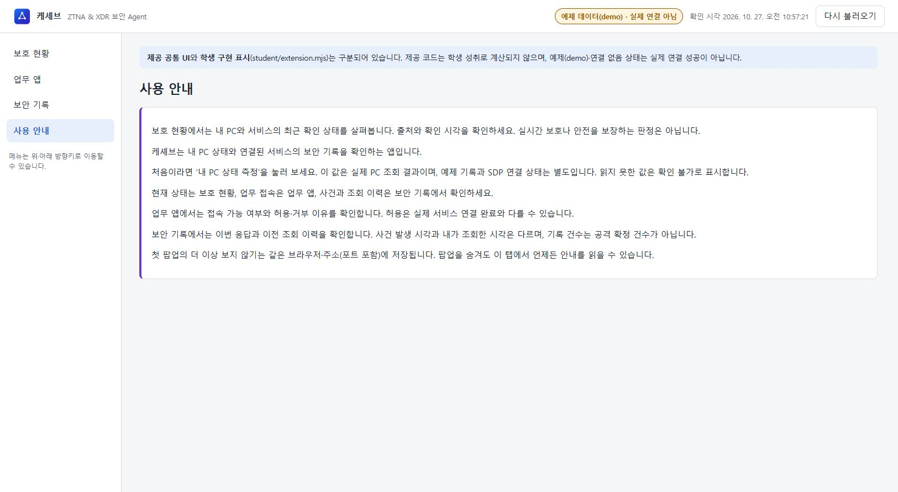
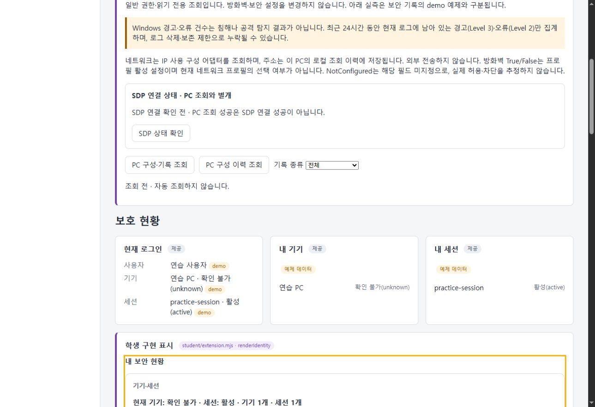

## 시작하기 이동과 사용 안내 구성 (2026-10-27)

첫 팝업의 **시작하기**는 보호 현황의 **내 PC 상태 측정** 버튼으로 이동하고 키보드 초점을 표시합니다. 자동 측정하지 않으며 사용자가 직접 버튼을 눌러야 측정합니다. Esc는 팝업만 닫고, 기존 숨김 선택은 유지합니다. 사용 안내 탭은 앱 목적 → 처음 할 일 → 탭별 역할 → 결과 읽는 법 순서입니다.

위 프로젝트 실행 명령으로 실행한 뒤 새로고침 → 시작하기 → PC 측정 버튼 초점과 ‘측정 전’ 확인 → 사용 안내 탭 순서로 확인합니다. 자동 측정이나 조회 이력 삭제가 발생해서는 안 됩니다. 팝업 숨김을 이미 선택했다면 자동 팝업은 표시되지 않습니다.

모의 테스트 13개·문법·diff 검사 통과. 브라우저에서 시작하기 후 측정 전 상태와 버튼 초점, 안내 구성 순서를 확인했습니다. PC 측정·저장 형식·제출물은 유지했으며 설치형 앱 반영은 미검증입니다.

아래 화면은 예제 모드의 사용 안내이며 실제 PC 측정 결과가 아닙니다.

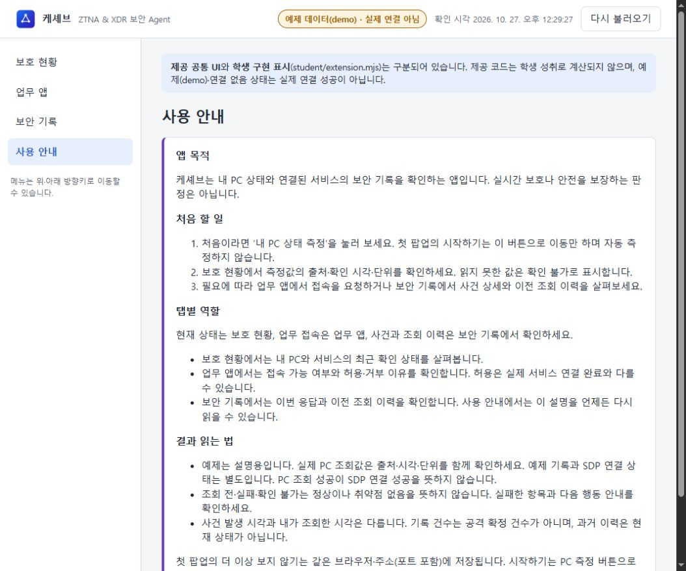

## 케셰브vJ 명칭과 초보자 안내 (2026-10-27)

현재 앱 명칭은 케셰브vJ입니다. 보호 현황의 내 보안 현황 제목 중복을 없애고 제작 구분·파일명을 기본 접힘 구현 정보로 옮겼습니다. 사용 안내는 PC가 느릴 때, 접속이 안 될 때 등 사용 상황과 기능의 유용성·이용 조건을 설명하고 세부 기능을 탭별로 펼쳐 볼 수 있습니다. 업무 앱을 반드시 거쳐야 하거나 자동 수리·안전을 보장한다고 설명하지 않습니다.

위 프로젝트 실행 명령으로 실행하거나 기존 화면을 새로고침한 뒤 제목 → 보호 현황의 내 보안 현황·구현 정보 → 사용 안내의 탭별 세부 기능 순서로 확인합니다. 예제는 실측이 아니며 조회 실패는 정상이나 거부 판정으로 대체되어서는 안 됩니다. 모의 테스트 15개·문법·diff 검사를 통과했고 브라우저에서 새 명칭과 안내 화면을 확인했습니다. 실행 스크립트의 새 메시지는 코드로 확인했으며 이번에 서버를 재시작하지 않았습니다. 설치본 반영은 미검증입니다.

PC 측정·저장 형식·과거 검증 기록·기존 스크린샷·제출물은 유지합니다. 아래는 예제 모드 안내 화면이며 PC 실측 결과가 아닙니다.

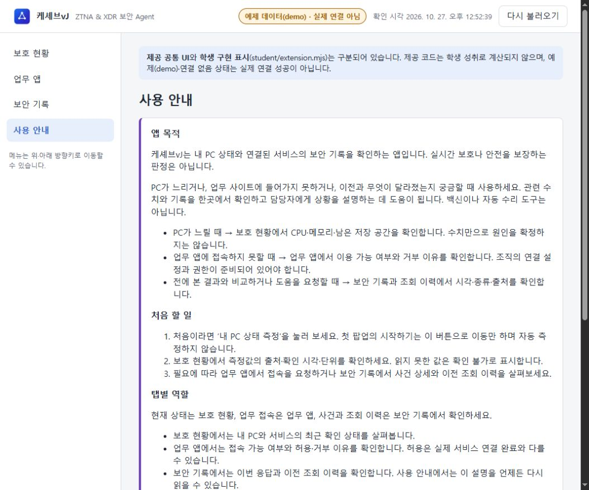

## 현재 이용 범위와 업무 앱 안내 (2026-10-27)

최근 공통 응답별로 예제·연결된 자료·조회 전·확인 불가와 확인 시각을 표시합니다. PC 조회 성공과 SDP 연결 성공은 별개이며 학생 카드 재조회는 해당 카드에서 확인합니다. 업무 앱 탭은 접속 가능 여부와 이유를 확인하는 용도임을 바로 설명합니다.

위 실행 명령으로 실행한 뒤 새로고침 → 현재 이용 범위 → 업무 앱 안내 순서로 확인합니다. 예제는 실제 연결 성공이 아니며 실패한 응답은 연결된 자료로 표시되어서는 안 됩니다. 정적 파일 허용 목록에 새 모듈을 등록해 404로 화면 초기화가 멈추던 문제를 수정했고, 같은 포트에서 서버를 재실행하여 모듈 HTTP 200과 실제 화면을 확인했습니다. 관련 모의 검사 2개와 문법·diff 검사 통과. PC 측정·저장 형식·제출물은 유지했으며 설치본은 미검증입니다.

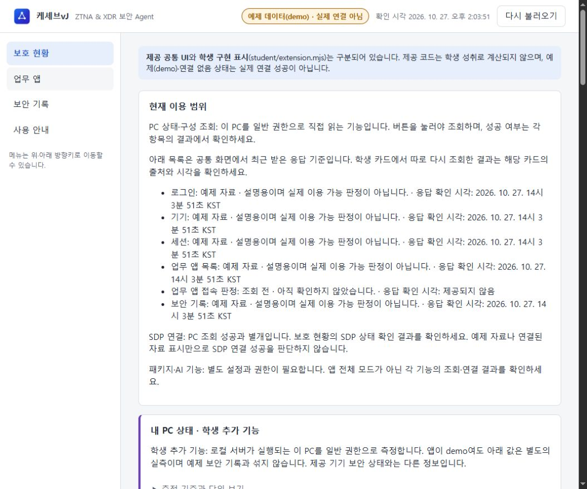

## 현재 이용 범위 접기 (2026-10-27)

현재 이용 범위는 기본 접힘이며 짧은 설명은 항상 보입니다. 위 프로젝트 실행 명령으로 실행한 뒤 새로고침 → 현재 이용 범위에 Tab 이동 → Enter로 펼치기 → 다시 불러오기 → Space로 접기 순서로 확인합니다. 응답 갱신만으로 펼친 영역이 자동으로 접히지 않아야 합니다. 페이지 새로고침은 기본 접힘으로 돌아갑니다.

브라우저에서 기본 접힘·키보드 조작·응답 갱신 후 펼침 유지와 diff 검사를 확인했습니다. 기존 기능·PC 측정·저장 형식·제출물은 보존했습니다. 설치본 반영은 미검증입니다. 아래는 예제 모드 화면이며 PC 실측 결과가 아닙니다.

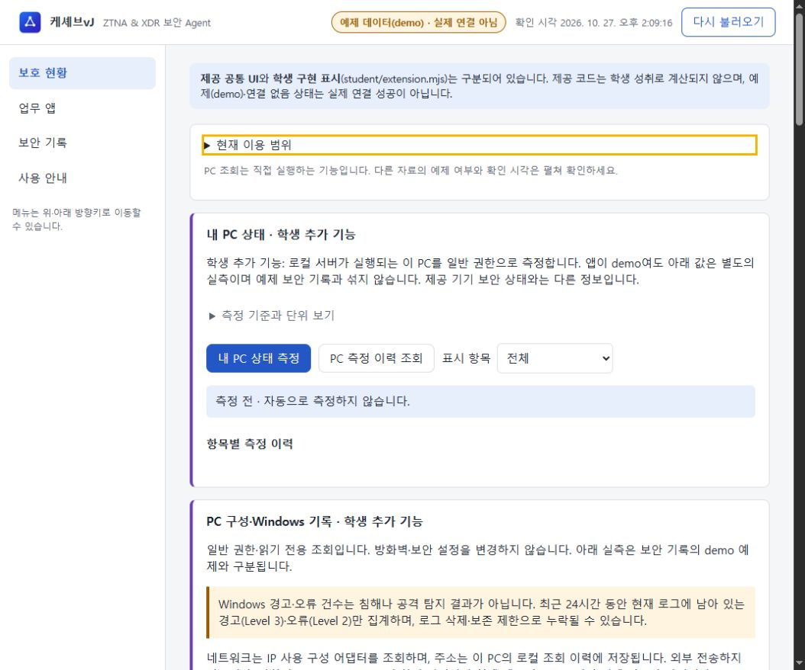

## 이용 범위 표와 화면 목적 안내 (2026-10-27)

현재 이용 범위는 기본 접힘을 유지하며, 펼치면 항목·자료 구분·확인 시각 표로 표시합니다. 예제 자료·서버 자료·확인 불가를 구분하고 반복 설명을 줄였습니다. 보호 현황 제목과 설명은 현재 이용 범위 아래, PC 측정 위에 배치했고 보안 기록에도 목적과 해석 주의사항을 추가했습니다.

프로젝트 루트에서 `powershell -NoProfile -ExecutionPolicy Bypass -File .\on-client\tools\start-alekov.ps1 -Demo -Port 5196` 실행 후 표시된 주소를 엽니다. 이미 실행 중이면 새로고침합니다. 보호 현황 → 현재 이용 범위 펼치기 → 표와 제목 위치 확인 → 보안 기록 탭 → 제목 아래 설명 순서로 확인합니다. 정상 응답은 자료 구분과 시각을 표시하며, 실패·출처 미확인 응답은 성공이나 실측으로 표시되어서는 안 됩니다. 응답 갱신 시 펼침 상태 유지 동작은 보존했습니다.

아래는 로컬 demo 화면이며 PC 실측 또는 SDP 연결 성공의 증거가 아닙니다. 기존 PC 측정·저장 형식·제출물과 과거 기록은 유지했습니다. 설치형 앱 검증과 새 제출 묶음 생성은 하지 않았습니다.

- [이용 범위 표](docs/screenshots/availability-table.png)
- [보호 현황 안내와 배치](docs/screenshots/protection-purpose.png)
- [보안 기록 안내](docs/screenshots/records-purpose.png)

## 입력 요소와 사용 안내 스타일 저장점 (2026-10-27)

드롭다운·복사·필터 초기화·이력 불러오기·삭제 버튼 스타일과 사용 안내 세부 기능 여백을 정리했습니다. 첫 안내 팝업은 화면 중앙에 배치하고 시작하기 버튼에 앱 스타일을 적용했습니다. Esc 닫기와 시작하기의 PC 측정 버튼 이동(자동 측정 없음)을 화면에서 확인했습니다. 더 이상 보지 않기와 삭제 확인 로직, PC 측정·저장 형식·제출물은 유지합니다.

프로젝트 루트에서 `powershell -NoProfile -ExecutionPolicy Bypass -File .\on-client\tools\start-alekov.ps1 -Demo -Port 5196`을 실행합니다. 이미 실행 중이면 새로고침합니다. 팝업 → Esc 또는 시작하기 → 보호 현황 → 보안 기록의 필터·이력 관리 → 사용 안내의 탭별 역할을 확인합니다. 팝업 숨김을 선택한 브라우저에서는 자동 팝업이 나오지 않는 것이 정상입니다. 삭제 확인 전에는 삭제 버튼이 비활성 상태여야 합니다. 이번 검증에서 삭제나 PC 측정은 실행하지 않았습니다.

- [중앙 팝업과 시작하기](docs/screenshots/guide-centered-controls.png)
- [조회 이력 입력 요소](docs/screenshots/record-control-styles.png)

스크린샷은 로컬 demo 화면이며 실제 보안 판정이나 PC 측정 증거가 아닙니다. 문법·diff 검사를 통과했습니다. 포장 작업의 컴백포인트는 `9fbce32` 시점의 공식 package-app 도구·승인 실행 환경 준비 확인 단계로 유지합니다. 설치형 앱 검증·포장·제출은 수행하지 않았습니다.

## 설치형 앱은 별도 준비 단계

계획은 **기본 포장 후 Inno Setup의 사용자 단위 setup.exe**입니다. 현재 이 프로젝트에서 케셰브vJ용 배포 setup.exe와 `.iss` 설치 설정을 확인하지 못했습니다. 따라서 설치 완료나 설치본 반영을 보장하지 않습니다. 제공 공통 화면 변경과 학생 확장이 실제 패키지에 포함되는지 확인하고 설치·실행 시험을 마친 뒤 설치 안내를 확정합니다. 지금은 위 프로젝트 실행 절차를 사용하세요.

## 확인 범위

- 이전 작업에서 로컬 브라우저의 예제 표시, PC 실측, 이력 복원, 학생 재조회·키보드 조작을 확인했습니다. 자세한 당시 결과와 제한은 아래 기록에 보존합니다.
- 다른 사람 PC의 재현, 실제 SDP 연결 성공, 설치본 실행, 운영 인증·공식 단계 통과를 의미하지 않습니다.
- 이번 문서 정리는 실행 코드와 안내를 대조한 작업이며, 새 설치나 다른 PC 재현 시험을 수행한 것은 아닙니다.

## 과거 저장점·검증 기록

아래는 당시의 명령·포트·미확인 범위를 그대로 보존한 기록입니다. **처음 실행할 때는 위 절차를 사용하세요.** 아래의 ‘이번’, ‘현재’, ‘미확인’은 각 기록을 작성한 시점 기준입니다.

<details>
<summary>과거 기록 펼치기</summary>

# Choi Bujang Secret Vault

Vercel, GitHub, Supabase로 가상 메모 자료실을 만들고 단계별로 접근 통제를 추가하는 알레프 방어전 실습 프로젝트입니다. 실제 개인정보나 민감한 자료는 사용하지 않습니다.

**현재 진행: 케셰브 22단계 최종 커밋의 새 환경 재현과 릴리스 기록 준비 · 검증 중. 새 폴더 재현과 학생 확인은 아직 미확인이고, 19단계 실집행 연결은 준비되지 않았습니다. 운영 인증·v1.0 인증·공식 단계 통과를 뜻하지 않습니다.**

## 학생 핵심 기능 저장점 (2026-10-27)

학생 첫 영역에 기기·세션 상태, 보안 기록 타임라인, 설치 패키지·취약점 조회를 순서대로 배치했습니다. 허용된 학생 api.get으로 다시 조회하며 대기·중복 방지·실패 항목과 다음 행동을 표시합니다. Tab/Enter/Space 조작과 재조회 후 버튼 초점을 유지합니다. 기존 상세 화면과 PC 측정 기능은 보존했습니다.

기존 프로젝트 루트에서 `powershell -NoProfile -ExecutionPolicy Bypass -File .\on-client\tools\start-alekov.ps1 -Demo -Port 5196` 실행 후 보호 현황 → 학생 핵심 기능 3가지에서 각 다시 조회 버튼을 확인합니다. 이미 실행 중이면 새로고침합니다. 정상 응답은 출처·시각을 표시하고 실패는 확인 불가·다음 행동을 표시하며 예제로 대체하지 않습니다.

`node --test on-client/test/student-dashboard.test.mjs`의 모의 검사 4개와 문법 검사가 통과했습니다. 브라우저에서는 예제 표기·키보드 재조회·초점 유지·패키지 미설정 안내를 확인했습니다. appearance.json은 현재 로더/규격을 찾지 못해 추가하지 않았습니다. 설치본 반영과 실제 스크린리더 음성 출력은 미검증입니다. 기존 자료실 설정·판정 규칙은 변경하지 않았으며 설치형 반영을 공통 화면 수정만으로 보장하지 않습니다.

아래 화면의 연습 사용자·기기·세션은 demo 예제이며 실제 계정이나 PC 실측이 아닙니다.

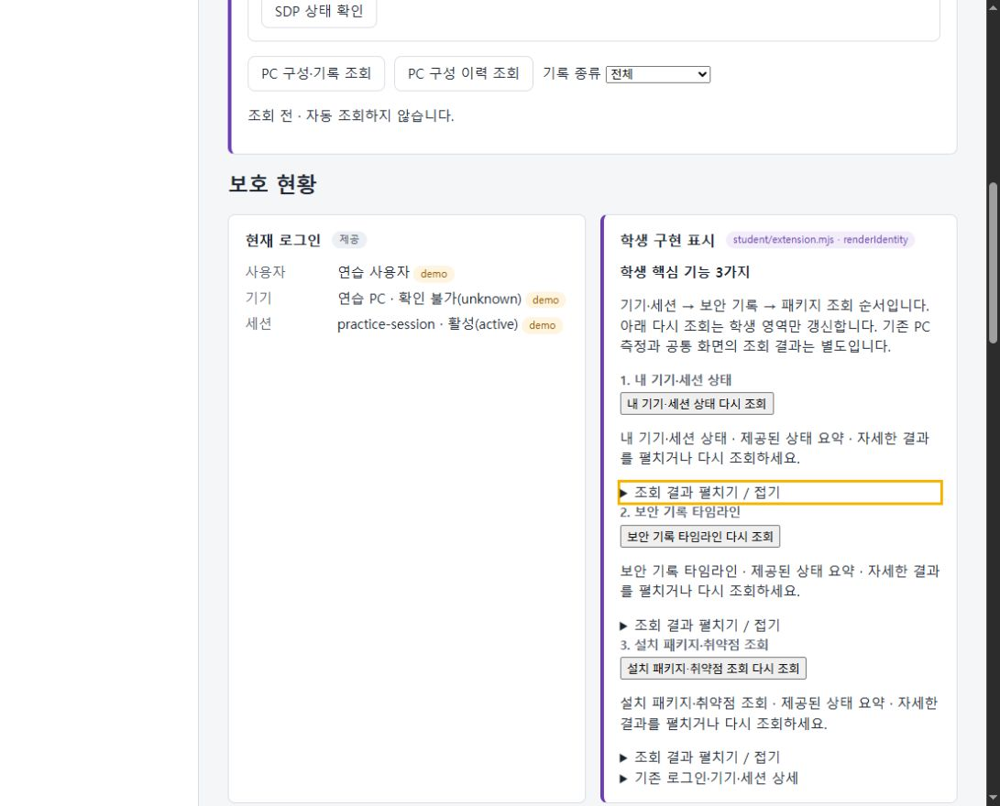

## Windows 경고·오류 카드와 표 저장점 (2026-10-27)

System·Application 각각에 최신 경고·오류 카드와 독립 접이식 표를 표시합니다. 표는 조회 시각별 최근 24시간 집계를 최신순으로 배치하며 경고·오류 아래에 값·단위 컬럼을 둡니다. 최신 조회 실패는 이전 정상값으로 대체하지 않고 확인 불가와 이유를 표시합니다. 겹치는 집계 구간의 건수는 합산하지 않으며 침해·공격 탐지 결과가 아닙니다.

기존 프로젝트 루트에서 `powershell -NoProfile -ExecutionPolicy Bypass -File .\on-client\tools\start-alekov.ps1 -Demo -Port 5196` 실행 후 보호 현황 → PC 구성 이력 조회 → System/Application 선택 → 조회 이력 펼치기를 확인합니다. 이미 실행 중이면 새로고침만 합니다. 저장된 실측 2회분으로 최신 카드·내림차순·독립 펼침·필터를 확인했고 문법·diff 검사를 통과했습니다. 설정·판정 규칙·기존 제출물은 보존했습니다.

아래는 저장된 실측 이력을 표시한 화면이며 현재 측정값이나 설명용 예제가 아닙니다. IP 주소·계정 정보·이벤트 본문은 포함하지 않았습니다.

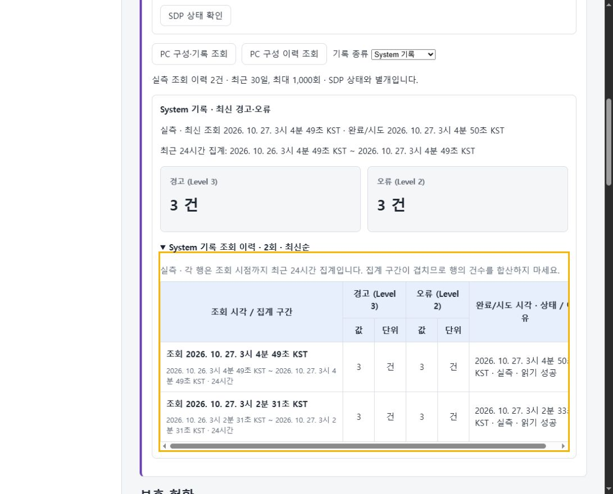

## PC 구성·Windows 기록 저장점 (2026-10-27)

일반 사용자 권한으로 네트워크 구성, 방화벽 적용 프로필 설정, 최근 24시간 System·Application의 경고·오류 건수를 읽습니다. 실패는 확인 불가와 이유로 표시하며 설정 변경이나 권한 승격은 하지 않습니다. 최신순 접이식 타임라인과 종류 필터를 제공하고 SDP 상태는 별도로 확인합니다. Windows 건수는 침해·공격 탐지 결과가 아닙니다.

기존 프로젝트 루트에서 `powershell -NoProfile -ExecutionPolicy Bypass -File .\on-client\tools\start-alekov.ps1 -Demo -Port 5196` 실행 후 보호 현황 → PC 구성·기록 조회 → 종류 필터 → SDP 상태 확인을 누릅니다. 이미 실행 중이면 중복 실행하지 않습니다. 정상은 실측·시각·단위 표시, 읽기 거부는 확인 불가이며 demo에서는 SDP 미연결이어야 합니다. 자세한 재현 순서는 [실행 설명서](docs/STUDENT_RUNBOOK.md)를 따릅니다.

관련 자동 검사 11개 통과, 일반 사용자 실조회 4개 항목 성공, 이력 복원과 별도 SDP 미연결 표시를 확인했습니다. 모의 자동 검사는 공격 시험이나 심판 판정이 아닙니다. 실제 SDP 연결 성공과 설치 프로그램 실행은 미검증입니다. 기존 자료실 설정·판정 규칙·제출물은 보존합니다.

아래는 2026-10-27에 확인한 실측 화면이며 현재 상태나 예제 수치가 아닙니다. 네트워크 주소·계정 정보·이벤트 본문은 포함하지 않았습니다.

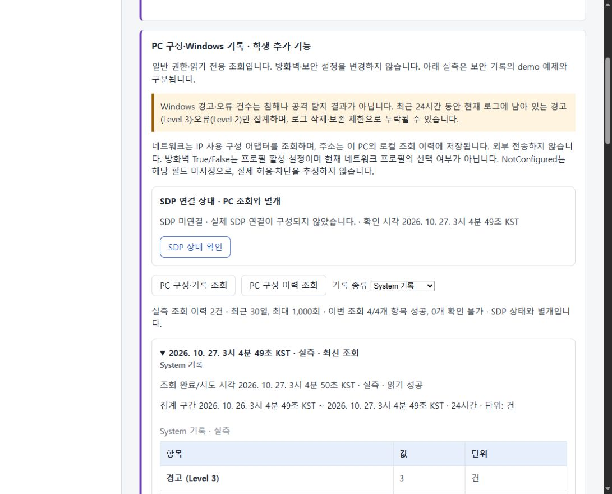

## 내 PC 상태 저장점 (2026-10-27)

일반 권한으로 CPU 사용률(%), 메모리 사용량(GiB), 홈 드라이브 여유 공간(GiB)을 측정합니다. 최신 카드·최근 최대 20회 그래프와 CPU/메모리/디스크별 독립 접이식 표(최신 기록 포함, 시각 내림차순)를 제공합니다. 측정 시각·단위·직전 유효 실측 대비 변화량을 표시하며, 실패는 확인 불가와 이유로 표시합니다. 실측과 예제는 구분합니다.

기존 프로젝트 루트에서 `powershell -NoProfile -ExecutionPolicy Bypass -File .\on-client\tools\start-alekov.ps1 -Demo -Port 5194` 실행 후 보호 현황 → 내 PC 상태 측정 또는 PC 측정 이력 조회 → 항목별 표 제목을 누릅니다. 이미 실행 중인 5194 서버는 그대로 사용합니다. 기존 폴더·제출물은 보존하며 Inno Setup 사용자 단위 설치는 아직 제작·검증하지 않았습니다.

`node --test on-client/test/pc-status.test.mjs on-client/test/history.test.mjs` 7개 통과(모의 입력·임시 저장소 검사). 브라우저에서는 저장된 실측 4건의 표·정렬을 확인했습니다. 기존 자료실 설정 step=12, 로그인 발급자·허용 경로·원본 API 및 구현 규칙은 보존합니다. 배포 주소의 현재 운영 상태와 심판 판정은 이번에 확인하지 않았습니다.

## 케셰브 22단계 재현 기록 (2026-10-26)

[재현 및 릴리스 기록](docs/REPRODUCTION_RECORD.md)에 기준 저장소·브랜치·커밋, 새 폴더 실행 절차, 13~21단계 확인 표와 데이터 보존 계획을 기록합니다. 실행 방법과 입력 계약은 [21단계 학생 실행 설명서](docs/STUDENT_RUNBOOK.md)를 유지합니다. 아래 과거 기록의 통과 결과를 이번 최종 커밋의 재현 결과로 합산하지 않습니다.

이번 변경은 문서뿐입니다. 학생 화면·어댑터·자료실·공개 가상 자료·인증 설정을 보존합니다. 다시 실행할 명령은 새 복제본의 Git 최상위에서 `powershell -NoProfile -ExecutionPolicy Bypass -File .\on-client\tools\start-alekov.ps1 -Demo -Port 5190`이며, 「보호 현황」에서 예제 표시를 확인합니다. 현재는 기존 폴더 보존을 학생이 확인하는 순서입니다. clone·설치·실행·브라우저·종료·재실행·제출은 이번에 실행하지 않았습니다.

## 케셰브 21단계 학생 안내 (2026-10-26)

실행 위치·명령·구성도·함수 입력·장애 확인·제출 절차는 [학생 실행 설명서](docs/STUDENT_RUNBOOK.md)를 따릅니다. 제공 문서와 앞 단계 코드는 보존하며 이번에는 README와 새 학생 문서만 변경합니다.

- 목적과 기능: 본인 로그인·기기·세션, 업무 앱 접근 판정, 보안 기록, AI 연결·설명 및 조치 상태를 구분해 표시하는 보안 Agent 「케셰브」입니다. 표시 구현과 실제 운영 연결 성공을 구분합니다.
- 구성: 브라우저 → `on-client/src/server.mjs` → 명시적으로 구성된 접근 제어·XDR 호스트 / AI 게이트웨이입니다. 학생 화면은 `on-client/student/extension.mjs`, 제공 화면·통신은 `on-client/public/app.js`가 담당합니다. 기존 자료실과 XDR 연습 파일은 같은 저장소에 보존되며 자동 운영 연결을 뜻하지 않습니다.
- 환경: Windows 실행 도구, 학생 앱 0.2.14, package의 Node 기준 24.19.0(실행 도구 허용 22~24). 이번 확인 버전은 Node 24.21.0, npm 11.19.0, PowerShell 7.6.5 / Windows PowerShell 5.1.19041.6456, Git 2.34.1.windows.1입니다. 다른 OS·브라우저 버전별 동작은 미확인입니다.
- 다시 실행: Git 최상위 PowerShell에서 `powershell -NoProfile -ExecutionPolicy Bypass -File .\on-client\tools\start-alekov.ps1 -Demo -Port 5190` 후 `http://127.0.0.1:5190/`의 「보호 현황」을 확인합니다. 포트 사용 중이면 기존 프로세스를 보존하고 번호를 바꿉니다. 제공 실행 도구 전체 절차와 이번 브라우저 확인은 미확인입니다.
- 직접 확인: `npm.cmd --prefix on-client run check` 종료 코드 0. 별도 임시 예제 HTTP 서버의 화면 경로 200 및 library allow / repository deny / approval challenge를 확인하고 해당 서버를 종료했습니다. 모의 자료 점검이며 실제 접속 허용·차단이나 심판 판정이 아닙니다.
- 실제 SDP/XDR 연결, 유료 AI, 보안 조치·효과 관측, 배포·단계 제출은 이번 미실행입니다. 21단계는 과제 화면에 저장소·40자리 커밋을 직접 입력하며 비공개 원문 절차는 새 설명서의 안내를 따릅니다.

## 케셰브 19단계 저장점 (2026-10-26)

- 변경 함수는 `on-client/student/extension.mjs`의 `renderAction`입니다. 앞 단계 함수는 보존합니다. 준비·사람 확인 안내·전달·접수(ACK)·관측 결과를 구분하며 `succeeded`이고 `observation.effectApplied === true`인 경우에만 효과 확인을 표시합니다. 현재 사건·근거·조치·대상·세대·요청·접수·버전 및 관측 시각을 받은 범위에서 표시합니다. 학생 코드에 버튼·통신·인증 티켓 저장을 추가하지 않습니다.
- 필수 항목 코드 대조: `student-source-changed`(함수 구현), `proposal_execution_separation`(준비/전달/ACK 구분), `human_confirmation`(대상·기한과 제공 확인 버튼 안내), `current_intent_binding`(현재 입력의 식별자와 data 속성), `observed_server_result`(엄격한 효과 관측 조건), `duplicate_prevention`(학생 집행 요청 없음·결과 재조회 안내), `unknown_not_success`(결과 불명), `action_refresh`(매번 새 DOM 반환)에 대응합니다. 실제 의도 검증·티켓 소비·중복 집행 방지는 제공 화면/서버의 책임이며 학생 코드의 안내 문구만으로 운영 검증을 통과했다고 판단하지 않습니다.
- 직접 실행: 모의 DOM 검사에서 12개 상태, 참 값만 허용하는 효과 조건, 식별자, 새 입력의 이전 표시 제거, HTML 모양 문자열의 텍스트 처리를 확인했습니다. 구문 검사와 diff 검사도 통과했습니다. 공식 심판 판정이 아닙니다.
- 실제 브라우저의 예제 모드에서 지원 조치 없음 안내·조치 준비 버튼 부재·학생 idle 표시를 확인했습니다. event-01 상세를 연 뒤 다시 불러오기로 상세 초기화를 확인했습니다. 예제 기록이 1건이어서 다른 기록 전환, 실제 요청/결과가 있던 상태의 초기화, 실제 계정 집행·효과·결과 재조회는 미확인입니다. 기존 5189 화면은 연결 없음이었고 별도 5190 예제 서버로 검사했습니다.
- 제공 화면의 실제 재조회 버튼 이름은 「원천 결과만 재조회」이며 공식 안내와 학생 문구의 「연동 시스템 결과만 재조회」와 다릅니다. 제공 코드는 수정하지 않았습니다. 취소는 이미 전달된 효과를 되돌리지 않습니다.
- 재실행: 저장소 루트 PowerShell에서 `npm --prefix on-client run demo` 후 http://127.0.0.1:5189/ 의 보안 기록 → event-01 상세 → 다시 불러오기를 확인합니다. 5189가 사용 중이면 `$env:ON_PORT='5190'; npm --prefix on-client run demo`로 별도 실행하고 http://127.0.0.1:5190/ 을 엽니다. 문법 검사는 `npm --prefix on-client run check`입니다. 정상 기대는 미지원 안내·미실행 표시와 상세 초기화이며, ACK 또는 관측 없는 succeeded를 효과 확인으로 표시하면 안 됩니다.
- 설정 대조: `aleph.config.json`의 step=12는 기존 자료실과 attack-check 지원 단계로 유지합니다. 배포 주소의 로컬 참조, 로그인 issuer/audience/JWKS 검증, 단일 메모·공지 GET 판정 경로, 원본 learning_notes API와 테이블 사용을 대조했습니다. 운영 배포 주소의 현재 응답·환경값은 미확인입니다. judgeIssuer는 보존하고 RULE_IDS 여섯 개는 실제 구현 분기에 대응합니다.
- 공개 가상 자료와 attack-check는 보존합니다. 이번 bundle·실제 요청 자기 점검·배포 확인·공식 제출·진도 기록은 미실행입니다. 비밀 설정·메모 본문·XDR 로그/후보/거부 규칙·bundle-notes.json·artifacts/submission.json은 이번 커밋에서 제외합니다.

## 케셰브 15단계 저장점 (2026-10-19)

- 변경 함수는 on-client/student/extension.mjs의 renderEvents입니다. 받은 배열을 복사해 최신순으로 정렬하고 ID·시각·종류·앱·요약, 기록 종류·업무 앱·접속 상태 필터와 건수, 근거·규칙·세 상태 상세를 표시합니다. 앞 단계 함수는 보존했습니다.
- 관측 범위는 서버가 전달하는 본인의 최근 40건과 이미 저장된 XDR 경보입니다. 전체 직원 이력이나 실시간 탐지가 아닙니다. 전체·생략 건수와 확인 시각은 제공 화면이 담당합니다. unknown은 확인 불가로 유지하며 조치 버튼은 만들지 않습니다.
- 직접 실행: 구현 시 문법 검사와 모의 DOM 점검에서 정렬·원본 보존·필터/건수·상세·문자 그대로 표시·재조회 초기화·빈 배열/실패/계약 불일치 구분을 확인했습니다. 저장점 준비에서 문법 및 diff 검사를 다시 확인합니다.
- 사용자 화면 확인 보고: 필터 적용·해제와 건수/행 일치, 최신순과 필수 정보, 근거·규칙·세 상태 및 unknown, 키보드 초점/조작, 재조회 상세 초기화/다시 열기를 확인했습니다. Console 모의 입력으로 빈 배열·오류·CONTRACT_MISMATCH의 구분과 이전 목록/상세 제거, HTML 모양 문자열의 문자 표시, 앱 ID 누락 안내, 조치 버튼 미생성을 확인했습니다. 마지막 다시 불러오기로 원래 조회 목록 복원을 확인했습니다. 실제 서버 장애 재현이나 실제 SDP 연결 증거는 아닙니다.
- 재실행: 저장소 루트 PowerShell에서 예제는 npm --prefix on-client run demo, 기본 실행은 npm --prefix on-client start, 문법은 npm --prefix on-client run check입니다. http://127.0.0.1:5189/ 의 학생 보안 기록 영역에서 필터·상세·다시 불러오기를 사용합니다. 이미 실행 중이면 기존 화면을 사용합니다.
- 정상 기대: 필터와 행/건수가 일치하고 상세의 세 상태가 구분됩니다. 거부 상태 denied는 접속 거부로 표시합니다. 실패나 계약 불일치를 빈 목록·허용으로 표시하거나 이전 결과를 현재 결과처럼 남기면 안 됩니다. 이 UI 확인은 실제 접속 허용·거부 시험이 아닙니다.
- 설정 대조: aleph.config.json의 step=12는 기존 자료실과 12단계까지 지원하는 attack-check 설정으로 유지합니다. publicAppUrl의 코드 참조, 로그인 issuer/audience/JWKS 연결, GET 단일 메모·공지 허용 분기, originalApiUrl의 learning_notes 경로와 API 테이블을 대조했습니다. 운영 배포 주소의 현재 응답·환경값은 미확인입니다. judgeIssuer는 보존하며 RULE_IDS 여섯 개는 구현 분기에 대응합니다.
- src/attack-check.mjs와 공개 가상 자료는 보존했습니다. 이번 attack-check·bundle·배포·push·제출·공식 판정·진도 기록은 미실행입니다. 비밀 설정·메모 본문·XDR 로그/후보/거부 규칙·bundle-notes.json·artifacts/submission.json은 이번 커밋에서 제외합니다.

## 케셰브 학생 화면 저장점 (2026-10-19)

- `on-client/student/extension.mjs`의 `renderDecision`: 요청 전·요청 중·판정 수신·요청 실패를 구분하고, 선택 앱 ID·판정 의미와 코드·이유·시각을 표시합니다. 알 수 없는 판정은 unknown이며 요청 실패는 deny와 구분합니다. allow는 실제 앱 접속 성공을 보장하지 않고 challenge의 인증 절차를 대신 수행하지 않습니다.
- `renderStatus`: 기기·세션의 로딩·빈 목록·실패, 자료별 알림, 연결 상태와 안전한 진단 6개 항목 및 도움정보 복사를 구현했습니다. 13단계 `renderIdentity`와 나머지 함수는 보존했습니다. `renderStatus`는 16단계 일부이며 15단계 상세의 미지원 조치 안내는 미구현입니다.
- 확인 근거: 문법 검사와 모의 DOM 입력 검사를 통과했습니다. 실제 로컬 브라우저에서 요청 전 안내, 연결 없음, 기기·세션 실패, 알림, 진단 표시 및 복사 버튼 활성화를 확인했습니다. 사용자가 메뉴 키보드 이동을 확인했습니다. 실제 클립보드 복사와 실제 SDP 계정의 판정·이유·시각, 접속 요청 버튼의 키보드 결과 갱신은 미확인입니다. 앞선 사용자 결과 확인 보고는 실제 SDP 연결 증거로 간주하지 않습니다.
- 다시 실행: 저장소 루트 PowerShell에서 `npm --prefix on-client start`, 문법 확인은 `npm --prefix on-client run check`. 브라우저 `http://127.0.0.1:5189/`에서 업무 앱 또는 보호 현황을 엽니다. 이미 서버가 실행 중이면 브라우저를 새로고침합니다. 기본 실행은 연결 없음이며 실제 연결은 담당자가 안내한 개인 SDP 설정이 필요합니다. 설정 내용과 인증 자료는 저장소에 넣지 않습니다.
- 예상 표시: 계약에 맞는 ok 응답은 판정·이유·시각을 표시하고, deny는 접근 거부, unknown은 확인 불가, error는 요청 실패로 표시합니다. 현재 연결 없음에서 기기·세션 실패를 정상이나 빈 목록으로 표시하지 않습니다. 정책 변경으로 네 판정을 강제로 만들지 않습니다.
- 저장점 대조: `aleph.config.json`의 step=12는 기존 자료실 과정 설정입니다. 배포 주소·로그인 issuer/audience/JWKS·메모 단건 및 공지 GET 허용 경로·원본 learning_notes API를 로컬 코드의 참조와 대조했고 유지합니다. 운영 주소의 현재 응답과 배포 환경값은 미확인입니다. `judgeIssuer`는 변경하지 않았습니다. `src/decider.mjs`의 RULE_IDS 여섯 개는 구현 분기와 일치하여 유지합니다.
- 기존 공개 가상 메모와 `src/attack-check.mjs`를 보존합니다. 이번 저장점의 attack-check·bundle·배포·공식 제출·진도 기록은 미실행이며 실제 요청 자기 점검 결과를 새로 만들지 않습니다. XDR 로그·차단 후보·거부 규칙, `bundle-notes.json`, `artifacts/submission.json`, 비밀 설정과 메모 본문은 이번 커밋에 포함하지 않습니다.

## 보너스 xdr-06 저장점 (2026-10-19)

- `xdr/exfiltration/`의 읽기 모듈, T1041·T1048을 참고한 패턴 3개, 독립 판정기와 신뢰 연결 응답 모듈을 저장했습니다. 반복·전체 반출과 이례적인 전송 통로 조건을 보완하고 준비·실패·부분 전송은 알림으로 남깁니다. 확신도는 패턴 일치 정도이며 0.85 이상 block, 0.5 이상 alert, 나머지 record입니다.
- 이번에 `npm.cmd run xdr:run -- exfiltration`을 다시 실행했습니다. 30건 중 **block 10 / alert 10 / record 10**입니다. 공개 설명 기준 ex-01~10은 block, ex-11~20은 alert, 정상 ex-21~30은 record로 정상 오차단은 0건입니다. 로컬 회귀 기대값이며 심판 정답이나 실제 차단 결과가 아닙니다.
- 앞선 분류·연결 모의 검사 4개와 기존 판정기 가상 요청 4개가 통과했습니다. 실패·취소·일부 전송과 승인된 정상 전송의 차단 제외, 동일 요청 거부, 다른 정상 요청 허용, 만료·중복 연결 제외를 확인했습니다.
- 신뢰 감사 자료로 연결된 block 후보만 동일 요청에 최대 15분 만료·근거 경보 번호를 붙여 등록합니다. [신뢰 연결 계약](docs/WEB_INJECTION_RESPONSE.md)을 따르며 경보 번호는 ex-입니다. 운영 연결 자료가 없으면 활성 규칙을 만들지 않습니다. 이번에는 respond를 실행하지 않았으므로 기존 후보·거부 규칙·알림은 최신 분류 결과로 재생성하지 않았습니다.
- 설정 step=12, 기존 배포 주소, 로그인 issuer/audience/JWKS, 단일 메모·공지 GET 허용 경로, 원본 learning_notes API를 로컬 구현과 대조했습니다. 설정과 judgeIssuer 및 실제 구현 RULE_IDS 여섯 개를 유지합니다. 운영 배포 주소의 현재 응답·서버 환경변수·규칙 파일 공급은 미확인입니다. attack-check와 bundle은 미실행이며 새 실측 결과를 기록하지 않습니다.
- 재실행: `npm.cmd run xdr:run -- exfiltration`. 화면 클릭 없이 터미널에서 실행합니다. 명확한 패턴 일치는 block, 애매한 신호는 alert, 정상 이벤트는 record가 기대 결과입니다.
- 이번 커밋은 README, 패턴, 판정기, 결과, 분류·연결 테스트를 포함합니다. 알림 로그·차단 후보·거부 규칙 파일과 bundle-notes.json·artifacts/submission.json은 제외합니다. 원본 경보·공개 가상 메모를 보존하며 원격 push는 실행하지 않습니다.

## 보너스 xdr-05 저장점 (2026-10-19)

- `xdr/privilege/`의 확인용 읽기 모듈, T1068·T1078을 참고한 패턴 3개, 외부 의존성 없는 `decide.mjs`, `respond.mjs`와 외부 규칙 로더 연결을 저장했습니다. 확신도는 패턴 일치 정도이며 0.85 이상 block, 0.5 이상 alert, 나머지 record입니다. 취약점 악용이나 계정 도용을 입증한 결과는 아닙니다.
- 이번에 `npm.cmd run xdr:run -- privilege`를 다시 실행했습니다. 26건 중 **block 9 / alert 8 / record 9**, 설명 기준 정상 이벤트 pv-18~26의 block은 0건입니다. 재생성한 `result.json`은 기존 커밋과 내용이 같습니다. 수업용 설명에 따른 로컬 검증이며 심판 정답이나 실제 차단 결과가 아닙니다.
- 신뢰 감사 자료로 연결된 block 후보만 동일 요청 지문에 최대 15분 만료·근거 경보 번호를 붙여 등록합니다. [신뢰 연결 계약](docs/WEB_INJECTION_RESPONSE.md)을 따르며 경보 번호는 pv-입니다. 연결 자료가 없으면 활성 규칙을 만들지 않습니다. 이번에는 respond를 실행하지 않아 기존 후보·거부 규칙·알림을 재생성하지 않았습니다.
- 앞선 분류·연결 모의 검사 3개와 판정기 가상 요청 4개가 통과했습니다. 정상·애매한 경보의 거부 규칙 제외, 동일 요청 거부, 다른 요청 허용, 만료·중복 연결 제외를 확인했습니다. 기존 ZTNA 판정 조건과 실제 구현 RULE_IDS 여섯 개는 유지합니다.
- 설정 step=12, 기존 publicAppUrl, 로그인 issuer/audience/JWKS, 단일 메모·공지 GET 허용 경로, 원본 learning_notes API를 로컬 구현과 대조했습니다. 설정과 judgeIssuer는 보존합니다. 운영 배포 주소의 현재 응답·서버 환경변수·운영 파일 공급은 이번에 확인하지 않았습니다. attack-check와 bundle은 미실행이며 새 실측 결과를 기록하지 않습니다.
- 재실행: `npm.cmd run xdr:run -- privilege`. 화면 클릭 없이 터미널에서 실행합니다. 정상 이벤트는 record, 명확한 패턴 일치는 block, 애매한 시도는 alert가 기대 결과입니다.
- 이번 커밋의 내용 변경은 README입니다. 알림 로그·후보·거부 규칙 파일과 bundle-notes.json·artifacts/submission.json은 제외합니다. 원본 경보·공개 가상 메모를 보존하며 원격 push는 실행하지 않습니다.

## 보너스 xdr-04 저장점 (2026-10-19)

- xdr/persistence/의 읽기 모듈, 근거 패턴 3개, 독립 decide.mjs, respond.mjs와 외부 로더 연결을 저장했습니다. 근거는 T1543·T1053 및 시작 폴더의 직접 근거 T1547.001입니다. 확신도 0.85 이상 block, 0.5 이상 alert, 나머지 record입니다.
- 이번에 npm.cmd run xdr:run -- persistence를 다시 실행했습니다. result.json은 기존 커밋과 동일하며 24건 중 **block 5 / alert 8 / record 11**입니다. 정상 이벤트 ps-17~24의 block은 0건입니다. ps-06~08은 alert, 애매한 ps-11·13·16은 record로 남아 있어 모든 공격 차단·애매한 시도 전체 알림을 달성한 상태는 아닙니다.
- respond.mjs는 신뢰 감사 자료와 연결된 block 후보만 동일 요청 지문에 최대 15분 만료·근거 경보 번호를 붙여 등록합니다. 연결 형식은 [신뢰 연결 계약](docs/WEB_INJECTION_RESPONSE.md)을 따르며 경보 번호는 ps-입니다. 앞선 기본 실행은 후보 5건·활성 규칙 0건·알림 13줄 추가였고, 이번에는 알림을 다시 생성하지 않았습니다.
- 기존 판정 조건과 실제 구현 RULE_IDS 여섯 개를 유지합니다. 앞선 연결 모의 검사 3개와 판정기 가상 요청 4개가 통과했습니다. 실제 운영 연결·배포·차단·심판은 미검증입니다.
- 설정 step=12, 기존 publicAppUrl, 로그인 issuer/audience/JWKS, 단일 메모·공지 GET 허용 경로, 원본 learning_notes API를 로컬 코드와 대조했습니다. 설정과 judgeIssuer는 보존하며 운영 배포 주소의 현재 응답·서버 환경변수는 이번에 확인하지 않았습니다. attack-check의 실제 요청 자기 점검과 bundle도 미실행이며 새 실측 결과를 기록하지 않습니다.
- 재실행: `npm.cmd run xdr:run -- persistence`. 화면 클릭 없이 터미널에서 실행합니다. 정상 이벤트는 record, 명확하게 일치하는 경보는 block, 부분 일치는 alert가 기대 결과이며 로컬 분류는 실제 차단이 아닙니다.
- 이번 커밋은 README 변경을 포함하며 재생성한 result.json에는 내용 차이가 없습니다. 알림 로그·후보·거부 규칙 파일과 bundle-notes.json·artifacts/submission.json은 제외합니다. 원본 경보·공개 가상 메모를 보존하며 원격 push는 실행하지 않습니다.

## 보너스 xdr-03 저장점 (2026-10-19)

- `xdr/known-cve/`에 확인용 읽기 모듈, CVE-2021-44228·T1190 근거의 패턴 세 개, 외부 의존성 없는 판정기, 후보·거부 규칙·알림 연결 모듈을 구현했습니다. 확신도 0.85 이상은 block, 0.5 이상은 alert, 나머지는 record입니다.
- 이번에 `npm.cmd run xdr:run -- known-cve`를 다시 실행해 `result.json`을 갱신했습니다. 24건 중 **block 8 / alert 1 / record 15**, 경보 설명 기준 정상 이벤트 오차단은 0건입니다. 이는 로컬 가상 경보 분류이며 실제 차단·심판 판정이 아닙니다.
- `node xdr/known-cve/respond.mjs`는 차단 후보와 알림을 기록합니다. 앞선 기본 실행은 후보 8건·활성 규칙 0건·알림 9줄 추가였으며, 이번 저장점에서는 알림을 재생성하지 않았습니다. 운영자가 감사 기록으로 대조한 연결 파일을 두 번째 인자로 전달한 경우에만 동일 요청 지문에 최대 15분 만료·근거 경보 번호를 붙여 등록합니다. 연결 형식은 [기존 신뢰 연결 계약](docs/WEB_INJECTION_RESPONSE.md)을 따르며 경보 번호는 `kc-`입니다.
- 외부 로더는 `xdr/known-cve/deny-rules.json`과 웹 주입 전용 파일을 독립적으로 읽습니다. 기존 허용·거부·추가 확인 조건과 RULE_IDS 여섯 개는 유지합니다. 앞선 연결 검사 2개·판정기 가상 요청 4개가 통과했으며, 정상·애매한 경보 제외, 동일 요청 거부, 다른 요청 허용, 만료를 모의 확인했습니다. 운영 등록·파일 공급·배포·실제 차단은 미검증입니다.
- 설정 step=12, 기존 publicAppUrl, 로그인 issuer/audience/JWKS, GET 단일 메모·공지 허용 경로, 원본 learning_notes API를 로컬 구현과 대조했습니다. 설정과 judgeIssuer는 변경하지 않았으며 현재 운영 배포 버전·서버 환경변수는 조회하지 않았습니다. 실제 요청을 보내는 자기 점검과 bundle은 이번에 실행하지 않았고 새 실측 결과를 기록하지 않았습니다.
- 재실행: `npm.cmd run xdr:run -- known-cve`. 클릭 없이 터미널에서 실행합니다. 정상 이벤트는 record, 명확한 원격 조회 형태는 block, 잘린 조회 형태는 alert가 기대 결과입니다.
- 이번 저장점에는 README와 result.json만 포함합니다. 알림 로그·차단 후보·외부 거부 규칙 파일과 bundle-notes.json·artifacts/submission.json은 제외합니다. 원본 경보와 공개 가상 메모는 유지하며 원격 push는 실행하지 않습니다.

## 보너스 xdr-02 저장점 (2026-10-19)

- `xdr/web-injection/`에 확인용 읽기 모듈, T1190 기반 패턴 세 개, 외부 의존성 없는 판정기, 후보·거부 규칙·알림 연결 모듈을 구현했습니다. 스크립트 태그의 직접 근거는 MITRE CWE-79로 보완했습니다.
- 이번에 `npm.cmd run xdr:run -- web-injection`을 다시 실행해 `result.json`을 갱신했습니다. 26건 중 **block 7 / alert 2 / record 17**, 경보 설명 기준 정상 이벤트 오차단은 0건입니다. 결과는 이전 커밋과 같으며 로컬 분류 기록입니다. 기존 패턴에 없는 명령 구분자 경보 wi-06은 record로 남아 있어 모든 공격 탐지 완료를 뜻하지 않습니다.
- 외부 거부는 신뢰 감사 자료로 연결된 동일 요청 지문에만 최대 15분 적용합니다. 기존 허용·거부·추가 확인 조건은 유지하며, RULE_IDS는 실제 구현한 기존 다섯 개와 external_deny를 합한 여섯 개입니다. 연결 증거 없는 현재 시험 경보는 후보 7건, 활성 규칙 0건이며 앞선 실행에서 알림 9줄을 추가했습니다.
- 앞선 연결·만료·정상 요청 모의 검사와 판정기 가상 요청 4개는 통과했습니다. 운영 등록·규칙 파일 공급·배포·실제 차단·심판은 미검증입니다. 연결 계약과 실행 방법은 [웹 주입 경보 연결](docs/WEB_INJECTION_RESPONSE.md)을 따릅니다.
- 설정의 step=12, 기존 publicAppUrl, 로그인 issuer/audience/JWKS, GET 단일 메모·공지 허용 경로, 원본 learning_notes API와 구현을 대조했습니다. 설정과 judgeIssuer는 변경하지 않았으며 현재 운영 배포 버전과 서버 환경변수는 이번에 조회하지 않았습니다.
- 재실행 명령은 `npm.cmd run xdr:run -- web-injection`입니다. 클릭할 화면 없이 터미널에서 실행합니다. 정상 이벤트는 record, 근거가 뚜렷한 반복 주입 경보는 block이 기대 결과입니다. 결과 파일 생성은 운영 차단이 아닙니다.
- 이번 저장점은 README와 재생성한 result.json을 대상으로 확인합니다. 실행 중 생성된 알림 로그·차단 후보·외부 거부 규칙 파일, bundle-notes.json과 artifacts/submission.json은 커밋에 넣지 않습니다. bundle과 원격 push는 실행하지 않았습니다.

## 12단계 저장점 (2026-10-19)

- 학생 판정기 규칙 목록·수, 운영 탐지/회수 미연동 상태, 권한 있는 계정의 복구 사본 미리보기 버전을 탈환 작전실에 표시합니다. 요약 API는 로그인·기기 승인을 검사하며 응답과 개인정보 없는 operations_summary 기록에 같은 요약 ID를 사용합니다. 본문은 포함하지 않습니다.
- 1~11단계 41종 시험안은 모두 미실행입니다. 공식 41종 목록과 동일하다고 주장하지 않습니다. 정상 허용·금지 거부·요청 ID·시각·가린 서버 기록이 모두 있어야 실측 통과로 기록합니다.
- 확인: 관련 모의 검사 18개, 판정기 가상 요청 4개, 탐지 가상 사건 6개와 로컬 빌드 통과. 2026-10-19 운영 /aleph.json은 HTTP 200·step=11·b2918508bb45862d6ed2977bdbcab86f41c419d3으로 확인했습니다. 12단계 배포 결과가 아닙니다.
- 설정 step=12. 기존 배포 주소·로그인 issuer/audience/JWKS·원본 learning_notes API·단일 메모 및 공지 GET 허용 경로·복원 경로를 유지하며 구현과 대조했습니다. judgeIssuer와 실제 구현 RULE_IDS 다섯 개는 변경하지 않습니다. 운영 환경변수 값·이번 커밋 배포는 미확인입니다.
- 재실행: 커밋 후 깨끗한 작업 트리에서 `npm.cmd run bundle`. 생성된 artifacts/submission.json의 step=12·commit·attackAttempts를 확인합니다. 현재 자기 점검 결과는 HTTP 5항목·not_run 15항목입니다. 인증정보·본문 없이 GET 요청 5건의 실제 HTTP 상태만 기록하며, 쓰기 점검 3건을 포함한 미실행 15항목은 observed=not_run으로 남깁니다. JSON 생성은 실측 전체 통과·배포·심판 통과가 아닙니다.
- 화면: 자료실 로그인 → 승인된 기기 확인 → 탈환 작전실 요약 새로고침. 정상 기대는 요약 응답과 같은 ID의 서버 기록 일치, 거부 기대는 무인증 401·미승인 403입니다. 이 정상/거부 운영 대조는 아직 미실행입니다.
- 설치·실행·중지·복구 순서와 제공 ALEPH SDP 엔진의 출처를 아래에 기록했습니다. bundle-notes.json 및 artifacts/submission.json은 커밋하지 않습니다. 비밀값·개인정보·메모 본문을 제출물에 넣지 않습니다.

## 설치·실행·중지·복구 안내 — 학생 구현과 제공 엔진

### 기준 버전과 검증 범위

읽어 대조한 기준 커밋은 **`b2918508bb45862d6ed2977bdbcab86f41c419d3` (`feat: 11단계 저장점`)**입니다. 설정 단계는 11입니다. 아래 11단계 기록의 “미커밋 기기 승인 변경”이라는 표현은 이 커밋 이전의 기록이며, 해당 기기 승인 구현은 기준 커밋에 포함되어 있습니다.

12단계 작전실 API·화면과 41종 기록 양식은 기준 커밋 이후의 변경이며 이번 **12단계 저장점에 포함**합니다. 최근 모의 검사 18개와 로컬 빌드 통과는 작전실 변경을 포함한 작업 트리에서 확인한 결과이며, 기준 커밋만 새로 설치해 검증한 결과가 아닙니다. 기준 커밋만 체크아웃하면 작전실은 포함되지 않습니다. 41종 실측, 새 환경 설치, 운영 DB 설치·실기기 승인·이번 변경 배포·엔진 연동은 이번 안내 작성에서 실행하지 않았습니다. 12단계 작업 트리의 검증을 11단계 기준 커밋의 배포 검증으로 바꾸어 기록하지 않습니다.

### 출처와 책임 구분

**접속 제어 엔진은 제공받은 ALEPH SDP 엔진을 사용합니다.** 학생이 엔진 자체를 개발한 것으로 표시하지 않습니다. 제공 계약의 출처는 `student-kit/sdp-core/decision-contract.mjs`의 `aleph.decision.v1`이며, 저장소의 [판정기 계약](docs/DECIDER_REQUEST.md)에 정리되어 있습니다. 엔진 배포판의 버전·설치 경로·기동/중지 명령은 이 저장소에 없으므로 제공 배포판의 안내와 운영 담당자가 확인한 버전을 사용하고 별도로 기록합니다.

| 구성요소 | 출처·학생 몫 | 설치·실행 범위 |
|---|---|---|
| ALEPH SDP 엔진 | 제공 엔진. 신원·기기·경로 확인과 판정 계약 처리의 경계. 학생 규칙의 allow가 엔진 검사를 우회하지 않음 | 제공 배포판 안내에 따름. 이 저장소의 npm 설치로 엔진이 설치·가동되는 것은 아님 |
| 학생 판정기 | 학생 작성 `src/decider.mjs`, 기존 RULE_IDS 다섯 규칙 | Node 의존성 설치 후 가상 검사. 실제 엔진 연결은 제공 계약·등록 절차로 별도 확인 |
| 학생 탐지 규칙 | 학생 작성 `src/detect.mjs`, 10분 내 동일 주체 GET 120건 초과 시 회수 제안 | 가상 사건 검사. 운영 사건 입력·회수 집행 연결은 미구현/미검증이며 제안은 실제 회수 아님 |
| 접속 앱 | 학생 작성 `public/`의 설치형 웹앱·세션/기기 확인 UI. 별도 전용 접속 프로그램이나 엔진 구현이 아님 | HTTPS 자료실에서 브라우저 설치. 설치만으로 기기 승인되지 않음 |
| 자료실 | 학생 작성 `api/`·화면·정책 SQL. Vercel 함수, Supabase Auth/DB, SimpleWebAuthn 등 외부 구성요소 사용 | Vercel 배포 및 별도 DB 준비 필요. 제공 로그인 검증 도우미 `src/verify-login.mjs`의 출처는 유지 |

자체 WebAuthn 승인 API와 ALEPH 엔진의 `deviceRegistered`는 별개입니다. 둘의 연결이 검증됐다고 표시하지 않습니다. `api/ai.js`·`api/threat-intel.js`는 501을 반환하는 시작 틀이며 완성 기능에 포함하지 않습니다.

### 1. 설치와 재현 준비

1. 현재 폴더에서 `git status --short`와 `git log -1 --oneline`을 확인합니다. 기존 미커밋 작업은 그대로 두고 **새 디렉터리**에 저장소를 clone합니다. 비밀값이 포함된 인증 URL을 사용하지 않습니다. 다음 명령은 절차이며 이번에 실행한 설치 기록이 아닙니다.

   ```powershell
   git clone <저장소-주소> vault-reproduce
   cd vault-reproduce
   git checkout --detach b2918508bb45862d6ed2977bdbcab86f41c419d3
   node --version
   npm.cmd ci
   ```

   Node.js 22 이상을 사용하고 정확한 Node/npm 버전과 설치 결과를 기록합니다. 기존 폴더를 reset하거나 미커밋 파일을 덮어쓰지 않습니다. 12단계 재현은 제출 JSON의 commit 또는 이번 저장점의 실제 Git 커밋 ID로 별도 checkout합니다. 문서에 자기 자신의 미래 커밋 해시를 만들어 적지 않습니다.

2. 새 시험 환경에는 Supabase 프로젝트와 Vercel 프로젝트를 준비합니다. 서버 환경변수는 **`SUPABASE_URL`**, **`SUPABASE_SERVICE_ROLE_KEY`**입니다. 값은 Supabase 공식 설정에서 확인해 Vercel → Settings → Environment Variables의 비밀 입력란에 직접 넣고 적용 환경을 확인합니다. 값·토큰·기기 개인키·실제 계정 정보는 README·Git·로그·제출 묶음에 복사하지 않습니다.
3. `aleph.config.json`의 공개 배포 주소, 로그인 issuer/audience/JWKS, 원본 API와 실제 시험 환경을 대조합니다. 새 도메인은 WebAuthn origin/RP ID와 일치해야 하며 기존 도메인의 기기 등록이 새 도메인에서 재사용된다고 가정하지 않습니다. `judgeIssuer`는 제공 측이 정한 값이므로 학생 임의로 바꾸지 않습니다. 이번 안내 작성에서는 설정을 변경하지 않았습니다.
4. **빈 시험 DB에 한해서** SQL의 전제·권한 변경을 검토하고 2 → 3 → 4(시험 소유자 준비·RLS) → 5 → 8 → 10 → 11단계 순으로 필요한 설치를 진행합니다. 실제 시험 계정 식별값은 SQL Editor 안에서만 입력합니다. 4단계 정책의 직접 접근 권한은 5단계에서 회수되므로 4단계까지만 실행한 상태를 현재 정책으로 보지 않습니다. 기존 DB에서는 설치·초기화·시험 메모 생성 SQL을 재실행하지 말고 적용 상태와 보존할 자료를 먼저 확인합니다. 관리자 권한으로 성공한 SQL은 사용자 접근 검증이 아닙니다.
5. 11단계 설치·관리자 승인·보안 장치 조건은 [기기 승인 계약](docs/DEVICE_APPROVAL.md)을 따릅니다. 관리자가 해당 사용자와 장치를 확인한 후 승인하고, 사용자가 새 서명으로 확인합니다. 승인 전 보호 자료 차단은 정상적인 기본 거부입니다.

### 2. 실행과 확인 순서

기준 커밋의 로컬 검사는 다음 순서로 실행합니다. 이 명령들은 자동으로 종료되며 실제 엔진·운영 DB·심판을 실행하지 않습니다.

```powershell
npm.cmd run build -- --local
npm.cmd run decider:test
npm.cmd run detect:test
node --test test/device-approval.test.mjs test/approval-lock.test.mjs test/auth.test.mjs test/notes-crud.test.mjs test/resources.test.mjs test/restore-note.test.mjs
```

정상 기대: 판정기의 등록 기기 허용 요청 allow, 탐지의 정상 사건 observe, 모의 본인 CRUD 성공. 거부 기대: 미등록 기기 deny, 복합 위험 사건 step_up, 미승인 보호 요청 403, 타인 메모 404. 로컬 테스트 통과를 실제 허용·거부 실측으로 기록하지 않습니다. 작전실 변경이 포함된 버전에서만 `node --test test/operations.test.mjs`를 추가 실행합니다.

화면만 확인하려면 `python -m http.server 8000 --bind 127.0.0.1 --directory public` 실행 후 `http://localhost:8000`을 엽니다(Python 설치 필요). **정적 서버는 `/api/*`를 실행하지 않으므로 로그인·승인·자료 조회의 통합 검증용이 아닙니다.**

실제 API 확인은 Vercel에서 준비한 저장소·커밋을 배포하고 `vercel.json`의 빌드 `npm run build`, 출력 `public`을 사용합니다. 일반 빌드는 Vercel 배포 식별 환경변수를 요구합니다. Deployments → 해당 배포 → Visit에서 `/aleph.json`의 커밋·단계·주소를 대조한 뒤, 자료실 로그인 → 기기 등록 요청 → 관리자 승인 → 승인된 기기 확인 순으로 진행합니다. 브라우저의 앱 설치 메뉴는 선택 사항이며 승인 절차를 대신하지 않습니다.

12단계 포함 버전은 탈환 작전실 → 요약 새로고침 → [41종 실측 기록 절차](public/verification.html) 순서로 확인합니다. 실제 API 응답과 같은 요청 ID의 가린 서버 기록으로 정상 허용·금지 거부를 모두 남깁니다. 요약의 snapshotId는 요약 응답 대조에만 사용합니다. 시험 환경이나 엔진 연결이 없으면 미실행으로 둡니다. 실제 엔진의 판정·사건 전달·회수는 제공 운영 절차로 별도 시험해야 합니다.

### 3. 중지

- 로컬 가상 검사·빌드는 종료 후 남는 서버가 없습니다. 실행 중 중단하려면 해당 터미널에서 Ctrl+C를 누릅니다. 정적 HTTP 서버도 해당 터미널의 Ctrl+C로 중지합니다.
- 접속 앱은 먼저 로그아웃한 후 창을 닫습니다. 앱 삭제·창 닫기만으로 서버 측 기기 승인이나 ALEPH 접속 권한이 회수됐다고 판단하지 않습니다. 자체 기기 승인 회수는 [기기 승인 계약](docs/DEVICE_APPROVAL.md)의 관리자 절차 후 새 보호 요청의 403을 확인합니다. ALEPH 엔진 접속 회수와는 별도로 기록합니다.
- Vercel 자료실은 로컬 터미널 종료로 중지되지 않습니다. 운영 중지는 배포 서비스의 공식 접근 차단·비활성화 절차를 해당 프로젝트 관리자와 적용하고, 외부 요청의 실제 차단을 확인합니다. DB·프로젝트 삭제를 중지 방법으로 사용하지 않습니다.
- 제공 ALEPH SDP 엔진은 해당 배포판 운영자가 문서화한 중지 절차를 사용합니다. 이 저장소에는 엔진 stop 스크립트가 없습니다. 가상 검사 종료·탐지 제안만으로 엔진 중지나 회수 완료를 표시하지 않습니다.

### 4. 복구와 재검증

1. 실패한 요청·배포 커밋·시각과 이번 변경 범위를 먼저 기록합니다. `git status --short`, `git diff --stat`로 다른 작업을 구분하며, 비밀값이 섞일 수 있는 전체 diff·환경변수·메모를 공개 기록에 복사하지 않습니다. `git reset --hard`, 자료 삭제, 정책 초기화는 사용하지 않습니다.
2. 코드/배포 복구는 **실제 정상 동작을 확인했던 배포**와 현재 DB·정책의 호환성을 확인한 후 그 배포를 복원하거나 해당 커밋을 별도 디렉터리에서 재배포합니다. `b291850`은 기준 커밋이지 운영 정상 검증 완료 배포라는 뜻이 아닙니다. 과거 배포로 돌아갈 때도 승인 전 차단·소유자 제한이 사라지지 않아야 합니다. DB는 코드 롤백과 함께 자동 복원되지 않습니다.
3. 정책 사본은 [정책 백업·복원 안내](docs/POLICY_BACKUP.md)에 따라 별도 보관한 신뢰 해시로 `preview` → `restore-plan` → 표시된 확인 코드와 함께 `restore` 순서로 처리합니다. 이 도구는 **로컬 trial.json의 지정 경로**를 복원하며 운영 엔진·DB 정책 전체를 복원하지 않습니다. 사본이나 해시가 없으면 새 기준을 만들어 통과시키지 말고 중단합니다.
4. 지정 B 시험 메모 복원은 권한 있는 B와 승인 기기로 `/api/restore-note`의 `mode=preview`를 먼저 확인하고, ID·소유자·해시 검증이 모두 성공한 경우에만 확인 해시를 넣은 `mode=restore`를 실행합니다. 본문은 기록하지 않고 `restored`와 일치 여부·다른 자료/기존 감사 기록 보존을 확인합니다. 다른 사용자·해시 불일치·사본 누락은 거부되어야 합니다. 일반 데이터 전체 백업·복구 기능으로 설명하지 않습니다.
5. 제공 엔진 복구는 제공 배포판의 검증된 버전·정책·운영 절차를 따릅니다. 학생 코드 재설치만으로 엔진 상태가 복원됐다고 보지 않습니다. 복구 후 현재 배포 식별 정보와 기기 승인 상태를 확인하고 정상 요청 허용·금지 요청 거부를 다시 실측합니다. 미실행/확인 불가가 남으면 복구 검증 완료로 표시하지 않습니다.

### 5. 비밀값 없는 전달 범위

소스·공개 설정·계약 문서·잠금 파일과 의존성 이름/버전만 전달 대상으로 검토합니다. `.env*`, `.vercel/`, `node_modules/`, `bundle-notes.json`, `artifacts/`의 제출 결과·DB 사본·실제 로그, 기기 개인키·토큰·비밀번호·실제 개인정보·메모 본문은 포장하지 않습니다. 기존 `data.json`의 가상 메모 본문도 전달 묶음에서 제외하며 원본 자료는 삭제하지 않습니다. `.gitignore`가 있다는 이유만으로 안전하다고 판단하지 말고 포함 파일과 실제 내용을 확인합니다.

`npm.cmd run bundle`은 별도의 저장점·제출 작업으로, 깨끗한 커밋 상태와 실제 자기 점검을 요구하며 HTTP 요청을 보낼 수 있습니다. 설치·실행 명령의 일부로 자동 실행하지 않습니다. 설치 안내 작성 시점에는 새 커밋·ZIP·제출 묶음·배포를 만들지 않았습니다. 이후 12단계 저장점 커밋·묶음 생성은 위 저장점 절과 실제 제출 JSON을 기준으로 확인합니다. 제공 엔진의 바이너리·소스·인증자료를 학생 제작물로 다시 포장하지 않고 제공 출처와 운영 안내를 별도로 유지합니다.

## 12단계 실측 기록 절차 추가 — 시험은 미실행

탈환 작전실의 **1~11단계 · 41종 실측 기록 절차와 통합 표** 링크에서 [기록 양식](public/verification.html)을 엽니다. 정상·금지 요청, 기대 결과, 실제 API 결과, 서버 발급 요청 ID, 확인 시각, 판정과 가린 서버 기록 대조를 한 표에 남깁니다. 공식 41종 목록은 제공되지 않아 기존 구현을 기준으로 작성한 시험안이며, 모든 행은 미실행입니다.

실제 응답·효과·동일 요청의 가린 서버 기록이 일치한 경우만 실측 통과입니다. 정상 허용과 금지 거부가 모두 실측되어야 완료이며, 요청 ID 미제공·운영 연동 없음은 임의로 채우지 않습니다. 모의 검사·과거 심판 결과를 실제 결과로 복사하지 않습니다. 메모 본문·개인정보·인증값은 기록하지 않습니다. 이번 추가는 절차·기록 양식이며 41종 시험, 배포, 단계 설정 변경을 실행한 것이 아닙니다.

## 11단계 저장점 — 기기 승인 구현 검증

- 설정 step=11과 기존 배포 주소·로그인 발급자·허용 경로·원본 API·복원 경로를 유지합니다. judgeIssuer와 RULE_IDS는 변경하지 않았습니다.
- 관련 검사 38개, 판정기 가상 요청 4개, 계약 밖 속성 접근 및 응답 형식을 검사한 1,296개 조합, 로컬 빌드를 확인했습니다. 실제 심판 결과와 구분합니다.
- 원격 73edfcd를 새로 clone한 npm install은 성공했습니다. 해당 원격 및 운영 배포는 이번 미커밋 기기 승인 변경 이전 버전이므로 신규 기능의 운영 검증으로 보지 않습니다.
- 재실행: 커밋 후 깨끗한 작업 트리에서 npm.cmd run bundle. 생성된 artifacts/submission.json의 step·commit·attackAttempts를 확인합니다. 무인증 자료 요청은 401이어야 하며, 묶음 생성은 실기기 승인 또는 심판 통과를 뜻하지 않습니다.
- bundle-notes.json과 artifacts/submission.json은 커밋에서 제외합니다. 운영 DB 설치·관리자 승인·실기기 정상/거부 흐름·배포·재심 및 운영 엔진 deviceRegistered 연동은 미완료입니다.

## 11단계 서버 기기 승인 구현

- 자체 자료실용 POST /api/device 계약을 docs/DEVICE_APPROVAL.md에 정의했습니다. 운영 엔진이 제공한 API라고 주장하지 않습니다. 엔진의 deviceRegistered와 RULE_IDS는 유지하며 별도 연동은 미구현입니다.
- SimpleWebAuthn 서버 검증으로 등록 공개키를 pending에 저장합니다. 관리자가 별도로 approved로 바꾼 기기의 새 WebAuthn 서명만 허용합니다. 동기화 패스키, 잘못된 origin·RP ID·challenge·서명·사용자 확인, 만료·재사용 challenge는 거부합니다. 개인키는 보안 장치 밖으로 가져오지 않습니다.
- 서명 검증 뒤 발급한 5분 접근 증명은 탭 메모리에만 유지합니다. DB에는 증명 해시와 로그인 세션 해시만 저장하며 보호 API는 매번 사용자·세션·만료·현재 승인 상태를 검사합니다. 승인 철회 뒤 새 요청은 403입니다. 기존 소유자/강사 검사는 함께 적용합니다.
- 화면은 로그인만으로 자료를 요청하지 않습니다. 기기 등록 요청 → 관리자 승인 → 승인된 기기 확인 → 서버 상태 재확인이 모두 끝나야 기존 메모 화면이 열립니다. 로그아웃·세션 변경·만료·오프라인·탭 숨김·403 때 자료와 편집 입력을 지웁니다.
- 설치 순서: docs/DEVICE_APPROVAL.md를 읽고 Supabase SQL Editor에서 supabase/step11_device_approval.sql을 적용합니다. 기존 메모/정책은 변경하지 않습니다. 운영 별칭 주소에서 로그인·등록 후 관리자가 별도로 승인하고 사용자가 보안 장치로 다시 확인합니다.
- DB가 미설치거나 검증에 실패하면 기본 거부합니다. 관리자 승인 전에는 기존 사용자도 보호 자료에 접근할 수 없습니다. 새 기기 권한 부여는 사람의 확인 없이 자동 실행하지 않습니다.
- 검증: 관련 검사 38개 통과(37개 일괄 검사 후 보호 API 경계 검사 1개 추가 통과), 로컬 빌드·판정기 가상 요청 4개 통과. 합성 보안 장치의 실제 서명 검증과 모의 DB를 사용했으며, 기존 자원 회귀 검사는 기기 승인 경계를 통과한 상태를 모의합니다. 로그인만 한 요청은 별도 검사에서 네 보호 처리기 모두 DB 자료 조회 전 403을 확인했습니다. 브라우저에서 로그인 전 자료 비표시와 등록/확인 버튼 비활성 상태를 확인했습니다.
- 실제 배포·DB 설치·실기기 등록/승인/회수·심판 재검증은 아직 미실행입니다. 앞선 40점 판정과 아래 기록은 이 변경 전 상태입니다.
- 재검사: node --test test/device-approval.test.mjs test/approval-lock.test.mjs test/auth.test.mjs. 보호 API의 무인증은 401, 로그인만 한 요청은 403 device_not_approved, 관리자 승인+새 서명+본인 자료는 정상이어야 합니다. 설치나 버튼만으로 승인하지 않습니다.

## 이전 11단계 심판 피드백 수정 기록

- 실제 판정 30/100: S11_KEY_EXPOSED, S11_DATA_BEFORE_APPROVAL, S11_BADGE_IS_TRUST. 첫 원인인 로그인 세션의 브라우저 영구 저장을 제거했습니다. 이전 vault-session-v1 값은 읽지 않고 삭제하며, 새 세션은 탭 메모리에서만 관리합니다. 새로고침·새 탭에서는 다시 로그인해야 합니다.
- 승인 요청·조회 계약은 아직 확보하지 못했습니다. 승인 전 자료 차단과 승인된 기기의 정상 화면은 미해결이며, 이번 토큰 저장 수정만으로 11단계 통과를 주장하지 않습니다. 서버 승인 API를 임의로 만들지 않습니다.
- 확인: 인증 회귀 검사 4개·브라우저 인증 스크립트 문법 검사 통과. 저장 토큰 읽기/쓰기 금지, 기존 저장값 삭제, 메모리 세션 갱신·로그아웃과 새 클라이언트의 비로그인 상태를 모의 검사했습니다.
- 재검사: node --test test/auth.test.mjs. 화면은 자료실 로그인 후 새로고침하면 로그아웃 상태여야 하며, 과거 저장 세션으로 자동 로그인되면 안 됩니다. 이 변경의 배포·재심은 미실행입니다.

## 11단계 저장점

- 구현 기준은 5b87f66입니다. manifest·아이콘·설치/연결 상태·오프라인 안내를 구현했고, 기기 승인 요청·조회 API 연결과 승인 전 자료 차단은 미구현입니다. 승인 기기의 실제 정상 동작도 미검증입니다.
- 2026-10-18 확인: 로컬 11단계 커밋을 별도 clone한 npm install 성공(종료 코드 0, 취약점 0). 원격 clone도 설치 성공했으나 검사 시 원격과 운영 /aleph.json은 0c01245·step=10이었습니다. 이번 저장점의 원격 반영·배포는 미확인입니다.
- 최근 판정기/웹앱 검사 12개, 판정기 가상 요청 4개, 계약 밖 속성 접근을 감시한 648개 조합이 통과했습니다. 응답 다섯 항목과 ruleIds의 RULE_IDS 포함을 확인했으며 모든 가능한 입력이나 실제 심판 통과를 의미하지 않습니다.
- 설정 step=11, 기존 로그인 issuer/audience/JWKS 연결, 원본 learning_notes 주소, 단일 메모 GET·공지 GET 허용 경로와 복원 경로를 유지합니다. 기존 구현 RULE_IDS 다섯 개와 judgeIssuer는 변경하지 않습니다.
- 자기 점검에 11단계를 허용했습니다. 기존 무인증 HTTP 8건과 미실행 12항목을 구분하며 기기 승인 미연결·승인 전 차단 미구현을 명시합니다. 요청은 인증정보·메모 본문 없이 전송합니다.
- 재실행: 커밋 후 깨끗한 작업 트리에서 npm.cmd run bundle. 생성된 artifacts/submission.json을 열어 step·commit·attackAttempts를 확인합니다. 정상은 JSON 생성, 거부 기대는 무인증 자료/복원 401·일반 공지 쓰기 405입니다. JSON 생성은 전체 점검·배포·심판 통과를 뜻하지 않습니다.
- bundle-notes.json과 artifacts/submission.json은 커밋하지 않습니다.

## 11단계 나만의 접속 앱을 완성합니다

- 앱 이름은 ‘최 부장 자료실’. manifest와 192/512 PNG 아이콘, standalone 실행 설정을 추가했습니다. 지원 브라우저의 설치 메뉴나 화면의 설치 버튼을 사용하며 별도 접속 프로그램은 만들지 않습니다.
- 설치/앱 창 상태와 기기 승인을 구분합니다. 현재 계약에는 브라우저용 기기 승인 조회 API가 없으므로 ‘기기 승인: 확인 불가 — 승인 정보 연결 전’으로 표시합니다. 로그인·설치·localStorage 값을 승인 증거로 쓰지 않습니다.
- 온라인/오프라인 안내를 표시합니다. 서비스 워커는 앱 시작 경로의 네트워크 실패 때만 정적 안내를 반환합니다. API 요청·응답은 가로채거나 캐시하지 않으며 오프라인 쓰기·자동 재전송은 하지 않습니다. 첫 온라인 방문과 서비스 워커 등록 전에는 오프라인 시작 안내가 제공되지 않을 수 있습니다.
- 기존 인증·소유자·기기·추가 확인·자료 구역·복구 API는 유지합니다. 설정 step만 11로 올리며 judgeIssuer·허용 경로는 유지합니다.
- 화면: 자료실 → ‘내 자료실 앱’. 설치 후에도 기기 승인은 확인 불가여야 합니다. 개발자 도구 Network의 Offline에서 안내를 확인하고 Online 복구 후 다시 접속합니다.
- 정상 기대: 본인 메모 CRUD 및 등록 기기 허용 요청 유지. 거부 기대: 무인증 401, 타인 메모 404, 미등록 기기 deny, 추가 확인 미충족 step_up. 실제 로그인·기기 승인·배포·심판 결과는 별도 검증 대상입니다.
- 확인: `node --test test/web-app.test.mjs test/auth.test.mjs test/notes-crud.test.mjs test/resources.test.mjs test/instructor-api.test.mjs test/decider-input.test.mjs test/decider-compound.test.mjs test/decider-zones.test.mjs test/restore-note.test.mjs` 32개 통과, `npm.cmd run decider:test` 4개·`npm.cmd run detect:test` 6개 통과, 로컬 빌드·문법 검사 통과. 로컬 브라우저에서 새 이름·승인 확인 불가·연결 안내·로그인 폼을 확인했습니다. 실제 계정 보호 요청이나 심판 검증 결과는 아닙니다.
- 아래 10단계와 이전 기록은 당시 상태입니다.

## 10단계 B 임시 메모 한 건 복원

### 10단계 저장점

- 설정 `step=10`, `restoreRoute=/api/restore-note`를 POST 구현과 대조했습니다. 기존 로그인 issuer·audience·JWKS 검증 연결, 원본 `learning_notes` API, 단일 메모 GET·공지 GET 허용 경로와 RULE_IDS의 실제 구현 다섯 규칙을 확인했습니다. `judgeIssuer`와 기존 정책은 유지합니다. 운영 서버 환경변수 값과 이번 커밋 배포는 미확인입니다.
- 정책 백업 해시 재검증과 모의 테스트 32개·판정기 가상 요청 4개·탐지 가상 사건 6개·계약 조합 1,296개 통과 기록을 유지합니다. 실제 관리자 DB 복원에서는 지정 B 메모의 ID·소유자·내용 해시 일치와 다른 메모·기존 감사 행·정책 정의 보존을 확인했습니다. 실제 B 로그인 POST·변조 사본 거부·기기·회수·심판 검증은 미실행입니다.
- 재실행: 커밋 후 `npm.cmd run bundle`. 화면에서 생성된 `artifacts/submission.json`을 열어 step·commit·restoreRoute·attackAttempts를 확인합니다. 자기 점검은 인증정보·본문 없이 HTTP 8건을 보내며, 나머지 12항목은 미실행입니다. 정상 결과는 JSON 생성이고, 거부 기대 결과는 무인증 자료/복원 401·일반 공지 쓰기 405입니다. 생성 성공은 점검 전체 통과나 심판 통과가 아닙니다.
- `bundle-notes.json`, `artifacts/`의 제출 JSON·스크린샷·사본은 커밋하지 않습니다. 제출 묶음에 메모 본문·실제 계정 정보·비밀값을 포함하지 않습니다.

- 지정 ID: `92cd9cd2-589c-4e18-9e4c-3c9a2bd1aa69`. B 임시 가상 메모와 비공개 사본이 실제 DB에 생성된 것을 확인했습니다. 실제 계정 ID·이메일·본문은 README에 기록하지 않습니다.
- 서비스: `notes_restore`. 경로: **`POST /api/restore-note`**. 인증된 Supabase 시험 계정 B만 DB에 고정된 복구 대상을 요청할 수 있습니다. 본문은 미리보기 `{ "id": "92cd9cd2-589c-4e18-9e4c-3c9a2bd1aa69", "mode": "preview" }`, 확인 후 복원은 같은 ID에 `mode: "restore"`, 미리보기의 `contentHash`를 전달합니다. 로그인 토큰은 기존 SDK 세션으로 전달하고 복사·기록하지 않습니다.
- 기존 `notes` 서비스, 판정기와 `allowedRoutes`는 유지합니다. 이 서버 전용 POST는 기존 판정기 허용 경로에 포함되지 않습니다. 운영 엔진 연결이나 심판 통과를 의미하지 않습니다.
- Supabase → SQL Editor에서 `supabase/step10_note_restore.sql` 설치 결과를 확인했습니다. 사용자가 공식 편집기에 시험 B 이메일을 직접 입력해 임시 메모·비공개 사본·고정 ID/소유자/해시를 생성했습니다. 설치·준비 SQL은 다시 실행하지 않습니다. 실제 계정 정보와 생성된 본문은 저장소에 넣지 않습니다.
- 비공개 사본은 공개 API 스키마 밖의 `vault_recovery.backup`, 기준은 `vault_recovery.target`에 보관합니다. 일반 사용자·앱 서버의 직접 테이블 접근은 회수하며 서버 역할에 검증 함수 실행만 부여합니다. 기존 메모 접근 정책은 바꾸지 않습니다.
- 복원은 사본의 ID·소유자·제목/본문 SHA-256을 기준과 대조합니다. 해시는 PostgreSQL의 `jsonb_build_array(title, content)::text` UTF-8 바이트 기준입니다. 사본 누락·변조·다른 소유자·다른 ID·확인 해시 불일치는 중단합니다. 삭제된 한 건은 같은 UUID로 재생성하며, 남아 있는 건은 같은 B 소유·가상 메모일 때 제목/본문만 복원합니다. 숫자형 내부 행 ID는 재생성될 수 있습니다.
- 결과의 `idMatches`, `ownerMatches`, `hashMatches`가 모두 true이고 `contentHash`가 미리보기와 같아야 합니다. 응답에는 실제 소유자 ID·본문을 넣지 않습니다. 복원 후 대조와 `vault_recovery.audit` 추가 기록이 같은 트랜잭션 안에서 수행되며 실패하면 전부 롤백합니다. 다른 메모와 기존 감사 행은 삭제·갱신하지 않습니다.
- 로컬 명령: `node --test test/restore-note.test.mjs`. 정상은 B의 지정 메모 미리보기/복원 200, 거부는 무인증 401·위조 입력/다른 ID 400·다른 계정 403·사본/해시 불일치 409입니다. API 모의 검사이며 실제 DB 결과와 구분합니다.
- 2026-10-18 실제 DB 확인: SQL Editor에서 지정 메모의 복원 함수를 실행하고 커밋했습니다. 결과는 `restore_committed`, `id_ok=true`, `owner_ok=true`, `hash_ok=true`입니다. 같은 트랜잭션에서 다른 메모·기존 감사 행·RLS 정책 정의가 그대로인지 대조했고 감사 행 1건 추가를 확인했습니다. 기존 메모 한 건에 대한 복원이며 삭제 후 재생성 검증은 아닙니다. 관리자 SQL 실행 결과로서 B 로그인 POST API·배포·심판 결과와 구분합니다.
- 이전 정책 사본·시험 정책 복원 도구는 유지합니다. 아래 9단계 기록은 이전 저장점입니다.

## 복구 후 1~9단계 재검사 순서

아래 표는 **실행 순서와 기대 결과**입니다. 실제 서비스의 정상·금지 요청 재시험은 아직 **미실행**이며, 별도로 실행한 로컬 모의 검사는 다음 확인 기록을 참조합니다. 앞선 통과 기록을 실제 서비스 재검사 결과로 옮겨 적지 않습니다. 관리자 DB 복원과 ID·소유자·해시 일치, 다른 메모·기존 감사 행·RLS 정책 정의 보존은 위에서 확인했습니다. 전체 정책을 복원했거나 실제 로그인·기기·회수가 검증됐다는 뜻은 아닙니다.

### 2026-10-18 체크리스트 확인 결과

- 사전 정책 백업: `policy:backup preview`로 `1263fc8` 기준 사본을 다시 읽어 별도 보관한 SHA-256과 일치함을 확인했습니다. 단, 기존 `trial.json`에는 `GET /api/notes/:id`를 `POST`로 바꾼 시험 변경이 아직 남아 있습니다. 이번 확인에서 시험 정책 복원이나 운영 정책 변경은 하지 않았습니다. 비공개 메모 사본은 앞선 실제 DB 복원 트랜잭션에서 검증했으며 이번 점검에서는 DB를 다시 조회하지 않았습니다.
- 복구 후 모의 재검사: auth·notes-crud·resources·instructor-api·decider-input·decider-compound·decider-zones·policy-backup·restore-note의 Node 테스트 32개 통과. 정상 A 조회와 B→A 거부도 모의 API 검사에 포함됩니다. `npm.cmd run decider:test` 가상 요청 4개, `npm.cmd run detect:test` 가상 사건 6개 통과. 실제 A/B 로그인·원본 DB 우회·기기·재로그인·접속 회수 재시험은 미실행입니다.
- 새 원격 clone 설치: GitHub 원격 저장소를 별도 검사 폴더에 새로 clone해 `npm install` 종료 코드 0, 패키지 10개 설치·11개 감사·취약점 0건을 확인했습니다. 검사 커밋은 원격의 **9단계 `1263fc8`**이며 로컬 10단계 커밋이 원격에 반영됐다는 뜻은 아닙니다. 설치 후 추적 파일 변경은 없었습니다. 원격 10단계 새 clone 설치 검증은 미실행입니다.
- 판정기 계약: `docs/DECIDER_REQUEST.md`와 소스를 대조하고, 계약 밖 속성을 읽으면 실패하는 Proxy 검사로 1,296개 가상 조합을 실행해 통과했습니다. 중첩 signals·stepUp·recentEvents 항목도 검사했습니다. 응답 다섯 필드, schema·requestId·decision·사유 코드 형식 및 모든 ruleIds의 RULE_IDS 포함을 확인했습니다. 검사한 가상 입력 전체의 결과이며 모든 가능한 입력이나 운영 등록부의 허용 사유 코드·심판 판정까지 증명하지 않습니다. 판정기 소스는 변경하지 않았습니다.
- 단계 설정: `aleph.config.json`의 `step`을 9에서 **10**으로 변경했습니다. 다른 설정·허용 경로·judgeIssuer는 유지했습니다. 이후 단계 전환 때도 이 숫자를 함께 갱신합니다. 실제 배포의 단계 10 반영은 미확인입니다.

### 0. 복구 기준과 실행 환경부터 확인

1. `git status --short`와 `git log -1 --oneline`로 검사할 코드 버전을 기록합니다. Vercel → Deployments → 해당 배포 → Visit에서 `/aleph.json`의 커밋·단계를 대조합니다. 배포가 다르거나 접근 보호로 302가 나오면 해당 배포 검사는 확인 불가로 남깁니다.
2. Supabase → SQL Editor에서 지정 B 메모와 `vault_recovery.target`·`backup`의 ID·소유자·내용 해시를 읽기 전용으로 다시 대조합니다. 다른 메모와 기존 감사 행의 보존도 확인합니다. 자료 본문·계정 ID·토큰은 결과 기록에 넣지 않습니다. 설치·초기화 SQL을 다시 실행하지 않습니다.
3. 별도로 보관한 해시로 정책 사본을 검증합니다: `npm.cmd run policy:backup -- preview step9-baseline f5ad6036b1d95ca87ccbc1ed60e4a18c0bda1f68a7e7455e9a8b89276a3945a0`. 이것은 **기준 사본과 trial.json의 비교**이며 운영 정책 검증이 아닙니다. 사본 누락·해시 불일치면 중단하고 새 기준을 만들어 통과시키지 않습니다.
4. 실제 `src/decider.mjs`·설정의 `allowedRoutes`를 검증한 기준과 대조하고, DB에서는 RLS 정책과 테이블·컬럼·상속 권한을 읽기 전용으로 확인합니다. 현재 허용 경로는 단일 메모 GET·공지 목록 GET입니다. DB SQL 파일 일치만으로 실제 DB 권한 일치를 판단하지 않습니다. 자료·정책 대조가 불일치하면 후속 요청을 진행하지 않습니다.

### 1. 로컬 모의 검사 → 실제 정상 요청 → 실제 금지 요청

각 행을 순서대로 진행합니다. 로컬 명령은 프로젝트 터미널에서 실행하며 클릭은 없습니다. 실제 화면은 해당 배포의 자료실과 개발자 도구 → Network에서 상태 코드·고정 사유만 확인합니다. 인증값을 명령줄이나 로그에 복사하지 않습니다. 실제 요청을 보낼 수 있는 도구·시험 계정·엔진이 없으면 미실행으로 둡니다.

| 순서·단계 | 실행 방법·정상 기대 결과 | 금지 요청·기대 결과 | 실제 서비스 재검사 결과 |
|---|---|---|---|
| 1 · 1단계 공개 노출 | 로그아웃 상태에서 첫 화면이 열리고 로그인 안내가 보이는지 확인. 기존 가상 자료는 인증 후 본인 목록에서 확인 | `/data.json`은 404 또는 빈 메모 배열, 비로그인 화면에 메모 본문 없음. 1단계의 과거 공개 노출을 다시 허용하지 않음 | 미실행 |
| 2 · 2단계 서버 조회 | `node --test test/notes-crud.test.mjs`. 실제 로그인 B의 `GET /api/notes` 200, 지정 B 메모의 개별 GET 200 | 무인증 목록·개별 GET 401, 정적 파일로 DB 자료 노출 없음 | 미실행 |
| 3 · 3단계 로그인 | `node --test test/auth.test.mjs`. 자료실에서 B 로그인·새로고침 후 본인 조회 성공, 로그아웃하면 자료 제거 | 잘못된 로그인 거부, 무효·만료 토큰의 자료 요청 401. 로그아웃 후 늦게 도착한 응답이 다시 표시되지 않음 | 미실행 |
| 4 · 4단계 소유자 | `node --test test/notes-crud.test.mjs`. A·B 각자 별도의 폐기 가능한 가상 메모에서 본인 CRUD 성공(조회/수정 200, 생성 201, 삭제 204). 복원한 B 대상과 사본은 변경하지 않음 | B의 A 메모 GET·PUT·DELETE 및 A의 B 메모 요청은 404. 거부 후 원본 불변, owner_id·userId·role 위조로 소유권 이전 불가. 마지막에 A 본인 조회가 여전히 200인지 확인 | 미실행 |
| 5 · 5단계 원본 우회 | 서버 API를 통한 본인 조회 성공. Supabase SQL Editor에서 실제 권한을 읽기 전용 조회하고, 별도 사용자 인증 문맥에서 원본 API 접근 검사 | 원본 `learning_notes` API의 anon/authenticated 직접 읽기·쓰기 거부. API 키 자체가 없어 발생한 거부나 관리자 SQL 성공만으로 사용자 DB 권한을 판정하지 않음 | 미실행 |
| 6 · 6단계 기기 | `npm.cmd run decider:test`. 가상 등록 기기 정상 읽기 allow. 실제 엔진에서는 등록 기기로 본인 읽기 성공 여부 별도 확인 | 가상 미등록 기기는 deny / device_not_registered. 실제 미등록 기기 차단은 엔진에서 별도 확인 | 미실행 |
| 7 · 7단계 복합 사건 | `node --test test/decider-input.test.mjs test/decider-compound.test.mjs`와 `npm.cmd run fixture:7`. 정상 allow, 유효한 최근 추가 확인 후 allow | 복합 위험 조건은 step_up / step_up_required, 누락·만료된 추가 확인으로 해제되지 않음. 실제 재로그인 전 차단·후 허용은 별도 실측 | 미실행 |
| 8 · 8단계 자료 구역 | `node --test test/resources.test.mjs test/instructor-api.test.mjs test/decider-zones.test.mjs`. 로그인 공지 GET 200, 활성 시험 강사의 허용 자료 조회 성공 | 일반 공지 POST 405, 일반 사용자의 강사 자료·관리 경로 403, 위조 role로 허용되지 않음. 판정기는 미허용 구역·쓰기·쿼리 우회 거부. 실제 권한 변경 없이 준비된 계정으로 검사 | 미실행 |
| 9 · 9단계 폭주 탐지 | `npm.cmd run detect:test`. 정상 30건·정확히 120건·느린 조회·서로 다른 주체는 observe | 같은 주체의 10분 내 121건·200건 GET은 propose_revocation / burst_read. **회수 제안이지 접속 거부 완료가 아님**. 실제 사건 전달·접속 회수·정상 기기 유지 여부는 별도 시험 환경에서 검사하며 운영에 폭주 요청을 보내지 않음 | 미실행 |

메모 CRUD API 자체의 권한과 판정기 경유 허용 범위는 다릅니다. 현재 판정기는 메모 쓰기를 허용하지 않으므로 CRUD 서버 검사를 판정기 통과 결과로 기록하지 않습니다. `decider:test`·`detect:test` 및 Node 테스트는 가상/모의 검사이며 실제 심판 판정이 아닙니다.

### 2. 최종 합격 판단과 기록

- 마지막으로 B 복원 대상의 ID·소유자·해시를 다시 대조하고 A·B 본인 조회 성공, B→A 및 A→B 거부를 재확인합니다. 정책 검사에서도 기존 금지 경로·미등록 기기·추가 확인 미충족 요청이 허용되지 않아야 합니다.
- 기록 양식: `실행 시각 | 코드/배포 커밋 | 검사 항목 | 모의/실제 | 정상 또는 거부 기대값 | 관측 상태·고정 사유 | 통과/실패/확인 불가/미실행`. 요청을 보내지 않았다면 미실행, 보내도 앱에 도달하지 않았거나 판단 근거가 부족하면 확인 불가입니다. 메모 본문·실명·이메일·토큰·개인키를 기록하지 않습니다.
- 정상 요청 실패나 금지 요청 허용이 하나라도 있으면 복구 검증 완료로 표시하지 않습니다. 첫 실패와 관련 변경 파일을 근거로 다음 한 가지 수정만 정하고, 자료·정책 초기화로 결과를 맞추지 않습니다. 이 절의 최종 종합 판정은 **미실행**입니다.

## 9단계 저장점

- `detect(events)`는 `at`, `method`, `identity.sub`만 읽습니다. 같은 주체의 GET을 시각순으로 정렬해 어느 10분 구간에서든 120건을 넘으면 `{action: "propose_revocation", reasonCode: "burst_read", subject}`만 반환하고 그 밖에는 `{action: "observe"}`만 반환합니다. 정확히 120건은 정상이며 다른 주체·10분 밖 사건은 합산하지 않습니다. 실제 회수 API나 기기 권한은 변경하지 않았습니다.
- 탐지 가상 검사 6개, 판정기 가상 검사 4개와 관련 테스트 10개, 추가 계약 검사 1,296개를 통과했습니다. 검사 범위에서 계약 밖 속성 접근이 없고 응답 다섯 항목·요청 ID·RULE_IDS 포함 여부를 확인했습니다. 정상 등록 기기 가상 요청은 allow입니다. 실제 정상 기기 유지·접속 회수·심판 결과와 구분합니다.
- 원격 저장소를 새로 clone해 `npm install` 성공, 취약점 0건을 확인했습니다. 원격 8단계 `17f1f88` 기준이며 로컬 9단계의 새 clone 검증은 아닙니다.
- 설정 단계는 9입니다. 운영 주소의 `/aleph.json`에서 HTTP 200, 단계 8, 커밋 `17f1f88516fdc0eb9a45f79aafa17184781a05f7`을 확인했습니다. 9단계 배포는 미확인입니다. 로그인 issuer·audience·JWKS 검증 연결, 허용 경로 `GET /api/notes/:id`·`GET /api/notices`, 같은 프로젝트의 원본 `learning_notes` API를 구현과 대조했습니다. 서버 환경변수 값은 조회하지 않았고 `judgeIssuer`는 유지했습니다.
- 판정기의 RULE_IDS 다섯 개는 기존 구현 규칙만 유지합니다. `burst_read`는 탐지 사유이며 판정기 RULE_IDS에 추가하지 않습니다. 기존 로그인·본인 CRUD·기기·추가 확인·자료 구역·강사 권한 규칙과 가상 메모를 보존합니다.
- 재실행: `npm run detect:test`. 프로젝트 터미널에서 실행하며 클릭은 없습니다. 정상 30건·120건·느린 조회·서로 다른 사용자 사건은 observe, 121건·200건 폭주는 propose_revocation이어야 합니다. 실제 차단은 별도 검증 대상입니다.
- 커밋 후 `npm run bundle`로 `artifacts/submission.json`을 생성합니다. 화면에서 해당 JSON을 열어 step·commit·attackAttempts를 확인합니다. HTTP 자기 점검은 기존 7건을 전송하고 계정·DB·기기·판정기·사건 전달·회수 검증은 미실행으로 표시합니다. 정상 생성과 점검 통과는 별개이며 비로그인 API 401·공지 쓰기 405가 기대 결과입니다. 비밀값·실명·메모 본문은 넣지 않고 `bundle-notes.json`과 제출 JSON은 커밋하지 않습니다.
- 아래 8단계 및 이전 설명은 당시 기록입니다.


## 8단계 구현 기록

### 8단계 저장점

- 설정 단계 8, 허용 경로 `GET /api/notes/:id`·`GET /api/notices`, 기존 로그인 발급자·대상·JWKS와 원본 `learning_notes` API 주소를 구현과 대조했습니다. `judgeIssuer`는 유지합니다. 실제 서버 환경변수 값은 조회하지 않았습니다. RULE_IDS의 다섯 규칙은 모두 구현되어 있습니다.
- 자기 점검을 8단계로 확장했습니다. `npm.cmd run bundle`은 비로그인 메모·정적 파일·원본 API GET 3건과 공지 GET·공지 POST·관리 공지 PUT·강사 자료 GET 4건을 전송합니다. 인증정보·요청 본문을 전송하지 않으며 응답은 상태·고정 사유 코드 일치 여부만 기록합니다. 계정별 CRUD·강사 권한·실제 DB·기기·재로그인·판정기 검증은 미실행으로 구분합니다. 심판 판정이 아닙니다.
- 재실행: 커밋 후 깨끗한 작업 트리에서 `npm.cmd run bundle`. 정상은 `artifacts/submission.json` 생성, 거부 기대 결과는 비로그인 자료 API 401 및 일반 공지 쓰기 405입니다. 화면에서는 생성 JSON을 열어 attackAttempts를 확인합니다. 생성 성공 자체가 모든 점검 통과를 뜻하지 않습니다. 제출 JSON과 `bundle-notes.json`은 커밋하지 않습니다.

- 구현 커밋 `3f984ce`의 확인 결과: GitHub main 반영과 Vercel 운영 Ready를 확인했습니다. 운영 `/aleph.json`은 단계 8과 `3f984cef22f165e9c435a22395b3e765078949f1`을 반환했습니다. 이 확인 기록을 추가하는 문서 커밋의 배포 결과와는 구분합니다.
- 원격 저장소를 별도 폴더에 새로 clone한 뒤 Node 24.21.0 / npm 11.19.0에서 `npm install`이 종료 코드 0으로 끝났습니다. 패키지 10개 설치, 검사 대상 11개, 보고된 취약점 0건이며 설치 후 추적 파일 변경은 없습니다.
- 관련 모의 테스트 26개와 `npm.cmd run decider:test` 가상 검사 4개를 다시 실행해 통과했습니다. 추가로 서비스·경로·메서드·기기·쿼리·재확인 상태를 조합한 가상 요청 1,296개에서 계약 밖 속성 접근이 없고 응답 다섯 항목과 requestId가 유지되며 모든 ruleIds가 RULE_IDS에 포함되는지 확인했습니다. 모든 가능한 입력이나 운영 심판 요청 전체를 검증했다는 의미는 아닙니다.
- 실제 비로그인 HTTP 확인: 메모·공지 조회, 공지 관리 PUT, 강사 자료 GET은 401, 일반 공지 POST는 405였습니다. 실제 로그인 계정 간 타인 자료 거부와 본인·강사 성공 요청은 아직 실측하지 않았습니다. 해당 동작의 통과 결과는 모의 검사입니다.
- 메모와 공지는 서버가 `notes`, `notices` 자원 ID로 지정합니다. 기존 메모·주소·화면 메뉴를 보존합니다. 판정기는 서비스·경로·경로 모양을 함께 검사하며 단일 메모 GET과 공지 목록 GET만 허용합니다. 메모 목록·쓰기, 공지 쓰기, 강사 자료, 알 수 없는 경로, 쿼리 요청과 export 기능 경로는 거부합니다. 기기 등록·입력 검사·복합 사건 추가 확인은 유지합니다. 구현 규칙은 `starter.deny`, `device_registered`, `connection_input`, `step_up_required`, `resource_zones`입니다.
- 설정 단계는 8이며 `allowedRoutes`는 `GET /api/notes/:id`, `GET /api/notices` 두 개입니다. 기존 메모 API CRUD와 소유자 검사는 유지하지만 판정기 경유 허용 범위는 더 좁습니다. 서버 전용 강사 경로는 판정기 허용 목록에 넣지 않습니다. 로그인 issuer·audience·JWKS와 `judgeIssuer`, 원본 `learning_notes` API 주소는 유지합니다.
- `supabase/step8_resource_permissions.sql`은 기존 메모를 변경하지 않고 `vault_instructors`, `learning_notices`, `instructor_materials`를 추가합니다. 사용자가 SQL 실행 성공과 강사 등록 완료를 보고했습니다. 에이전트가 실제 DB 상태를 조회한 결과는 아닙니다. 강사 권한은 DB 관리자만 등록하며 앱 서버는 권한표를 읽기만 합니다.
- API는 검증된 Supabase 사용자 ID와 매 요청 조회한 `vault_instructors.active`를 대조합니다. 활성 강사는 `PUT /api/admin/notices/:id`로 공지 제목·내용만 수정하고 `GET /api/instructor/materials/:id`로 강사 자료를 읽습니다. 클라이언트 role은 무시하며, 권한 없음은 403, 권한표 조회 실패는 503입니다. 일반 `GET /api/notices`는 로그인 후 published=true인 공지만 반환합니다. 미공개 공지와 강사 자료는 별도 테이블로 분리합니다.
- 거부 로그에는 고정 자원 이름·사유 코드만 남기고, `X-Denial-Reason` 헤더로도 표시합니다. 타인 메모와 없는 메모는 동일한 404입니다. 기존 메모 소유자·자료 구역 검사를 유지하며 사용자 ID·토큰·본문은 로그에 넣지 않습니다.
- 재실행: `node --test test/instructor-api.test.mjs test/notes-crud.test.mjs test/resources.test.mjs test/decider-zones.test.mjs test/decider-input.test.mjs test/decider-compound.test.mjs test/auth.test.mjs`. 로컬 모의 테스트 26개 통과. 정상 본인 CRUD·활성 강사 조회/수정은 허용, 타인 메모·위조 강사 역할·회수된 권한은 거부되어야 합니다. 터미널 검사에는 화면 클릭이 없습니다. 배포 후 Vercel → Deployments → 해당 배포 → Visit, 개발자 도구 → Network → Headers에서 응답을 확인합니다.
- 운영 주소는 `https://choi-bujang-secret-vault-okfv.vercel.app/`입니다. 이 기록 커밋의 배포 결과는 커밋 시점에 미확인입니다. 실제 강사 성공·일반 사용자 거부·DB 권한·심판 검증은 로컬 모의 테스트와 구분하며 아직 미실행입니다. 아래 7단계 및 이전 기록은 당시 상태입니다.

## 7단계 저장점 (2026-10-18)

- 상황실의 7단계 재심에서 「방어에 성공했습니다」, 100/100점, 조건 7개·완결성 가점 3개 모두 통과를 확인했습니다. 판정 대상은 `d26d9129a040653186c473b26709e67838b7a879`이며 해당 커밋의 운영 배포에서 단계 7과 커밋 일치를 확인한 뒤 제출했습니다. 이 기록을 추가하는 저장점 커밋 자체를 재심한 결과는 아닙니다. 화면 확인: 방어전 상황실 → 7단계 창 → 합격 결과. 로컬 가상 검사, 공식 심판 결과, 실제 자료 차단 실측은 각각 구분합니다.
- 서버 로그인·본인 메모 CRUD와 등록 기기 규칙을 보존했습니다. 입력 검사에서 가상 `judge_fixture`와 미확인 `none`을 구분하며, 누락·불명확한 출처를 정상값으로 채우지 않습니다. 클라이언트 헤더는 신뢰 신호로 변환하지 않습니다.
- 등록 기기의 자료실 GET에서 가상 신호의 새벽 0~5시, `unusual` 네트워크, 최근 60초 이내 `risk_signal` 20건 이상이 모두 겹치면 `step_up`·`step_up_required`를 반환합니다. 지역은 조건에 넣지 않으며 영구 차단하지 않습니다. 개인별 평소 시각을 학습한 결과가 아닌 가상 사건 기준입니다.
- 실제 구현 규칙은 `starter.deny`, `device_registered`, `connection_input`, `step_up_required`입니다. 심판 피드백과 기존 가상 검사에 맞춰 복합 사건에서도 `stepUp.verified === true`이고 `authAgeSeconds`가 유한한 숫자 0~300초이면 허용합니다. 누락·문자열·음수·만료는 추가 확인을 유지합니다. 실제 동일 주체의 새 로그인 시각 검증과 자료 차단·해제 연결은 미실측입니다.
- 재실행: `npm.cmd run fixture:7`. 정상 사건은 `allow`, 복합 사건은 `step_up`이어야 합니다. 프로젝트 터미널에서 실행하며 화면 클릭은 없습니다. 미등록 기기는 `deny`·`device_not_registered`입니다. 입력·복합 사건 테스트 7개와 `npm.cmd run decider:test`의 정상·미등록·복합·재확인 가상 검사 4개를 실행해 통과했습니다. 실제 엔진·심판 판정이 아닙니다.
- 설정 단계는 7입니다. CRUD 허용 경로 5개와 서버의 `learning_notes` 사용, 로그인 issuer·audience·JWKS 검증 도우미 연결, 같은 프로젝트의 원본 `/rest/v1/learning_notes` 주소를 대조했습니다. 원격 서버 환경변수 값의 일치는 미확인입니다. `judgeIssuer`는 변경하지 않았습니다.
- 설정 운영 주소의 `/`와 `/aleph.json`에서 HTTP 200을 확인했습니다. 최초 `76ab0dc`의 43/100점·`S07_SAME_VERDICT` 이후 규칙 이름과 5분 이내 재확인 허용을 수정한 `d26d912`를 배포·재제출해 100/100점을 받았습니다. 실제 동일 주체의 재로그인 전 자료 차단·새 요청 허용 실측은 여전히 미실행입니다.
- 커밋 후 `npm.cmd run bundle`로 제출 JSON을 생성합니다. HTTP 자기 점검은 비로그인 목록·정적 메모 파일·자격증명 없는 원본 GET 3건이며, 기기·계정 CRUD·DB·재로그인 검증은 미실행으로 기록합니다. 공개 가상 메모는 보존하되 메모 본문·인증정보는 묶음에 넣지 않습니다. `bundle-notes.json`과 `artifacts/submission.json`은 커밋하지 않습니다.
- 아래 6단계 및 이전 설명은 당시 기록이며 현재 상태는 이 절을 우선합니다.

## 6단계 저장점 (2026-10-18)

- 기존 서버 로그인·본인 메모 CRUD를 보존하고 등록 기기의 자료실 GET만 허용하는 판정기 규칙을 추가했습니다. 미등록·누락은 `deny`·`device_not_registered`, 나머지는 기존 기본 거부입니다. 구현된 `RULE_IDS`는 `starter.deny`, `device_registered`입니다.
- 설정 단계는 6입니다. 기존 CRUD 허용 경로 5개를 서버 구현과 대조했고, 원본 API는 로그인 issuer와 같은 프로젝트의 `/rest/v1/learning_notes`입니다. audience·JWKS 설정과 기존 검증 도우미 연결은 유지하며, 원격 서버 환경변수 값의 일치는 확인하지 않았습니다. `judgeIssuer`는 변경하지 않았습니다.
- 설정의 운영 주소에서 `/`와 `/aleph.json` HTTP 200을 확인했습니다. 배포 식별 정보는 아직 5단계·`94f787995339e9049d4e4b19d4f3196bd9e21aa7`입니다. 이번 6단계 커밋의 배포·실제 등록 기기 접속·심판 결과는 미확인입니다.
- 재실행: `npm.cmd run decider:test`. 정상은 등록 기기 읽기 허용, 거부는 미등록 `device_not_registered`입니다. 터미널 확인이므로 화면 클릭·접속 프로그램 설치는 없습니다. 미등록 기기 공격은 심판 담당입니다.
- 커밋 후 `npm.cmd run bundle`로 `artifacts/submission.json`을 생성합니다. 자기 점검은 비로그인 서버 목록·정적 메모 파일·자격증명 없는 원본 API GET 3건만 전송합니다. 실제 기기 접속·계정 CRUD·DB 검증은 미실행으로 기록하며 심판 판정으로 간주하지 않습니다. `bundle-notes.json`과 제출 JSON은 커밋하지 않습니다.
- 아래 5단계 및 이전 설명은 당시 기록입니다. 현재 상태는 이 절과 6단계 확인 순서를 우선합니다.

## 6단계 판정기 가상 요청 확인 (2026-10-18)

5단계 저장점 이후 등록 기기 읽기 규칙을 추가했습니다. 아래는 로컬 가상 요청 확인이며 실제 배포·접속·심판 판정 결과가 아닙니다.

1. 프로젝트 폴더의 터미널에서 `npm.cmd run decider:test`를 실행합니다. 별도 접속 프로그램 설치나 화면 버튼 클릭은 필요하지 않습니다.
2. `통과 · 등록 기기의 정상 요청`을 확인합니다. 등록 여부가 정확히 `true`인 자료실 GET 요청은 `allow`·`approved`를 반환해야 합니다.
3. `통과 · 미등록 기기의 가상 요청`을 확인합니다. 이 통과는 접근 허용이 아니라, `deny`·`device_not_registered` 거부가 기대와 일치했다는 뜻입니다. 등록 여부가 없을 때도 같은 이유로 거부합니다.
4. 2026-10-18 실행에서 위 두 항목 통과를 확인했고, 같은 가상 요청의 판정 응답도 직접 확인했습니다: 등록 `allow`·`approved`, 미등록 `deny`·`device_not_registered`.

미등록 기기 공격은 심판이 담당합니다. 실제 릴레이는 미등록 기기를 판정기 전에 차단하며, 이 로컬 연습은 공격 실행이나 심판 통과 증거가 아닙니다. 아래 5단계 저장점과 기존 단계 기록은 보존합니다.

## 5단계 저장점 (2026-10-12)

- 직전 5단계 저장점은 `4acb9a7`, 공개 키 제거·서버 Auth 이전 커밋은 `520e1b9`입니다. 아래 1~4단계 설명과 검증 결과는 당시 기록으로 보존합니다. 아래의 “이번 저장점” 표현도 4단계 당시를 뜻하며, 현재 상태는 이 절을 우선합니다.
- 브라우저 메모 읽기·추가·수정·삭제는 서버 `/api/notes`와 `/api/notes/:id`를 호출합니다. 브라우저 공개 키와 Supabase SDK를 제거했으며, 로그인·세션 갱신·로그아웃도 `/api/auth` 서버 함수로 처리합니다. 서버의 로그인 검증·소유자 조건·서버 전용 환경변수는 유지했습니다.
- `supabase/step5_notes_server_only.sql`은 `public.learning_notes`의 PUBLIC·anon·authenticated 권한만 회수합니다. 전후 테이블·컬럼·상속 권한을 확인하며, 직접 권한이 남거나 service_role CRUD 권한이 없으면 취소합니다. 데이터와 RLS 정책은 유지합니다. 실제 실행은 하지 않았습니다.
- 검토 후 Supabase → SQL Editor → New query → SQL 전체 붙여 넣기 → Run. 적용 후 anon/authenticated 권한은 false, service_role CRUD는 true여야 합니다. 4단계 RLS SQL 재실행은 authenticated 권한을 다시 부여합니다.
- 정상 기대 결과: A 로그인 후 본인 CRUD 성공. 거부 기대 결과: 원본 API의 anon/authenticated 직접 읽기·쓰기 거부, 서버 무인증 401, 타인 메모 접근 404. 실제 A/B·DB 검증은 미실행입니다.
- 재실행: `node --test test/auth.test.mjs test/notes-crud.test.mjs` (모의 테스트 8개 통과), `npm.cmd run build -- --local` (로컬 빌드), 커밋 후 `npm.cmd run bundle` (제출 JSON 생성). 화면 검증은 Vercel Deployments → 해당 배포 → Visit → 자료실 로그인에서 진행합니다.
- 설정 단계는 5, 허용 경로는 기존 CRUD 5개입니다. originalApiUrl은 로그인 발급자와 같은 Supabase 프로젝트의 쿼리 없는 `/rest/v1/learning_notes` HTTPS 주소입니다. 실제 서버 환경변수 값과의 일치는 원격에서 확인하지 않았습니다.
- publicAppUrl은 확인된 운영 별칭 `https://choi-bujang-secret-vault-okfv.vercel.app/`으로 갱신했습니다. 이 주소는 후속 운영 배포를 가리킵니다. 2026-10-12 검증 당시 `/aleph.json`의 커밋은 `520e1b9e14a0bf4b34e17707d5ce7e96fb1a0357`, 개별 배포 주소는 `https://choi-bujang-secret-vault-okfv-e7kcp884n-jkimsvsd-code.vercel.app`이었고 Vercel Production Ready를 확인했습니다. 이번 문서·설정 커밋 자체의 배포 결과와 구분합니다. 로그인 issuer/audience/jwksUrl은 기존 Auth 설정과 대조했고 judgeIssuer는 유지했습니다. RULE_IDS는 구현된 기본 거부 `starter.deny`만 유지합니다.
- 실제 운영 확인: 첫 화면 HTTP 200 및 `X-Content-Type-Options: nosniff`, 화면·인증 스크립트의 공개 키 미검출을 확인했습니다. 사용자가 화면에 직접 로그인한 뒤 `로그인됨`·로그아웃 버튼·메모 입력 화면 표시 및 새로고침 후 세션 유지를 확인했습니다. 가상 잘못된 계정의 로그인 실패 안내도 확인했습니다. 정상 로그인 성공을 실제 메모 CRUD·DB 권한 회수 검증으로 간주하지 않습니다. 실제 로그아웃·토큰 갱신은 별도 검증하지 않았습니다.
- 5단계 자기 점검은 비로그인 서버 목록, 정적 메모 파일, 자격증명 없는 원본 API의 GET 총 3건만 전송합니다. 리디렉션·통신 실패는 확인 불가로, 계정 CRUD·타인 접근·원본 DB 권한 검증은 미실행으로 기록합니다. 원본의 무자격증명 거부만으로 DB 권한 회수 성공을 판단하지 않습니다. 실제 결과는 생성된 제출 JSON에 기록하며 심판 판정이 아닙니다.
- bundle-notes.json과 artifacts/submission.json은 커밋에서 제외합니다. 제출 JSON에 메모 본문·인증정보를 포함하지 않습니다.

기록 기준: 2026-10-12. 4단계 저장점 준비 직전 `preview` HEAD는 `b0c4f81`입니다. CRUD 화면과 공통 API는 `d684150`, 개별 메모 경로·DB 변경 SQL·테스트는 `2f4bea8`, API 소유자 검사와 학습 메모 소유자 SQL은 `916bf13`, RLS SQL은 `b0c4f81`에 반영되었습니다. `preview`의 `916bf13`까지 원격 push를 확인했으며, 이후 커밋의 push나 실제 배포 성공은 확인하지 않았습니다. 이번 저장점은 단계 설정·README·자기 점검을 현재 구현에 맞춥니다. 구현, 사용자 확인, 로컬 모의 검증, 실제 배포 및 심판 판정을 구분합니다.

## 1. 1~4단계 진행 기록

| 단계 | 구현 및 변경 | 확인 상태 |
|---|---|---|
| 1단계: 공개 자료 노출 확인 | 로그인 없이 공개 가상 메모를 확인하는 자료실 구성 | 이후 단계에서도 가상 자료를 보존하며 접근 방식 변경 |
| 2단계: 서버 API로 자료 조회 | 화면이 `/api/notes`를 호출하고 서버가 Supabase `learning_notes` 조회. `public/data.json` 제거 및 빌드의 정적 메모 복사 제거 | 기존 README에 2단계 완료 기록이 있음. 아래 역사 기록 참고 |
| 3단계: 진짜 로그인 | Supabase Auth 이메일·비밀번호 로그인/로그아웃, 기존 검증 도우미로 API 토큰 검사, 세션 토큰을 포함한 자료 요청, 메모 추가·수정·삭제 | 로컬 CRUD·모의 화면 검증 통과. 실제 DB 변경 SQL 적용과 A 계정 배포 CRUD 검증은 미실행. 이전 Preview 환경변수 오류 해결 결과도 미확인 |
| 4단계: 본인 자료만 접근 | 개별 GET·PUT·DELETE 소유자 조건, 수정 후 소유자 고정, A·B 격리 테스트, 학습 데이터·RLS SQL 작성 | 모의 테스트 4개 통과. SQL 적용·실제 A/B 접근·DB 권한 검증은 사용자가 진행 예정 |

### 기존 2단계 완료 기록

이전 README에는 Vercel 배포, 메모 4건과 `/data.json`, `/aleph.json`과 보안 헤더, 현재 파일·저장소의 가상 메모 검색, 심판 결과, 저장점 커밋·제출 묶음 검증이 모두 완료로 표시되어 있었습니다. 이를 당시의 기록으로 보존합니다. 이번 문서 갱신에서는 해당 결과를 재실행하거나 원본 판정 자료와 대조하지 않았으며, 이 기록을 3단계 통과 근거로 사용하지 않습니다.

### 3단계 구현 내용

- 공식 Supabase JavaScript SDK의 `signInWithPassword`, `signOut`, `onAuthStateChange`로 로그인·로그아웃·세션 복원 처리.
- 로그인 성공 시 `로그인됨`과 로그아웃 버튼 표시. 실패 시 화면에 이유 표시. 회원가입 화면은 없음.
- 브라우저가 SDK 세션의 access token을 `Authorization: Bearer …` 헤더로 자료 API에 전달.
- `/api/notes`가 기존 `src/verify-login.mjs`의 `createLoginVerifier`를 호출. 도우미는 수정하지 않음.
- 토큰이 없으면 401, 검증 실패 시 401로 자료 없이 거부. 브라우저가 보낸 `userId`·`role`로 권한을 판단하지 않음.
- 서버 환경변수가 누락되면 토큰 검증 전 500으로 중단하며 자료는 반환하지 않음.
- 검증을 통과한 요청만 DB에 접근. 추가 시 서버가 검증한 `identity.userId`를 `owner_id`로 저장하며 입력의 `owner_id`·`userId`·`role`은 신뢰하지 않음.
- 3단계 당시 목록 GET은 본인 메모만 반환했고, 한 건 GET·PUT·DELETE는 인증만 검사했습니다. 현재는 아래 4단계 소유자 검사도 적용되어 있습니다.
- 로그인 후 가상 메모 추가, 수정·수정 취소, 삭제 확인 화면 제공. 실패 시 상태에 맞는 안내 표시.
- **3단계의 역사적 허점:** B가 A의 메모 UUID를 알면 한 건 조회·수정·삭제가 가능한 구조였습니다. 4단계에서 API 소유자 조건을 추가했으며 실제 배포에서의 차단 결과는 아직 확인하지 않았습니다.
- 로그아웃 시 화면 자료 제거, 진행 중 요청 취소, 이전 세션의 늦은 응답 표시 방지.

### 4단계 구현 내용

- 목록과 개별 조회·수정·삭제는 검증된 `identity.userId`와 DB `owner_id`가 같은 행만 대상으로 합니다. 개별 작업은 UUID·소유자·가상 메모 표시 조건을 같은 DB 쿼리에 적용합니다.
- 추가는 서버가 확인한 ID를 소유자로 저장합니다. 수정은 기존 행의 소유자를 조건으로 검사하고 새 행의 소유자도 같은 ID로 고정합니다. URL·본문의 `owner_id`로 소유자를 지정하거나 이전할 수 없습니다.
- 한 건 응답 `{id,title,body}`, 수정 본문 `{title,body}`, 실제 메서드·경로 5개를 유지합니다. 타인 메모의 개별 GET·PUT·DELETE는 없는 메모와 동일한 404를 반환합니다.
- A·B 양방향 타인 접근 거부, 거부 후 원본 보존, 본인 CRUD, 소유자 위조 무시를 모의 테스트로 확인했습니다.
- 학습 데이터 SQL과 RLS·최소 권한 SQL은 별도 파일로 준비했습니다. SQL 실행 및 DB 검증은 사용자가 진행하며, 실행 완료나 심판 통과로 기록하지 않습니다.

## 2. 현재 동작 구조

1. 브라우저가 `public/index.html`을 열고 Supabase Auth 세션을 확인합니다.
2. 로그인 전에는 자료 요청 없이 로그인 안내를 표시합니다.
3. 사용자가 프로젝트에 등록된 테스트 계정으로 로그인합니다. 비밀번호와 JWT 생성·검증 흐름은 공식 SDK와 기존 서버 도우미가 처리합니다.
4. 브라우저가 세션 토큰을 포함해 `/api/notes`를 요청합니다.
5. 서버가 요청 토큰을 검증한 뒤 서버 환경변수로 Supabase에 연결합니다.
6. 목록은 `learning_notes`에서 가상 메모 표시와 검증된 사용자 `owner_id`가 일치하는 행을 조회합니다. 추가·수정·삭제도 같은 서버 API를 사용합니다.
7. 화면은 반환 자료를 텍스트로 표시하며, 로그아웃하면 지웁니다.

서버용 키는 브라우저 코드·응답·로그에 포함하지 않습니다. 브라우저의 Project URL과 publishable key는 공개 연결 설정이며 사용자 계정을 대신하지 않습니다.

## 3. 폴더와 주요 파일

| 경로 | 역할 |
|---|---|
| `public/index.html` | 로그인·로그아웃, 본인 목록, 메모 추가·수정·삭제 화면 |
| `api/notes.js` | 공통 인증과 CRUD 처리, 목록 GET·POST 진입점 |
| `api/notes/[id].js` | 한 건 GET·PUT·DELETE 동적 경로 진입점 |
| `src/verify-login.mjs` | 제공된 로그인 검증 도우미 |
| `src/attack-check.mjs` | 1·2·4단계 자기 점검. 4단계는 비로그인 목록·정적 파일 GET 결과와 미실행 항목 기록 |
| `src/decider.mjs`, `src/detect.mjs` | 이후 단계의 정책·탐지 실습 틀 |
| `aleph.config.json` | 단계, 배포 주소, 로그인 발급자, 심판 설정 |
| `scripts/build-public.mjs`, `scripts/deployment-identity.mjs` | 배포 식별 정보 생성·검증 |
| `scripts/bundle.mjs` | 커밋·설정·자가 점검을 검사하고 제출 JSON 생성 |
| `supabase/step2_learning_notes.sql` | 2단계 학습 DB 관련 SQL |
| `supabase/step3_notes_crud.sql` | 기존 자료를 보존하는 API용 UUID 컬럼·인덱스·권한 추가 |
| `supabase/step4_sample_owners.sql` | 이메일로 A/B ID 조회, 기존 가상 메모 네 건을 A에게 연결하고 B 시험 메모 추가 |
| `supabase/step4_notes_rls.sql` | 메모 테이블 권한 회수·최소 CRUD 권한·소유자 RLS·전후 권한 조회. `b0c4f81`에 커밋 |
| `test/notes-crud.test.mjs` | 메모 API 계약·인증 거부·A/B 소유자 격리 모의 회귀 테스트 |
| `docs/`, `test/`, `package/`, `xdr/` | 계약 문서, 테스트, 실습 자료 |
| `vercel.json` | 빌드 명령, 공개 폴더, `nosniff` 헤더 설정 |

공개 출력 폴더는 `public/`입니다. 루트의 기존 `data.json`은 보존되지만 빌드가 이를 `public/`에 복사하지 않습니다. 과거 Git 커밋·배포의 공개 자료까지 삭제되었다는 의미는 아닙니다.

## 4. 설정과 아직 맞춰야 할 항목

### 서버 환경변수

| 이름 | 값의 출처 | 사용 위치 |
|---|---|---|
| `SUPABASE_URL` | 같은 Supabase 프로젝트의 Connect → Project URL | Vercel 서버 함수 |
| `SUPABASE_SERVICE_ROLE_KEY` | Supabase Settings → API Keys의 서버용 service_role 키 | Vercel 서버 함수 전용 |

Vercel 프로젝트의 Settings → Environment Variables에서 **각 변수의 적용 환경**을 확인합니다. 같은 프로젝트라도 Production과 Preview 적용 범위는 구분됩니다. 기존 변수에 Preview가 포함되어 있다면 중복 생성할 필요가 없습니다. 특정 브랜치 제한·덮어쓰기와 정확한 변수 이름도 확인합니다.

환경변수 변경은 기존 배포에 소급 적용되지 않습니다. 변경 후 해당 환경으로 재배포하고 **새 배포의 Visit**에서 확인합니다. 값은 공식 비밀 입력란에 직접 입력하며 README, 코드, 채팅, Git, 제출 묶음에 복사하지 않습니다.

### 로그인 발급자와 단계 설정

`aleph.config.json`의 `identityProvider`에는 다음 공개 정보가 기록되어 있습니다.

- `issuer`: 화면에서 사용하는 Supabase 프로젝트 URL의 `/auth/v1`
- `audience`: `authenticated`
- `jwksUrl`: issuer 뒤에 `/.well-known/jwks.json`을 붙인 공개키 주소

현재 구현과 설정 사이에는 다음 미완료 항목이 있습니다.

- `step`은 이번 저장점에서 **4**로 맞췄습니다. 이는 구현 단계이며 DB 검증·심판 통과를 의미하지 않습니다.
- `allowedRoutes`에는 아래 CRUD 경로 5개를 기록했습니다. 이 배열 자체가 인증·권한 검사를 실행하는 것은 아닙니다.
- `publicAppUrl`은 기존 개별 배포 주소를 유지합니다. 저장점 준비 중 `/`와 `/aleph.json`에 실제 요청을 보내 HTTP 302를 확인했습니다. 배포 커밋과 현재 구현의 정합성은 확인하지 못했습니다.
- `src/attack-check.mjs`는 4단계에서 비로그인 목록 401과 정적 메모 비노출을 기대합니다. 리디렉션·통신 실패는 확인 불가, 계정이 필요한 CRUD·타인 접근·소유자 위조 및 DB RLS는 미실행으로 기록합니다. 토큰·메모 본문은 기록하지 않습니다.
- `originalApiUrl`은 null이며, 원본 API 주소 설정은 5단계부터의 항목입니다.
- `judgeIssuer`는 운영 측이 정한 값입니다. 학생 로그인 발급자와 구분하며 임의로 변경하지 않습니다.

이번 저장점에서는 단계와 자기 점검을 갱신합니다. `judgeIssuer`는 유지하며 `RULE_IDS`는 실제 기본 거부 동작을 구현한 `starter.deny`만 유지합니다. 4단계 API 검사에 대응하는 가상의 판정기 규칙을 추가하지 않습니다.

### 메모 API 계약

모든 경로에 유효한 로그인 토큰이 필요합니다. 목록은 객체로 감싼 `notes` 필드가 아닌 **배열 자체**를 반환합니다.

| 메서드·경로 (`allowedRoutes`) | 입력 | 정상 응답 |
|---|---|---|
| `GET /api/notes` | 없음 | 200, 본인 메모의 `[{id,title,body}, …]`. 없으면 `[]` |
| `POST /api/notes` | `{id?,title,body}` | 201, `{id}`. UUID 생략 시 서버 생성 |
| `GET /api/notes/:id` | 경로의 UUID | 200, `{id,title,body}` |
| `PUT /api/notes/:id` | `{title,body}` | 200, 수정된 `{id,title,body}` |
| `DELETE /api/notes/:id` | 경로의 UUID | 204, 응답 본문 없음. 이후 GET은 404 |

- 제목·본문은 비어 있지 않은 문자열이며 최대 길이는 각각 200자·20,000자입니다.
- 잘못된 UUID·JSON·입력은 400, 중복 UUID 생성은 409, 없거나 타인 소유인 한 건 조회·수정·삭제는 404입니다.
- 인증 실패는 자료 없이 401, 지원하지 않는 메서드는 405입니다. 서버 설정·DB 오류는 500이며 DB의 원본 오류나 비밀값을 응답하지 않습니다.
- API의 `id`는 DB `note_id` UUID에, `body`는 기존 DB `content`에 대응합니다. 기존 숫자형 DB `id`는 유지합니다.

### DB 변경 SQL 적용 — 사용자가 실행·검증, 결과 확인 대기

1. 기존 `learning_notes`가 있는 Supabase 프로젝트에서 **SQL Editor → New query**를 엽니다.
2. `supabase/step3_notes_crud.sql` 내용을 붙여 넣고 **Run**을 누릅니다. 2단계 테이블이 먼저 준비되어 있어야 합니다.
3. `supabase/step4_sample_owners.sql`의 이메일 자리표시자는 SQL Editor에서 직접 바꾸고 실행합니다. 실제 이메일을 저장소 파일이나 대화에 넣지 않습니다.
4. `supabase/step4_notes_rls.sql`을 검토하고 실행합니다. 기존 메모 테이블 정책을 모두 교체하므로 실행 전 정책 조회 결과도 확인합니다.
5. 아래 권한 결과를 대조하고, Preview의 서버 환경변수·배포 커밋을 확인한 뒤 A/B 정상·거부 요청을 검증합니다.

SQL은 기존 행을 삭제하지 않고 `note_id` UUID 컬럼·기본값·고유 인덱스를 추가합니다. 기존 메모의 숫자 ID·제목·본문·`owner_id`는 보존합니다. `owner_id`가 없는 기존 메모를 A에게 자동 배정하지 않으므로, 그 메모는 본인 목록에 나타나지 않습니다. 최초 로그인 시 빈 목록일 수 있으며 A가 새 메모를 추가해 확인합니다.

3단계 SQL은 `anon`·`authenticated`의 DB 직접 접근을 회수합니다. 4단계 RLS SQL은 그 이후에 적용합니다. 제공된 검증 도우미는 운영 측 심판 ID도 지원하므로 `owner_id`에는 `auth.users` 외래 키를 추가하지 않습니다.

학습 데이터 SQL은 기존 가상 메모 네 건의 제목·본문·ID를 유지하면서 소유자를 A로 연결합니다. 계정 누락·중복, 같은 A/B 계정, 대상 메모 누락·중복·다른 소유자가 있으면 전체 변경을 취소합니다. B의 공개 가능한 가상 시험 메모는 재실행 시 중복 추가하지 않습니다. 공개 가능한 내용이라는 뜻이며 비로그인 공개 권한을 부여하지 않습니다.

RLS SQL은 `public.learning_notes`만 대상으로 `PUBLIC`, `anon`, `authenticated`의 테이블 권한을 회수하고 `authenticated`에 SELECT·INSERT·UPDATE·DELETE만 부여합니다. SELECT·DELETE는 기존 행 `USING`, INSERT는 새 행 `WITH CHECK`, UPDATE는 둘 모두에서 `auth.uid() = owner_id`를 요구합니다. 다른 테이블은 변경하지 않습니다.

적용 전후 `information_schema.role_table_grants`와 `has_table_privilege` 결과를 비교합니다. 후자는 역할 상속 등을 포함한 실제 테이블 권한을 확인합니다. 예상과 다르면 SQL이 오류로 전체 변경을 취소합니다.

| 역할 | SELECT·INSERT·UPDATE·DELETE | TRUNCATE·REFERENCES·TRIGGER |
|---|---|---|
| `anon` | 모두 false | 모두 false |
| `authenticated` | 모두 true, 행 접근은 RLS로 제한 | 모두 false |

권한 조회만으로 RLS 동작이 검증되는 것은 아닙니다. 사용자 인증 문맥에서 본인 CRUD 성공, 타인 행 조회 숨김·수정/삭제 대상 0건, 타인 소유 INSERT·소유자 이전 UPDATE 거부를 따로 확인합니다. SQL Editor의 관리자 실행 결과를 사용자 접근 결과로 간주하지 않습니다. 현재 API는 `service_role`로 DB에 접근하여 RLS를 우회하므로 API 소유자 검사도 유지해야 합니다.

## 5. 다시 실행하기

Node.js 22 이상과 npm이 필요합니다. PowerShell에서 프로젝트 폴더로 이동한 뒤 최초 의존성 설치를 실행합니다.

```powershell
npm.cmd ci
```

로컬 빌드 확인:

```powershell
npm.cmd run build -- --local
```

일반 `npm run build`는 Vercel 시스템 환경변수로 배포 식별 정보를 생성하므로 로컬에서 해당 정보가 없으면 오류가 납니다. 로컬용 위 명령은 실행·정상 종료를 확인했으며 배포 식별 정보 생성은 건너뜁니다.

CRUD 회귀 테스트:

```powershell
node --test test/notes-crud.test.mjs
```

이 테스트는 메모리 DB와 모의 인증 결과를 사용하는 API 통합 검사입니다. 실제 Supabase·A 계정·심판을 호출하지 않습니다.

서버 파일 문법 확인:

```powershell
node --check api/notes.js
```

로그인 화면만 로컬에서 열려면 Python이 설치된 환경에서 다음 명령을 실행하고 `http://localhost:8000`에 접속합니다.

```powershell
python -m http.server 8000 --directory public
```

이 정적 서버는 Vercel 서버 함수 `/api/notes`를 실행하지 않습니다. 로그인부터 자료 조회까지의 통합 검증은 Preview에서 진행합니다. `--local` 빌드는 실제 배포·환경변수·심판 통과를 증명하지 않습니다.

## 6. Preview 점검 절차와 기대 결과

1. 위 DB 변경 SQL을 적용한 뒤 Preview 범위의 서버 환경변수를 확인합니다.
2. Production과 분리된 브랜치로 Preview를 배포하고 Deployments → 해당 Preview → Visit을 엽니다.
3. 같은 Supabase 프로젝트의 Authentication → Users에 준비된 A 테스트 계정으로 로그인합니다. 계정 비밀번호는 화면에 직접 입력합니다.
4. 아래 정상·거부 결과를 각각 확인하고 배포·커밋과 함께 기록합니다.

| 점검 | 기대 결과 |
|---|---|
| 자료실 비로그인 상태 | 메모 없이 로그인 안내 표시 |
| 토큰 없는 `/api/notes` 요청 | 401, 메모 없음 |
| 잘못되거나 만료된 토큰 요청 | 서버 설정이 정상일 때 401, 메모 없음 |
| `userId`·`role`만 보낸 요청 | 인증 근거로 사용하지 않고 거부 |
| 정상 A 로그인 | `로그인됨`, 목록 API 200, 본인 메모만 표시. 최초에는 빈 목록 가능 |
| A가 제목·내용 입력 후 추가 | POST 201·UUID 반환, 목록에 새 메모 표시 |
| A가 수정 → 수정 저장 | PUT 200, 수정 내용 표시 |
| A가 삭제 → 확인 | DELETE 204, 목록에서 제거, 해당 UUID GET 404 |
| 무로그인 GET·POST·PUT·DELETE | 지원 경로에서 모두 401, 자료 반환·변경 없음 |
| B가 A 메모 UUID로 개별 GET·PUT·DELETE, A가 B 메모에 같은 요청 | 모두 404, 타인 자료 반환·변경·삭제 없음 |
| URL·본문 owner_id 위조 | 소유자 지정 근거로 사용하지 않음. 본인 추가·수정 후에도 검증된 사용자 소유 유지 |
| 잘못된 비밀번호 | 로그인 실패 이유 표시 |
| 로그아웃 | 입력 폼 복귀, 표시한 메모 제거 |
| 로그아웃 뒤 이전 요청 도착 | 이전 자료가 다시 나타나지 않음 |
| `/data.json` | 404 또는 빈 메모 배열 |
| `/aleph.json` | 새 배포의 식별 정보에서 단계 4와 배포 커밋 확인. 기존 주소는 302로 확인 불가 |
| 첫 화면 응답 헤더 | `X-Content-Type-Options: nosniff` |

Preview의 Vercel 로그인 보호와 자료실의 Supabase 로그인은 별개입니다. Vercel이 `/sso-api`로 302를 반환하면 앱에 도달하지 않은 것이므로 자료 API 성공·실패로 판정하지 않습니다. Preview 접근 권한을 확보한 뒤 자료실에서는 로그아웃 상태와 로그인 상태를 나눠 확인합니다.

## 7. 지금까지 확인한 결과와 남은 문제

| 항목 | 결과·근거 |
|---|---|
| JavaScript 문법·로컬 빌드·변경 검사 | 앞선 구현 작업에서 통과 |
| 로그인·로그아웃·실패·세션 복원 | 모의 SDK 응답으로 검증 |
| API 인증 전 DB 접근 차단, 위조 필드 무시 | 로컬 모의 검증 통과 |
| 실제 도우미의 잘못된 인증 형식 거부 | 로컬 검증 통과. 도우미 파일 미수정 확인 |
| 정상 인증 결과 후 자료 표시, 로그아웃 응답 경합 | 모의 검증 통과. 실제 A 계정의 배포 통합 검증과 구분 |
| Supabase 공개 Auth 설정 | HTTP 200, 이메일 로그인 활성 확인 |
| Preview의 실제 로그인 | 사용자가 `로그인됨` 표시 확인을 보고 |
| Preview의 실제 자료 조회 | 사용자가 `Server configuration unavailable` 응답을 보고. 해결 후 성공 결과는 아직 미확인 |
| 외부에서 Preview 접근 | Vercel 로그인 보호 302를 확인. 앱 상태 직접 검증 불가 |
| CRUD 회귀 테스트 4개 | 4단계 구현 시 `node --test test/notes-crud.test.mjs` 실행, 4개 통과. 본인 CRUD, A/B 양방향 격리·소유자 위조, 무로그인/무효 인증 거부, 입력 오류·중복 UUID 검사. 실제 DB·심판 검증 아님 |
| 소유자 저장·목록 필터 | 모의 검증으로 서버 확인 ID 저장, 입력 owner_id 무시, 본인 목록 필터 확인 |
| CRUD 화면 | 모의 API로 추가·수정·삭제 버튼 및 로그아웃 상태 검증 통과 |
| CRUD 파일 문법·로컬 빌드·변경 검사 | 구현 작업에서 실행·통과 |
| DB 변경·학습 데이터·RLS SQL | 파일 작성 완료. 사용자가 DB에 적용·검증 예정, 결과 확인 대기 |
| 실제 A 계정 CRUD | Preview 배포 통합 검증 미실행 |
| B의 타인 메모 접근 | API 모의 테스트에서 거부 확인. 실제 Preview·DB 사용자 문맥 검증은 결과 대기 |
| preview 브랜치 반영 | `main`의 `916bf13`까지 fast-forward 후 원격 push 완료. 이후 RLS SQL은 `b0c4f81`에 로컬 커밋 |
| 3·4단계 심판·제출 묶음 | 완료 미확인 |

`Server configuration unavailable`은 실행 중인 API가 `SUPABASE_URL` 또는 `SUPABASE_SERVICE_ROLE_KEY`를 없거나 빈 값으로 읽었을 때 반환합니다. 어느 변수가 누락됐는지는 이 응답만으로 알 수 없습니다. 브라우저 로그인은 별도 공개 설정을 사용하므로 서버 설정 오류와 동시에 성공할 수 있습니다.

사용자는 프로젝트 환경변수가 설정되어 있다고 보고했습니다. 남은 확인은 변수의 정확한 이름, Preview·브랜치 적용 범위, 설정 변경 뒤 생성된 새 배포인지 여부입니다. 아직 원격 설정이나 재배포 성공을 직접 확인하지 않았습니다.

## 8. 제출 및 보존 원칙

- 이번 단계와 무관한 파일, 공개 가능한 가상 자료, 학습 DB를 보존합니다.
- 비밀번호·토큰·개인키·서버 전용 키·실제 개인정보·메모 본문을 제출 묶음에 넣지 않습니다.
- `bundle-notes.json`과 `artifacts/submission.json`은 Git 커밋에서 제외합니다.
- `npm.cmd run bundle`은 커밋된 설정과 깨끗한 작업 트리를 요구합니다. 커밋 후 실행하면 `artifacts/submission.json`을 생성합니다. 생성 성공은 실제 배포·DB·심판 검증 성공을 뜻하지 않습니다.
- `bundle-notes.json`에는 이번 단계 설명과 검증 미완료 사유만 기록합니다. 생성 JSON의 `attackAttempts` 중 미실행 항목은 실제 전송한 요청 수에 포함하지 않습니다. 현재 4단계 자기 점검이 전송하는 요청은 비로그인 목록과 정적 파일 GET 두 건입니다.
- `npm run bundle`의 자기 점검과 `npm run decider:test`·`npm run detect:test`의 가상 연습은 실제 심판 판정이 아닙니다.
- 실제로 확인하지 않은 배포·시험·심판 결과는 완료로 기록하지 않습니다.

참고: [Vercel 환경변수](https://vercel.com/docs/environment-variables), [Vercel 배포 환경](https://vercel.com/docs/deployments/environments), [Supabase Auth 사용자](https://supabase.com/docs/guides/auth/users).

</details>
