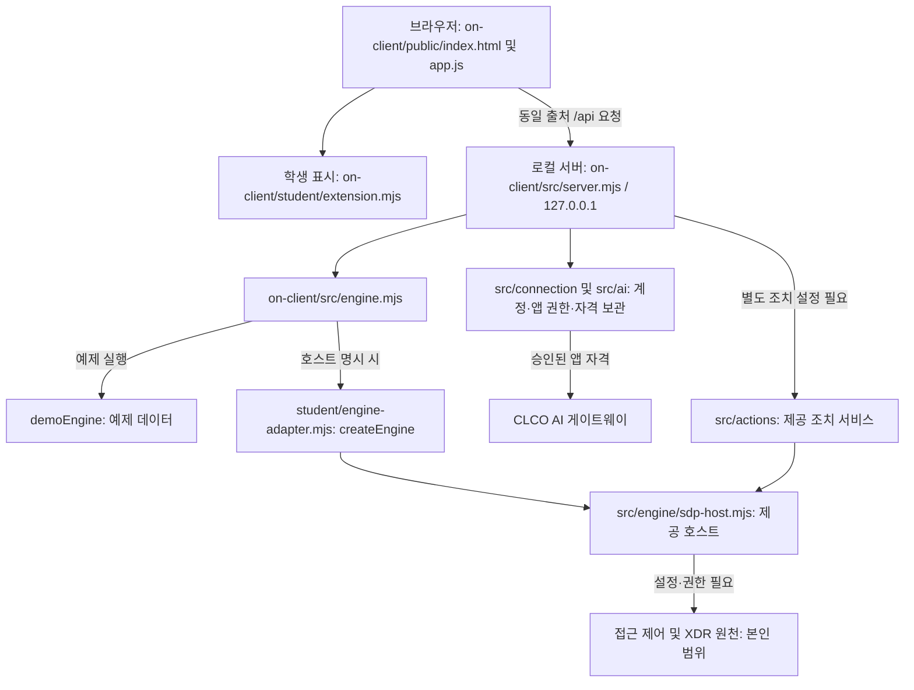

# 케셰브vJ 실행 안내 · 처음 사용하는 사람용

이 안내는 **Windows에서 프로젝트 폴더를 실행하는 절차**입니다. 설치형 앱은 아래 별도 절에서 준비 상태만 안내합니다. 기존 프로젝트 폴더·이력·제출물은 지우거나 이동하지 않습니다.

## 1. 실행 전에 준비하기

- 받은 프로젝트를 일반 폴더에 압축 해제합니다. 압축 파일 안에서 실행하거나 기존 작업 폴더에 덮어쓰지 않습니다. 이미 프로젝트가 있으면 그 폴더를 사용합니다.
- `README.md`와 `on-client` 폴더가 함께 있는 곳이 **프로젝트 최상위 폴더**입니다. 다른 사람의 사용자 경로를 그대로 입력하지 않습니다.
- 파일 탐색기에서 그 폴더를 열고 주소 표시줄에 `powershell`을 입력합니다. **관리자 권한으로 실행하지 않습니다.**
- 다음 확인 명령은 파일을 바꾸지 않습니다.

```powershell
Get-Location
Test-Path .\on-client\tools\start-alekov.ps1
node --version
```

`Test-Path` 결과는 `True`여야 합니다. `False`이면 프로젝트 위치와 받은 폴더 구조를 확인합니다. Node.js 버전은 현재 스크립트가 허용하는 주 버전 22~24여야 합니다. 코드에 기록된 수업 기준은 24.19.0이며, 최신 배포 버전을 뜻하지 않습니다. Node가 없다면 [공식 사이트](https://nodejs.org/)에서 호환 버전을 설치하고 PowerShell을 새로 엽니다.

학생 앱 예제 실행에는 npm 의존성 설치가 필요하지 않습니다. 저장소 루트의 패키지는 기존 자료실용으로, 루트에서 `npm start`나 `npm ci`를 먼저 실행할 필요가 없습니다. Workbench를 앱 실행을 위해 계속 켜 둘 필요도 없습니다.

## 2. 프로젝트 코드 실행하기

프로젝트 최상위 폴더의 PowerShell에서 다음 한 줄을 실행합니다.

```powershell
powershell -NoProfile -ExecutionPolicy Bypass -File .\on-client\tools\start-alekov.ps1 -Demo -Port 5196
```

- `-Demo`는 예제 엔진 실행입니다. 계정 연결용 보관소 자동 준비를 하지 않습니다. 실제 계정/SDP 연결 절차와 섞지 않습니다.
- `-ExecutionPolicy Bypass`는 이 실행에만 적용되는 옵션입니다. 영구 실행 정책이나 방화벽 설정을 바꾸지 않습니다.
- 실행 창은 열어 둡니다. 브라우저가 자동으로 열릴 것을 전제로 하지 않습니다.
- 정상 시작 메시지: `케셰브vJ가 켜졌습니다. 브라우저에서 http://127.0.0.1:5196/ 을 여세요.`
- 브라우저에서 [앱 주소](http://127.0.0.1:5196/)를 엽니다. 다른 PC의 같은 주소는 그 PC 자체를 가리키므로 서버도 그 PC에서 실행해야 합니다.

포트 5196이 사용 중이면 기존 프로그램을 종료하지 않습니다. 예를 들어 비어 있는 5197을 선택했다면 명령의 `-Port 5196`을 `-Port 5197`로 바꾸고 주소도 `http://127.0.0.1:5197/`로 바꿉니다. 5197은 **설명용 포트 예시**이며 사용 가능 여부를 조회한 결과가 아닙니다. 포트 번호는 코드 버전이나 기능 종류를 뜻하지 않습니다. 이미 같은 폴더의 원하는 버전이 실행 중임을 알고 있다면 기존 주소를 사용합니다.

## 3. 화면에서 차례로 확인하기

처음 사용하는 사람은 팝업의 **시작하기**를 눌러 PC 측정 버튼으로 이동한 뒤 직접 측정합니다. 자동 측정은 하지 않으며 Esc는 팝업만 닫습니다. 팝업을 숨겼다면 보호 현황에서 직접 버튼을 찾습니다. **사용 안내** 탭에서 앱 목적·처음 할 일·탭별 역할·결과 읽는 법을 읽고, 탭별 접이식 세부 설명을 펼치면 누가·언제·어디서·무엇을·왜·어떻게 이용하는지 확인할 수 있습니다.

| 순서 | 누를 곳 | 정상 또는 예상되는 결과 |
|---|---|---|
| 1 | 보호 현황 → 내 보안 현황 | 기기·세션, 보안 기록, 패키지 조회가 순서대로 보임 |
| 2 | 대상별 ‘다시 조회’ | 대기 후 결과 또는 실패 항목·다음 행동 표시. 학생 영역만 갱신하며 공통 화면과 별개 |
| 3 | 결과 펼치기·접기, 보안 기록 종류 선택 | 사건 발생 시각순 기록과 종류 필터. 원천 확인·화면 수신 시각과 사건 시각을 구분 |
| 4 | 내 PC 상태 측정 | CPU(%), 메모리·디스크(GiB)의 실측·시각. 두 번 측정하면 이전 유효 값과 비교 가능 |
| 5 | PC 구성·기록 조회 | 네트워크·방화벽 읽기 결과, System/Application 최근 24시간 경고·오류 건수 또는 확인 불가 |
| 6 | 기록 종류에서 System/Application 선택 | 최신 카드, 최신순 접이식 표. 표의 행은 조회 시점별 24시간 집계이며 겹치는 행을 합산하지 않음 |
| 7 | SDP 상태 확인 | demo 실행에서는 SDP 미연결. PC 조회 성공과 별개 |
| 8 | PC 측정 이력 조회 / PC 구성 이력 조회 | 저장된 과거 조회를 표시. 새 측정이 아니므로 기록 시각을 확인 |

키보드만 사용할 때는 `Tab`/`Shift+Tab`으로 이동하고 버튼·접이식 제목은 `Enter` 또는 `Space`, 종류 선택은 방향키를 사용합니다. 조회 중에는 중복 실행하지 않습니다.

### 예제·실측·확인 불가 구분

- demo 기기·세션·보안 기록은 **설명용 예제**입니다. 실제 PC 측정이나 SDP 연결 증거가 아닙니다.
- PC 측정과 PC 구성·Windows 기록은 demo 실행 중에도 **버튼을 누른 로컬 서버 PC의 실제 조회**입니다. 권한 부족·시간 초과는 ‘확인 불가’와 이유로 표시하며 0이나 예제로 대체하지 않습니다.
- 패키지는 앱 demo 모드가 아닌 개별 조회 상태·출처로 판단합니다. `not_configured`, 미조회, 실패는 취약점 없음이 아닙니다. 프로젝트 설치·lock 파일·승인된 공개 조회 대상 준비가 필요합니다.
- Windows 경고·오류 건수는 **침해·공격 탐지 결과가 아닙니다.** 현재 보존된 로그만 집계합니다. 방화벽 설정은 읽기만 합니다.
- 과거 스크린샷의 숫자는 당시 기록입니다. 다른 PC나 다른 시각에 같은 숫자가 나와야 하는 것은 아닙니다.

## 4. 종료·재실행·변경 적용

1. 이번에 실행한 PowerShell 창에서 `Ctrl+C`를 누릅니다. 다른 실행 창과 프로세스는 종료하지 않습니다.
2. 브라우저에 이전 화면이 남아 있어도 서버 실행 중이라는 뜻은 아닙니다. 종료 여부는 해당 주소로 새 요청이 가능한지 확인합니다.
3. 같은 폴더에서 같은 명령으로 실행하고 같은 주소를 엽니다. 이력 버튼으로 저장 자료를 다시 확인합니다.
4. 화면 파일만 바뀐 경우에는 브라우저 새로고침으로 반영합니다. 서버 코드가 바뀌었다면 해당 서버를 종료·재실행한 뒤 새로고침해야 합니다. 포트 변경 자체로 최신 코드가 적용되는 것은 아닙니다.

이력은 기본적으로 `%LOCALAPPDATA%\Keshev\history`의 `queries.json`, `pc-status.json`, `pc-inspection.json`에 분리 저장됩니다. 프로젝트 위치·사용자 등에 따라 조회 범위가 달라집니다. 네트워크 주소가 들어갈 수 있으므로 이력 파일을 Git이나 제출 묶음에 넣지 않습니다. 잠금 파일이나 이력을 임의로 지워 오류를 해결하지 않습니다.

## 5. 막혔을 때 첫 오류부터 확인하기

| 증상 | 확인할 것과 다음 행동 |
|---|---|
| 스크립트를 찾을 수 없음 / Test-Path=False | 프로젝트 최상위 폴더인지 확인. 새 폴더 구조를 임의로 만들지 않음 |
| Node 명령 없음 / 버전 범위 오류 | Node 준비 후 새 PowerShell에서 버전 확인 |
| 포트 사용 중 / EADDRINUSE | 기존 프로세스 보존, 다른 빈 포트로 명령과 주소를 함께 변경 |
| 시작 시간 초과 / 브라우저 접속 불가 | 실행 창의 첫 오류, 서버가 켜져 있는지, 주소의 포트 확인 |
| PC 조회 접근 거부 / 관리자 실행 거절 | 일반 권한으로 실행. 권한 상승·보안 설정 변경으로 우회하지 않고 확인 불가로 기록 |
| 이력 읽기·저장 실패 | 현재 조회와 저장 성공을 구분. 실패 문구와 시각을 기록하고 사용자 저장 경로를 확인 |
| 패키지 미설정·미조회 | 프로젝트 설치 상태·lock 파일·공개 조회 승인 설정 확인. 안전하다고 판정하지 않음 |
| SDP 미연결 / AI 권한 준비 중 | demo에서 실제 연결을 기대하지 않음. 실제 연결은 담당자가 안내한 승인·설정 절차 확인 |

도움 요청에는 **실행 폴더, 입력한 명령, 막힌 단계, 첫 오류 문구, 발생 시각**을 전달합니다. 비밀번호·토큰·개인정보·설정 파일 원문은 가립니다. 실제 오류가 없는 상태에서는 안내 문제와 코드 문제를 단정하지 않습니다. 계정 연결을 별도로 준비할 때는 제공 [시작 안내](../on-client/docs/STUDENT_LAUNCH_GUIDE.md)와 [SDP 연결 계약](../on-client/docs/SDP_HOST_CONNECTION.md)을 따르며, 비밀값을 코드에 적지 않습니다.

## 6. 설치형 앱 안내 — 아직 확정하지 않은 절차

예정 형태는 **기본 포장 → Inno Setup setup.exe → 사용자 단위 설치**입니다. 현재 케셰브vJ용 배포 setup.exe·`.iss` 설정을 이 프로젝트에서 확인하지 못했고 설치 시험도 하지 않았습니다. 프로젝트의 Node 실행 절차를 설치형 사용법으로 간주하지 않습니다.

배포 전에 확인할 항목은 다음과 같습니다.

- 설치 패키지에 포함되는 서버·학생 파일·공통 화면·추가 API의 목록과 버전
- 설치본의 학생 확장 로딩과 조회 API 지원. 공통 화면 수정만으로 설치본 반영을 보장하지 않음
- 사용자 단위 설치 위치·실행 바로가기·런타임 포함 여부·종료 방식
- 설치 후 PC 조회·SDP 상태 분리·키보드 조작·이력 저장 및 업데이트 시 보존

이 항목을 실제 설치본으로 검증한 뒤 다운로드 위치와 설치·실행 순서를 확정합니다. 지금은 검증되지 않은 setup.exe 실행 명령이나 설치 완료 화면을 안내하지 않습니다.

## 7. 현재 확인 범위와 과거 기록 읽는 법

이전 작업에서 로컬 브라우저의 PC 실측·저장 이력 복원·Windows 집계 표, 학생 재조회·예제 표시·키보드 조작을 확인했습니다. 모의 검사는 기능별 테스트이며 운영 연결이나 심판 판정이 아닙니다. 다른 사람 PC의 재현, 실제 SDP 연결 성공, 설치본 실행·스크린리더 음성 출력은 미검증입니다.

이번 정리는 문서와 코드의 대조이며 새 환경 실행 시험이 아닙니다. 아래는 작성 당시의 상세 근거·구성도·검증 기록을 보존한 자료입니다. **아래의 다른 포트, ‘이번 미확인’, 단계 제출 설명은 당시 기록이며 현재 첫 실행 절차는 위 1~5절을 따릅니다.**

<details>
<summary>과거 기능별 안내·검증·제출 기록 펼치기</summary>

# 케셰브 학생 실행 설명서 · 21단계

## 학생 핵심 기능 3가지 — 2026-10-27

학생 파일 `on-client/student/extension.mjs` 안에서 첫 학생 영역(renderIdentity)에 기기·세션, 보안 기록 타임라인, 설치 패키지·취약점 조회를 모았습니다. 기존 상세 함수와 PC 측정 기능은 보존합니다. 공통 화면·CSS는 수정하지 않았으며 appearance.json은 현재 로더/규격이 없어 만들지 않았습니다. 설치본에 학생 확장과 동일한 api.get 계약이 포함되는지, 사용자 단위 Inno Setup 패키지에서 동작하는지는 아직 검증하지 않았습니다.

실행: 기존 프로젝트 루트에서 `powershell -NoProfile -ExecutionPolicy Bypass -File .\on-client\tools\start-alekov.ps1 -Demo -Port 5196`. 이미 실행 중이면 브라우저를 새로고침합니다. 보호 현황 → 학생 구현 표시(renderIdentity) → 학생 핵심 기능 3가지를 확인합니다. 제공 영역 전체 순서는 바꾸지 않고 학생 영역 안에서만 우선 배치합니다.

- 각 다시 조회 버튼을 Tab으로 선택하고 Enter 또는 Space로 실행합니다. 중복 요청은 막되 버튼 초점은 유지하고, 조회 중 aria-busy와 상태 메시지를 제공합니다. 상세의 summary는 Enter/Space로 펼치고 접으며 종류 select는 방향키로 선택합니다. 기존 보안 기록 메뉴의 상세·근거 표시는 유지됩니다.
- 학생 재조회는 해당 학생 요약만 갱신합니다. 공통 화면의 결과가 자동으로 같아지는 것은 아닙니다. 보안 기록 행은 사건 발생 시각 내림차순이며 원천 확인 시각·화면 수신 시각과 구분합니다. 영구 조회 이력은 기존 별도 기능을 유지합니다.
- demo 기기·세션·사건은 설명용 예제입니다. PC 실측이 아닙니다. 패키지는 앱 demo 모드가 아닌 조회 상태·출처로 판단합니다. 원천 시각이 없으면 제공되지 않음으로 표시하며 현재 시각으로 대체하지 않습니다.
- 실패는 실패한 항목과 로컬 앱·계정 연결·도움정보 확인을 안내합니다. 패키지 미설정/미조회는 설치 상태·lock 파일·공개 조회 승인 설정을 안내합니다. 실패값을 예제나 취약점 없음으로 대체하지 않습니다. 학생 API가 없으면 지원 버전 확인을 안내하고 직접 fetch로 우회하지 않습니다.
- 검사: `node --test on-client/test/student-dashboard.test.mjs` — 모의 DOM/API 4개 검사 통과(대기·중복 방지·실패·예제 구분·늦은 응답 폐기·정렬/필터). 브라우저에서 Enter/Space 재조회와 완료 후 버튼 초점 유지, demo 표기, 패키지 not_configured 안내를 확인했습니다. 스크린리더 실제 음성 출력과 설치본 실행은 미검증입니다.

## PC 구성·Windows 기록 읽기 전용 조회 — 2026-10-27

기존 프로젝트에서 일반 권한 PowerShell로 `powershell -NoProfile -ExecutionPolicy Bypass -File .\on-client\tools\start-alekov.ps1 -Demo -Port 5196`를 실행합니다. 기존 5194 서버는 이전 코드로 동작하므로 그대로 보존하고 이번 확인은 5196를 사용합니다. 이미 5196가 실행 중이면 중복 실행하지 않습니다.

1. http://127.0.0.1:5196/ → 보호 현황 → PC 구성·Windows 기록 → **PC 구성·기록 조회**를 누릅니다.
2. 네트워크(IP/게이트웨이/DNS), 방화벽 프로필 설정, System·Application 각각의 경고(Level 3)·오류(Level 2)를 확인합니다. 건수의 범위는 조회 시작 시각까지 최근 24시간입니다. Critical(Level 1)은 오류 건수에 포함하지 않습니다. 현재 보존된 로그만 집계하므로 완전한 과거 사건 수나 침해·공격 탐지 결과가 아닙니다.
3. 성공은 실측·시각·값·단위를 표시합니다. 거부/실패는 **확인 불가와 이유**를 표시하며 0건이나 예제로 대체하지 않습니다. 관리자 권한으로 실행된 프로세스에서는 조회 자체를 거절합니다. 일반 권한 접근 거부 시 승격하거나 설정을 바꾸지 않습니다.
4. **SDP 상태 확인**을 별도로 누릅니다. demo/미구성은 SDP 미연결, 실제 호스트를 통한 활성 세션 조회만 연결 확인, 실패/근거 부족은 확인 불가입니다. 세션 확인은 업무 앱 터널의 연결 성공 증명이 아닙니다.
5. 기록 종류 필터, 최신순 접이식 타임라인, **PC 구성 이력 조회**로 저장된 기록을 확인합니다. PC 조회와 이력 재조회는 SDP 상태를 변경하지 않습니다. 이전 SDP 상태에는 확인 시각이 붙습니다.

학생 추가 구현: `src/pc-inspection.mjs`, `public/pc-inspection-view.mjs` 및 로컬 서버/이력 연결. 기존 제공 로그인·SDP 엔진은 재사용하고 CPU·메모리·디스크 기능은 보존합니다. 원격 PC 조회·이벤트 본문 수집·방화벽 변경·보안 설정 변경·공격/침투 모의 시험은 하지 않습니다. 고정된 읽기 명령만 숨김 PowerShell 프로세스로 실행하며 각 조회는 7.5초 제한입니다. 실패한 부분 집계를 정상 건수로 표시하지 않습니다.

방화벽은 [Get-NetFirewallProfile의 ActiveStore](https://learn.microsoft.com/en-us/powershell/module/netsecurity/get-netfirewallprofile)로 적용 정책을 읽습니다. True/False는 프로필 활성 설정이며 현재 선택된 네트워크 프로필이 아닙니다. NotConfigured는 미지정으로 표시하고 허용/차단을 추정하지 않습니다. Windows 기록은 [EventLogReader](https://learn.microsoft.com/dotnet/api/system.diagnostics.eventing.reader.eventlogreader)로 시간 구간과 Level만 읽습니다.

네트워크 주소를 포함한 조회 이력은 `%LOCALAPPDATA%\Keshev\history\pc-inspection.json`에만 저장하며 Git·제출 묶음에 넣지 않습니다. 기존 사건/성능 이력과 파일을 분리하고 최근 30일·최대 1,000회로 제한합니다. 외부 전송은 하지 않습니다. 예제 값을 실제 결과로 저장하지 않으며 자동 시험의 문서용 주소와 수치는 모의 입력입니다.

검사: `node --test on-client/test/pc-inspection.test.mjs on-client/test/pc-status.test.mjs on-client/test/history.test.mjs` — 11개 통과. 모의 입력/임시 저장소 검사이며 실제 공격 시험이나 심판 판정이 아닙니다. 제한된 도구 실행에서는 네트워크·방화벽 접근 거부를 확인했습니다. 일반 Windows 사용자 실행에서는 네트워크 단일 CIM 조회, 방화벽 및 Windows 두 로그를 모두 읽었습니다. 네트워크는 IPEnabled=True 어댑터의 IP·서브넷·게이트웨이·DNS만 조회합니다. 서버 재시작 후 브라우저의 이력 재조회로 저장된 기록 복원도 확인했습니다. 다른 PC의 조회 권한이나 Inno Setup 설치 후 실행은 미검증입니다. 사용자 단위 setup.exe 방향은 유지하고 이번에는 설치 프로그램을 변경하지 않았습니다.

## 내 PC 상태와 직전 조회 대비 변화 — 2026-10-27

제공 0.2.14의 내 기기는 보안 상태이며 CPU/메모리/디스크 측정 기능은 없었습니다. 이번 학생 추가 기능은 `src/pc-status.mjs`, `public/pc-status-view.mjs`와 로컬 서버 연결입니다. 제공 로그인·기기·세션과 기존 사건 타임라인은 보존합니다.

프로젝트 루트에서 `powershell -NoProfile -ExecutionPolicy Bypass -File .\on-client\tools\start-alekov.ps1 -Demo -Port 5194`를 실행하고 http://127.0.0.1:5194/ 의 보호 현황 → 내 PC 상태 측정을 누릅니다. 완료 후 한 번 더 눌러 이전 유효 실측과 비교합니다. PC 상태 종류에서 CPU/메모리/디스크를 고릅니다. 기본 서버가 이미 실행 중이면 새 포트를 쓰거나 해당 서버만 종료 후 재시작해야 새 API가 적용됩니다. 기존 폴더와 제출물을 이동하지 않습니다.

최신 조회는 카드와 최근 최대 20회 추이 그래프로 표시합니다. 아래 CPU·메모리·디스크 표는 각각 접거나 펼칠 수 있으며 최신 기록도 포함합니다. 측정 시각 내림차순이고 실패는 시도 시각, 시각 누락은 조회 시각을 사용합니다. 각 행에서 시각·단위·변화량·출처·실패 이유를 확인합니다. 종류 필터는 최신 카드에 적용되며 세 이력 표는 유지됩니다. 5194 브라우저에서 저장된 실측 4건의 표와 정렬을 확인했습니다.

이 버튼은 demo 실행 중에도 **로컬 서버 PC의 실제 값**을 읽습니다. 보안 기록의 demo 값과 분리하여 ‘실측’으로 표시합니다. 자동 측정·관리자 승격·외부 전송·AI 호출·서비스 설치는 하지 않습니다. 측정 방식은 Node의 [OS API](https://nodejs.org/api/os.html#oscpus)와 [statfs](https://nodejs.org/api/fs.html#fspromisesstatfspath-options)를 사용합니다.

- CPU: 모든 논리 CPU 누적 시간의 약 1초 차이로 계산한 평균 사용률(%). 실제 측정 구간(초), 시작·종료 시각을 표시합니다. 작업 관리자와 표본 구간/계산 방식이 달라 일치하지 않을 수 있습니다. 변화량 단위는 %p입니다.
- 메모리: 전체 물리 메모리에서 OS가 보고한 여유 메모리를 뺀 값(GiB). 특정 앱의 사용량이나 메모리 누수 진단이 아닙니다.
- 디스크: 사용자 홈이 속한 드라이브에서 현재 사용자가 쓸 수 있는 공간(GiB). PC 전체 드라이브 합계가 아닙니다.
- 각 값의 측정 시각을 KST로 표시합니다. GiB는 1,073,741,824바이트입니다. 소수 둘째 자리로 표시하며 변화량은 반올림 전 값으로 계산합니다. 확인 불가에는 값 대신 이유와 시도 시각을 표시하고, 실패값을 0으로 비교하지 않습니다. 최초 유효 값에는 비교 자료 부족을 표시합니다. 같은 종류·대상·단위의 이전 유효 실측만 비교하며 변화 원인은 단정하지 않습니다.

이력은 기존 사건 파일과 별개인 `%LOCALAPPDATA%\Keshev\history\pc-status.json`에 저장합니다(LOCALAPPDATA 미설정 시 사용자 홈 AppData/Local). 최근 30일·최대 1,000개 측정 묶음을 유지하며 다음 접근 때 정리합니다. OS 사용자와 프로젝트 범위의 로컬 이력이며 ALEPH 계정 로그인과 무관합니다. 전체 파일 경로·실명·프로세스 목록·키는 수집하지 않습니다. 서버 재시작 후 ‘PC 측정 이력 조회’를 누르면 이전 자료를 볼 수 있습니다. 이번에는 PC 이력의 수동 삭제 UI나 설치 위치 간 이전을 추가하지 않았습니다.

정상 기대: 값·시각·단위·직전 변화가 표시되고 종류 필터가 동작합니다. 거부/실패 기대: 외부 출처 POST 거부, 읽기 실패 시 확인 불가와 이유, 예제/다른 대상/단위 간 비교 금지. 저장 실패 시 현재 측정은 보여 주되 저장 실패를 표시합니다.

검사 명령: `node --test on-client/test/pc-status.test.mjs on-client/test/history.test.mjs`. 2026-10-27 로컬 자동 검사 7개 통과. 모의 입력과 임시 저장소로 계산·실패·이력 분리·복원·출처 거부를 검사했으며 공식 심판 판정이 아닙니다. 별도 5193 임시 서버에서 일반 권한 실측 2회·변화 설명·메모리 필터를 브라우저로 확인했습니다. 기본 사용자 저장소의 새 PC 이력 재현과 Inno Setup 설치 후 실행은 아직 미확인입니다. 사용자 단위 설치 방향을 유지하며 이번에는 setup.exe를 제작하지 않았습니다.

## 조회 이력 추가 — 2026-10-27

기존 폴더에서 `powershell -NoProfile -ExecutionPolicy Bypass -File .\on-client\tools\start-alekov.ps1 -Demo -Port 5192`로 실행합니다. 5192가 사용 중이면 다른 빈 포트를 선택합니다. 서버 코드가 바뀌었으므로 이전 서버의 브라우저 새로고침만으로는 적용되지 않습니다. 기존 서버와 제출물을 보존합니다.

보안 기록 → 저장된 조회 이력에서 예제 표시·조회 시각·사건 발생 시각을 확인합니다. 위쪽 다시 불러오기는 원천을 조회하고 기록을 추가합니다. ‘저장된 이력 다시 조회’는 저장 내용만 읽습니다. 실행 창에서 Ctrl+C 후 같은 폴더·명령으로 실행하면 이전 이력과 새 조회가 함께 표시되어야 합니다. 저장 이력 종류에서 access/XDR를 걸러 봅니다. 현재 예제는 access 1건이며 조회마다 별도 항목으로 저장합니다. 빈 원천 조회는 사건 이력을 추가하지 않습니다.

기본 저장소는 `%LOCALAPPDATA%\Keshev\history\queries.json`입니다. LOCALAPPDATA가 없으면 사용자 홈의 AppData/Local 아래를 사용합니다. 프로젝트·Git·제출물에 포함하지 않습니다. 원문 요약·근거·사건/사용자 ID·앱 이름·인증값은 저장하지 않습니다. 계정/프로젝트/소스 경로를 구분하는 해시, 모드, 임의 조회 ID, 조회 시각, 사건 시각, 종류만 보관합니다. 이는 익명화 인증이 아니라 로컬 범위 분리이며 다른 Windows 계정의 접근 권한 강화·설치 위치 이동 시 이력 이전은 이번 검증 범위 밖입니다.

한 저장소 전체에 최근 30일·최대 1,000건을 적용합니다. 정리는 다음 읽기/쓰기 때 수행하며 앱이 꺼진 동안 예약 삭제하지 않습니다. 예제와 연결 계정은 서로 분리되고, 연결 계정은 현재 활성 신원을 확인해야 이력을 읽거나 삭제할 수 있습니다. 연결 없음은 이전 계정 이력을 공개하지 않습니다. 저장 실패는 현재 원천 조회를 막지 않지만 별도 경고로 표시합니다. 동시 쓰기 잠금이나 비정상 종료 후 잠금 파일이 남으면 오류로 표시하고 자동으로 지우지 않습니다.

삭제는 ‘현재 계정·모드의 저장 이력만 삭제함을 확인합니다’ 체크 후 ‘확인한 조회 이력 삭제’입니다. 원천 사건·학습 DB·프로젝트·기존 제출물은 삭제하지 않습니다. 삭제 후 원천 다시 불러오기를 하면 새 이력이 생깁니다. 외부 출처의 삭제 요청과 신원 미확인 요청은 거부되어야 합니다.

자동 검사: `node --test on-client/test/history.test.mjs`. 임시 폴더의 모의 자료로 재시작 복원·보관 제한·계정 분리·활성 상태 검사·출처 거부·저장 실패 시 현재 기록 유지 등을 확인합니다. 실제 SDP 연결·심판 판정·설치 프로그램 시험이 아닙니다. 2026-10-27 브라우저 확인은 별도 임시 저장소의 5191 예제 서버에서 수행했으며, 기본 사용자 저장 경로의 재시작 시험과 실제 계정 운영 연결은 미확인입니다.

작성 기준: 2026-10-26의 현재 코드와 학생이 전달한 21단계 공식 과제 안내. 목적은 기존 자료실과 학생 코드를 보존하면서 다른 사람이 작업 위치, 실행 명령, 데이터 흐름과 확인 범위를 대조하게 하는 것입니다. 이번 단계는 문서만 변경하며 함수·API·인증 설정은 변경하지 않습니다.

## 1. 환경과 설치 범위

| 항목 | 파일의 요구 조건 | 이번에 직접 확인한 값 / 한계 |
|---|---|---|
| 운영체제 | 제공 실행 도구는 Windows PowerShell 사용 | Windows에서 명령 실행. 다른 OS 실행은 미확인 |
| Node.js | `on-client/package.json` engines: `24.19.0`; 실행 도구는 22~24 허용 | `node --version`: `v24.21.0`. 수업 기준과 다름. 이 버전에서 문법 및 예제 HTTP 검사만 확인 |
| PowerShell | `on-client/tools/start-alekov.ps1` | 작업 셸 7.6.5, `powershell -NoProfile`로 확인한 Windows PowerShell 5.1.19041.6456 |
| npm / Git | npm 스크립트 실행 / 커밋 관리 | `npm.cmd --version`: 11.19.0; `git --version`: 2.34.1.windows.1 |
| 브라우저 | JavaScript와 DOM을 지원하는 브라우저 | 이번 단계의 브라우저 종류·버전·화면 동작은 미확인 |
| 학생 앱 | `on-client/package.json` | 0.2.14, 외부 dependencies와 별도 lock 파일 없음 |
| 기존 자료실 | 루트 `package.json`, `package-lock.json` | Node >=22, lockfileVersion 3. 학생 앱과 별도 패키지 |

Node.js가 없으면 제공 실행 안내에 따라 수업 기준 24.19.0을 설치하고 PowerShell을 새로 엽니다. 이번 작업에서 설치는 실행하지 않았습니다. 학생 앱의 예제 실행에는 npm 패키지 설치가 필요하지 않습니다. 기존 자료실 의존성을 복원할 때만 저장소 루트에서 `npm.cmd ci`를 사용합니다. 이는 lock 기반 설치 명령이며 이번에는 실행하지 않았습니다. 루트에는 `start` 스크립트가 없으므로 루트의 `npm start`를 학생 앱 실행 명령으로 쓰지 않습니다.

## 2. 작업 위치와 구조

이 PC에서 확인한 Git 최상위 폴더는 `C:\Users\ekfcj\J26\J26_git\github-check\choi-bujang-secret-vault`입니다. 아래 경로는 이 폴더 기준입니다. 다른 PC에서는 실제 복제 위치를 사용합니다.

```text
README.md                         기존 기록 + 21단계 학생 안내
docs/STUDENT_RUNBOOK.md            이번 학생 문서
package.json / package-lock.json   기존 자료실 의존성·검사·빌드 명령
api/ · src/ · public/ · supabase/   기존 자료실 API·판정·화면·SQL
xdr/ · scripts/                    기존 경보 분류·응답 및 연습 도구
aleph.config.json                  기존 자료실 설정 (21단계 번호로 변경하지 않음)
on-client/
  package.json                    학생 앱 실행 명령
  .env.example                    비밀 없는 설정 견본
  student/extension.mjs            학생 화면 함수
  student/engine-adapter.mjs       본인 범위 호스트 연결 어댑터
  public/index.html · app.js       제공 화면·요청·상태 관리
  src/server.mjs                   제공 loopback HTTP 서버
  src/engine.mjs · engine/         예제/연결 없음 및 SDP 호스트
  src/connection/ · ai/            계정 연결·AI 권한·게이트웨이 통신
  src/actions/                    제공 조치 준비·집행·결과 조회
  src/vulnerabilities/            설치 패키지 대조·OSV 조회
  tools/start-alekov.ps1           제공 Windows 실행 도구
  docs/                           제공 실행·연결·입력 계약
```

기존 미추적 워크벤치 배포본, 원고, 운영 도구 예외 기록, XDR 로그·후보·거부 규칙은 이번 문서 작업에서 수정하거나 추가 커밋하지 않습니다. 학습 DB도 변경하지 않습니다.

## 3. 실행·종료·재실행

### 확인 1 — 새 PowerShell에서 예제 시작

기존 실행 창은 닫지 않습니다. 파일 탐색기에서 위 Git 최상위 폴더를 열고 주소 표시줄에 `powershell`을 입력합니다. `Get-Location`으로 위치를 확인한 다음 아래 **한 줄**을 실행합니다. 기본 5189와 분리하기 위해 예제 확인에는 5190을 사용합니다.

```powershell
powershell -NoProfile -ExecutionPolicy Bypass -File .\on-client\tools\start-alekov.ps1 -Demo -Port 5190
```

도구는 Node 버전·폴더·포트를 확인하고 `on-client/src/server.mjs --demo`를 실행합니다. `-Demo`에서는 자동 계정 연결 설정을 만들지 않습니다. 다른 프로세스를 종료하지 않습니다. 포트 사용 중 오류가 나면 먼저 그 오류만 확인하고, 사용하지 않는 번호로 `-Port`와 브라우저 주소를 함께 바꿉니다.

정상 시작 신호는 `케셰브가 켜졌습니다. 브라우저에서 http://127.0.0.1:5190/ 을 여세요.`와 `서버가 응답한 것만 확인했습니다. AI 연결 상태는 화면에서 따로 확인해 주세요.`입니다. 이 메시지는 HTTP 응답 확인이며 운영 연결 성공이 아닙니다.

브라우저에서 `http://127.0.0.1:5190/`을 열고 「보호 현황」을 누릅니다. 예제 자료임을 확인합니다. 여기까지 확인한 뒤 다음 확인으로 넘어갑니다. 이 실행 도구 전체 절차와 실제 화면은 이번 단계에서 아직 실행·확인하지 않았습니다.

### 확인 2 — 경로·버튼·상태 대조

확인 1이 끝난 뒤 한 항목씩 수행합니다.

1. 「업무 앱」에서 「학습 자료실 접속 요청」을 누릅니다. 예제 `allow` → `접근 허용(allow)`가 기대 결과입니다. 실제 자료실 접속 완료를 뜻하지 않습니다.
2. 「개발 저장소 접속 요청」을 누릅니다. 예제 `deny` → `접근 거부(deny)`가 거부되어야 할 결과입니다. HTTP 요청 자체는 200일 수 있으며 판정 값이 deny입니다.
3. 「확인할 업무 앱 접속 요청」은 `challenge` → `추가 인증 또는 확인 필요(challenge)`가 기대 결과입니다.
4. 「보안 기록」의 event-01 상세에서 접속 denied, 기기 unknown과 근거를 확인합니다. 지원 조치가 없어 「조치 준비」 버튼이 표시되지 않는 것이 정상입니다. 「다시 불러오기」 후 이전 상세 초기화를 확인합니다.
5. 경로와 명령을 이 문서 및 `on-client/package.json`과 대조합니다. 실행·화면 확인하지 못한 항목은 미확인으로 남깁니다. 유료 AI 설명과 보안 집행은 이 확인 절차에 포함하지 않습니다.

종료는 **이번에 실행한 창에서만** Ctrl+C입니다. 새 HTTP 요청이 더 이상 응답하지 않는지 확인합니다. 이미 표시된 화면이 남아 있는 것만으로 서버가 실행 중이라고 판단하지 않습니다. 재실행은 같은 폴더에서 같은 명령을 실행하고 같은 주소를 다시 엽니다. 종료·재실행의 실제 확인은 미확인입니다.

### 실행 방식의 차이

| 목적 | Git 최상위 폴더에서 실행할 명령 | 코드상 동작 / 확인 범위 |
|---|---|---|
| 기본 실행 | `npm.cmd --prefix on-client start` | 기본 5189, 호스트 미지정 시 연결 없음. 이번 실행 미확인 |
| 예제 직접 실행 | `npm.cmd --prefix on-client run demo` | 기본 5189, 예제 엔진. 포트 선점검은 하지 않음 |
| 제공 계정 연결 준비 | `powershell -NoProfile -ExecutionPolicy Bypass -File .\on-client\tools\start-alekov.ps1` | 기본 5189. 프로젝트 밖 개인 보관소를 준비할 수 있음. 로그인·승인은 별도이며 이번 미실행 |
| 학생 화면 문법 검사 | `npm.cmd --prefix on-client run check` | `node --check student/extension.mjs`; 이번 종료 코드 0. 화면·운영 검증 아님 |

실제 계정 연결은 제공 [시작 안내](../on-client/docs/STUDENT_LAUNCH_GUIDE.md)와 [SDP 연결 계약](../on-client/docs/SDP_HOST_CONNECTION.md)을 따릅니다. NativeHostConfig는 계정/AI 연결, SdpHostConfig는 접근 제어 연결이며 서로 대체하지 않습니다. 실제 설정 경로와 비밀값은 이 문서에 적지 않습니다. `.env.example`은 견본이며 위 npm 명령은 `.env` 자동 로드 옵션을 사용하지 않습니다. 견본 복사만으로 연결됐다고 판단하지 않습니다. 비밀은 Git·제출 밖의 승인된 개인 설정/보관소에 두고 공식 비밀 입력 화면에서 직접 설정합니다.

## 4. 글로 쓴 시스템 구성도



브라우저는 제공 app.js로 요청하고 학생 함수는 받은 자료를 DOM으로 표시합니다. 서버는 `127.0.0.1`에만 바인딩합니다. 기본 실행은 연결 없음이며, 예제는 `demoEngine()`의 가상 자료입니다. 실제 SDP 호스트가 명시돼야 어댑터가 본인 조회·판정 기능을 전달합니다. 이 선은 코드상 가능한 경로이며 운영 연결 확인 표시가 아닙니다.

AI 요청은 브라우저에서 로컬 서버를 거쳐 앱 권한과 자격 검증 후 게이트웨이로 갑니다. `src/ai/connection.mjs`의 공개 기본 주소는 `https://ai-classroom-gateway-production.up.railway.app`, 승인 포털은 `https://aleph-omega.vercel.app`입니다. 이번 작업에서 원격 주소에 접속하거나 연결 성공을 확인하지 않았습니다. AI 설명·제안은 조치 집행과 별개입니다. 조치 경로는 제공 서비스가 담당하며 단순 예제 실행이나 학생 어댑터에 집행 기능이 생기는 것은 아닙니다.

루트의 기존 `api/`, `src/decider.mjs`, `src/detect.mjs`, `xdr/`는 별도 자료실·연습 구현입니다. 같은 저장소에 있다는 이유만으로 로컬 앱과 자동 연결되지 않습니다. 실제 원천 연결·접속 회수·XDR 전달은 미확인입니다.

## 5. 구현 함수·제공 코드·입력 계약

아래 학생 함수는 모두 `on-client/student/extension.mjs`의 `createStudentView()`가 반환합니다. 이번에는 함수 수정이 없습니다. 표시 구현이 존재한다는 코드 확인과 실제 화면 검증은 구분합니다.

| 학생 함수 | 실제 입력 | 구현 내용 / 경계 |
|---|---|---|
| renderIdentity | `{me, devices, sessions}` | 각 자료의 status/mode/data/error로 로그인·기기·세션 표시 |
| renderDecision | `{status, mode, data, error, appId}` | allow/deny/challenge/unknown, 이유·시각; 요청 실패를 deny로 바꾸지 않음 |
| renderEvents | `{status, mode, data, error}` | 기록 정렬·필터·상세·CONTRACT_MISMATCH 표시 |
| renderStatus | `{devices, sessions, notifications, diagnostics, mode}` | 보호 현황·자료별 실패·도움정보 표시 |
| renderVulnerabilities | `{status, mode, data, error}` | 설치 버전·OSV 결과; 미조회를 취약점 없음으로 표시하지 않음 |
| renderAiConnection | `{status, mode, data, error, checkedAt, explanationAccepted}` | 연결 점검 상태·안전한 오류; 사건 설명과 구분 |
| renderExplanation | `{event, explanation, checkedAt}` | 근거 ID·지원 조치·미실행·사람 확인 필요 검증 후 설명 표시 |
| renderAction | `{status, event, actionId, target, receipt, observation, message, confirmationExpiresAt, error}` | 준비/전달/접수/관측 구분. succeeded와 effectApplied === true일 때만 효과 확인 |

| 경계 | 파일·함수 | 책임 |
|---|---|---|
| 학생 연결 모듈 | `on-client/student/engine-adapter.mjs`: createEngine(host) | 검증된 호스트의 readIdentity/readApps/decideAccess와 선택적 readEvents/readDevices/readSessions만 전달; 기본 export는 disconnected |
| 제공 화면 | `on-client/public/app.js`, `index.html` | 통신·버튼·상태 교체·집행 확인. 이번 수정 금지 범위로 보존 |
| 제공 서버 | `on-client/src/server.mjs`: createOnServer | 입력 검증·동일 출처 검사·본인 범위·오류 응답 |
| 제공 연결 | `on-client/src/engine.mjs`: loadEngine, engineMethod, demoEngine | 실제/미연결/예제 분리 |
| 제공 AI·조치 | `on-client/src/ai/`, `src/actions/` | 권한·근거·요청·결과 검증. 학생 표시 문구가 권한을 대신하지 않음 |

HTTP 응답 계약은 `{ok:true,data,meta:{mode,checkedAt}}` 또는 `{ok:false,error:{code,message,retryable},meta:{mode,checkedAt}}`입니다. mode는 connected/demo/disconnected입니다. 학생 표시 입력의 status와 HTTP의 ok는 다른 계층입니다.

| API | 입력 / 반환 범위 |
|---|---|
| GET /api/me, /api/apps, /api/events, /api/devices, /api/sessions | 본인 정보·업무 앱·사건·기기·세션 |
| POST /api/access | `{appId}` → appId/decision/reason/checkedAt |
| POST /api/ai/check | `{}` → 현재 앱 권한과 모델 목록 점검; 생성 설명 아님 |
| POST /api/ai/explain | `{eventId}` → 서버가 읽은 사건 근거에 대한 설명 |
| POST /api/actions/prepare | `{eventId,actionId}` → 조치 준비 |
| POST /api/actions/execute | `{requestId,confirmationId}` → 집행 요청; 이번 미실행 |
| POST /api/actions/result | `{requestId}` → 원천 결과 재조회; 이번 미실행 |
| GET /api/diagnostics, /api/vulnerabilities | 진단 / 설정된 프로젝트와 승인된 공개 패키지 조회 |

## 6. 장애 확인 순서

오류가 나면 첫 오류 코드·발생 단계부터 확인합니다. 비밀 설정 원문이나 인증값을 복사하지 않습니다. 해당 원인 하나를 확인한 뒤 재시도하며 정책을 바꿔 성공 표시를 만들지 않습니다.

| 실제 처리·오류 근거 | 먼저 확인 | 복구 / 기대 상태 |
|---|---|---|
| 실행 도구: Node 없음·버전 범위 오류 | `node --version` | 수업 기준 설치 후 새 창. 설치 전 정상 시작으로 기록하지 않음 |
| 실행 도구: 앱 폴더 아님 | Get-Location, 위 파일 경로 | 실제 저장소 폴더에서 재실행; 새 구조를 만들지 않음 |
| 실행 도구: 포트 사용 중 / 직접 실행 EADDRINUSE | 선택한 포트 | 기존 프로세스 보존, 다른 -Port 사용 |
| 실행 도구: 제한 시간 내 시작 실패 | 같은 창의 첫 오류 | 오류에 해당하는 파일·설정만 대조. 무조건 재설치하지 않음 |
| ENGINE_NOT_CONNECTED | 예제/기본/호스트 실행 방식 | 기본 미연결이면 정상적인 실패 표시. 실제 연결은 담당자 안내 확인 |
| ENGINE_ADAPTER_INVALID, ENGINE_RESULT_UNVERIFIED, CONTRACT_MISMATCH | 호스트 메서드·응답 계약 | 계약 차이를 담당자에게 전달. 빈 성공·허용으로 대체하지 않음 |
| ENGINE_TIMEOUT, REQUEST_TIMEOUT | 연결 상태와 오류 발생 시각 | 상태 확인 후 수동 재조회, 이전 결과를 현재 결과로 쓰지 않음 |
| HOST_REJECTED, ORIGIN_REJECTED | loopback 주소·앱 화면 경유 여부 | 문서 주소로 접속. 서버 검사 제거 금지 |
| ON_AI_PROVISIONING_PENDING, SUBJECT_SCOPE_UNVERIFIED | 계정 연결과 앱 권한 | 담당자 확인. 키 복사·자동 재발급으로 우회하지 않음 |
| 조치 pending / unknown | 접수·관측 정보 | 접수는 효과 아님. 기존 요청 결과만 조회하며 중복 집행 금지 |

버튼 명칭 차이: 학생 renderAction 문구의 「연동 시스템 결과만 재조회」에 대응하는 제공 화면 실제 버튼은 **「원천 결과만 재조회」**입니다. 이번에는 제공 코드와 학생 함수를 수정하지 않습니다. 「조치 화면 취소」는 이미 전달된 조치를 되돌리지 않습니다.

## 7. 검증 기록과 미확인 범위

| 구분 | 이번 직접 확인한 결과 | 한계 |
|---|---|---|
| 코드 대조 | package/lock/설정 견본·실행 도구·라우트·학생 함수·버튼 이름 확인 | 코드상 존재가 운영 성공 증거는 아님 |
| 명령 실행 | 버전 조회, 학생 화면 문법 검사 종료 코드 0 | 전체 기능 테스트 아님 |
| 모의 자료 HTTP 점검 | createOnServer + demoEngine을 임시 loopback 포트로 실행. GET / 200; library allow, repository deny, approval challenge 모두 HTTP 200 확인 후 해당 서버 종료 | 제공 실행 도구 전체 실행·브라우저 DOM 검사는 아님. 기존 서버를 종료하지 않음 |
| 실제 화면 | 이번 단계 미확인 | 확인 1·2를 학생이 수행해야 함. 앞 단계 README 기록은 당시 증거 |
| 운영 연결·보안 집행 | 미확인·미실행 | 실제 SDP/XDR·로그인·유료 AI·취약점 원격 조회·집행·효과 관측·배포·제출·공식 판정 포함 |

지원하지 않는 범위: loopback 밖 공개 바인딩은 현재 서버 실행 방식에 없습니다. Windows 제공 도구를 macOS/Linux 실행 절차로 안내하지 않습니다. 전체 직원 사건 조회, 자동 운영 차단, 미조회 패키지의 안전 보장은 지원 기능으로 기록하지 않습니다.

## 8. 21단계 커밋·원문 제출

제공 `on-client/docs/STUDENT_LAUNCH_GUIDE.md`의 21·22단계 미확정 설명과 일반 워크벤치 제출 설명은 이번 공식 안내와 다릅니다. 제공 문서는 보존하며 **21단계는 이번에 전달된 공식 안내**를 따릅니다. 서버 AI는 커밋의 문서·구성도·실행 파일·설정 견본을 읽으며 명령을 실행하지 않습니다.

1. 이번 변경은 README와 이 학생 문서입니다. 기존 학생 코드는 같은 커밋의 저장소 트리에 보존합니다. 커밋 전 변경 목록과 비밀값 검사 결과를 확인하며 다른 작업을 일괄 추가하지 않습니다. bundle-notes.json, artifacts/submission.json, 비밀 설정·실제 개인정보·메모 본문을 이번 제출 변경에 넣지 않습니다.
2. 커밋 후 Git 최상위 폴더에서 `git rev-parse HEAD`로 40자리 해시를 확인합니다. 과제 화면에 저장소 주소와 그 해시를 직접 입력합니다. 워크벤치 「포털 제출 준비」는 13~20단계 범위이므로 21단계에 사용하지 않습니다. 비공개 저장소를 공개로 바꾸지 않습니다.
3. 비공개 커밋은 같은 단계의 「비공개 저장소 원문 준비 방법」 → 「원문 전달 도구 받기」를 사용합니다. ZIP을 프로젝트 밖에 풀고 JSON 출력용 새 폴더도 프로젝트 밖에 준비합니다.
4. Git 최상위 PowerShell에서 과제 화면의 student-source-cli.mjs 명령을 사용합니다. 실제 도구·출력 경로와 `--commit` 뒤 40자리 해시를 확인한 다음 실행합니다. 현재 그 도구 위치와 화면 명령은 확인하지 않았으므로 추측한 명령은 제공하지 않습니다. 도구는 커밋된 원문을 묶으며 학생 코드를 실행하거나 업로드하지 않습니다.
5. 생성 JSON을 같은 단계 「비공개 저장소 원문 묶음」에서 선택하고 저장소·커밋·단계를 확인한 뒤 직접 제출합니다. 원문 전달과 AI 검토 통과를 구분합니다. 원문 전달만 실패하면 기존 접수를 유지하고 「원문만 다시 보내기」를 사용합니다.

이번 작업에서 단계 제출과 공식 판정은 실행하지 않았습니다. 커밋 해시는 문서 안에 미리 만들거나 통과 결과로 기록하지 않습니다.

</details>
