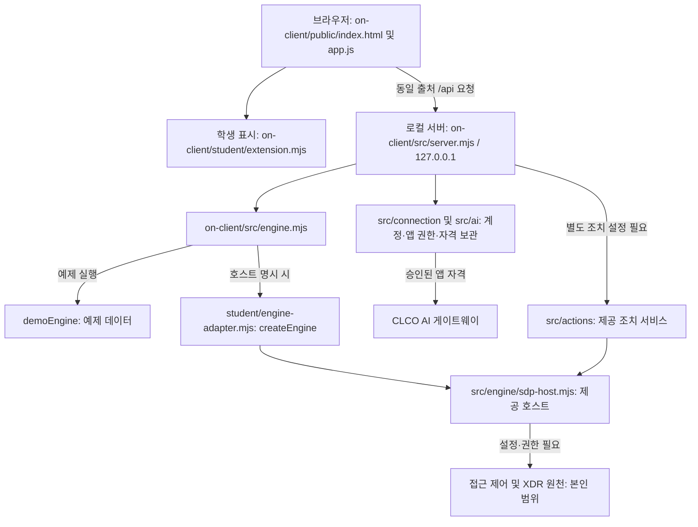

# 케셰브 학생 실행 설명서 · 21단계

## 조회 이력 추가 — 2026-10-27

기존 폴더에서 `powershell -NoProfile -ExecutionPolicy Bypass -File .\on-client\tools\start-alekov.ps1 -Demo -Port 5192`로 실행합니다. 5192가 사용 중이면 다른 빈 포트를 선택합니다. 서버 코드가 바뀌었으므로 이전 서버의 브라우저 새로고침만으로는 적용되지 않습니다. 기존 서버와 제출물을 보존합니다.

보안 기록 → 저장된 조회 이력에서 예제 표시·조회 시각·사건 발생 시각을 확인합니다. 위쪽 다시 불러오기는 원천을 조회하고 기록을 추가합니다. ‘저장된 이력 다시 조회’는 저장 내용만 읽습니다. 실행 창에서 Ctrl+C 후 같은 폴더·명령으로 실행하면 이전 이력과 새 조회가 함께 표시되어야 합니다. 저장 이력 종류에서 access/XDR를 걸러 봅니다. 현재 예제는 access 1건이며 조회마다 별도 항목으로 저장합니다. 빈 원천 조회는 사건 이력을 추가하지 않습니다.

기본 저장소는 `%LOCALAPPDATA%\Keshev\history\queries.json`입니다. LOCALAPPDATA가 없으면 사용자 홈의 AppData/Local 아래를 사용합니다. 프로젝트·Git·제출물에 포함하지 않습니다. 원문 요약·근거·사건/사용자 ID·앱 이름·인증값은 저장하지 않습니다. 계정/프로젝트/소스 경로를 구분하는 해시, 모드, 임의 조회 ID, 조회 시각, 사건 시각, 종류만 보관합니다. 이는 익명화 인증이 아니라 로컬 범위 분리이며 다른 Windows 계정의 접근 권한 강화·설치 위치 이동 시 이력 이전은 이번 검증 범위 밖입니다.

한 저장소 전체에 최근 30일·최대 1,000건을 적용합니다. 정리는 다음 읽기/쓰기 때 수행하며 앱이 꺼진 동안 예약 삭제하지 않습니다. 예제와 연결 계정은 서로 분리되고, 연결 계정은 현재 활성 신원을 확인해야 이력을 읽거나 삭제할 수 있습니다. 연결 없음은 이전 계정 이력을 공개하지 않습니다. 저장 실패는 현재 원천 조회를 막지 않지만 별도 경고로 표시합니다. 동시 쓰기 잠금이나 비정상 종료 후 잠금 파일이 남으면 오류로 표시하고 자동으로 지우지 않습니다.

삭제는 ‘현재 계정·모드의 저장 이력만 삭제함을 확인합니다’ 체크 후 ‘확인한 조회 이력 삭제’입니다. 원천 사건·학습 DB·프로젝트·기존 제출물은 삭제하지 않습니다. 삭제 후 원천 다시 불러오기를 하면 새 이력이 생깁니다. 외부 출처의 삭제 요청과 신원 미확인 요청은 거부되어야 합니다.

자동 검사: `node --test on-client/test/history.test.mjs`. 임시 폴더의 모의 자료로 재시작 복원·보관 제한·계정 분리·활성 상태 검사·출처 거부·저장 실패 시 현재 기록 유지 등을 확인합니다. 실제 SDP 연결·심판 판정·설치 프로그램 시험이 아닙니다. 2026-10-27 브라우저 확인은 별도 임시 저장소의 5191 예제 서버에서 수행했으며, 기본 사용자 저장 경로의 재시작 시험과 실제 계정 운영 연결은 미확인입니다.

작성 기준: 2026-10-26의 현재 코드와 학생이 전달한 21단계 공식 과제 안내. 목적은 기존 자료실과 학생 코드를 보존하면서 다른 사람이 작업 위치, 실행 명령, 데이터 흐름과 확인 범위를 대조하게 하는 것입니다. 이번 단계는 문서만 변경하며 함수·API·인증 설정은 변경하지 않습니다.

## 1. 환경과 설치 범위

| 항목 | 파일의 요구 조건 | 이번에 직접 확인한 값 / 한계 |
|---|---|---|
| 운영체제 | 제공 실행 도구는 Windows PowerShell 사용 | Windows에서 명령 실행. 다른 OS 실행은 미확인 |
| Node.js | `on-client/package.json` engines: `24.19.0`; 실행 도구는 22~24 허용 | `node --version`: `v24.21.0`. 수업 기준과 다름. 이 버전에서 문법 및 예제 HTTP 검사만 확인 |
| PowerShell | `on-client/tools/start-alekov.ps1` | 작업 셸 7.6.5, `powershell -NoProfile`로 확인한 Windows PowerShell 5.1.19041.6456 |
| npm / Git | npm 스크립트 실행 / 커밋 관리 | `npm.cmd --version`: 11.19.0; `git --version`: 2.34.1.windows.1 |
| 브라우저 | JavaScript와 DOM을 지원하는 브라우저 | 이번 단계의 브라우저 종류·버전·화면 동작은 미확인 |
| 학생 앱 | `on-client/package.json` | 0.2.14, 외부 dependencies와 별도 lock 파일 없음 |
| 기존 자료실 | 루트 `package.json`, `package-lock.json` | Node >=22, lockfileVersion 3. 학생 앱과 별도 패키지 |

Node.js가 없으면 제공 실행 안내에 따라 수업 기준 24.19.0을 설치하고 PowerShell을 새로 엽니다. 이번 작업에서 설치는 실행하지 않았습니다. 학생 앱의 예제 실행에는 npm 패키지 설치가 필요하지 않습니다. 기존 자료실 의존성을 복원할 때만 저장소 루트에서 `npm.cmd ci`를 사용합니다. 이는 lock 기반 설치 명령이며 이번에는 실행하지 않았습니다. 루트에는 `start` 스크립트가 없으므로 루트의 `npm start`를 학생 앱 실행 명령으로 쓰지 않습니다.

## 2. 작업 위치와 구조

이 PC에서 확인한 Git 최상위 폴더는 `C:\Users\ekfcj\J26\J26_git\github-check\choi-bujang-secret-vault`입니다. 아래 경로는 이 폴더 기준입니다. 다른 PC에서는 실제 복제 위치를 사용합니다.

```text
README.md                         기존 기록 + 21단계 학생 안내
docs/STUDENT_RUNBOOK.md            이번 학생 문서
package.json / package-lock.json   기존 자료실 의존성·검사·빌드 명령
api/ · src/ · public/ · supabase/   기존 자료실 API·판정·화면·SQL
xdr/ · scripts/                    기존 경보 분류·응답 및 연습 도구
aleph.config.json                  기존 자료실 설정 (21단계 번호로 변경하지 않음)
on-client/
  package.json                    학생 앱 실행 명령
  .env.example                    비밀 없는 설정 견본
  student/extension.mjs            학생 화면 함수
  student/engine-adapter.mjs       본인 범위 호스트 연결 어댑터
  public/index.html · app.js       제공 화면·요청·상태 관리
  src/server.mjs                   제공 loopback HTTP 서버
  src/engine.mjs · engine/         예제/연결 없음 및 SDP 호스트
  src/connection/ · ai/            계정 연결·AI 권한·게이트웨이 통신
  src/actions/                    제공 조치 준비·집행·결과 조회
  src/vulnerabilities/            설치 패키지 대조·OSV 조회
  tools/start-alekov.ps1           제공 Windows 실행 도구
  docs/                           제공 실행·연결·입력 계약
```

기존 미추적 워크벤치 배포본, 원고, 운영 도구 예외 기록, XDR 로그·후보·거부 규칙은 이번 문서 작업에서 수정하거나 추가 커밋하지 않습니다. 학습 DB도 변경하지 않습니다.

## 3. 실행·종료·재실행

### 확인 1 — 새 PowerShell에서 예제 시작

기존 실행 창은 닫지 않습니다. 파일 탐색기에서 위 Git 최상위 폴더를 열고 주소 표시줄에 `powershell`을 입력합니다. `Get-Location`으로 위치를 확인한 다음 아래 **한 줄**을 실행합니다. 기본 5189와 분리하기 위해 예제 확인에는 5190을 사용합니다.

```powershell
powershell -NoProfile -ExecutionPolicy Bypass -File .\on-client\tools\start-alekov.ps1 -Demo -Port 5190
```

도구는 Node 버전·폴더·포트를 확인하고 `on-client/src/server.mjs --demo`를 실행합니다. `-Demo`에서는 자동 계정 연결 설정을 만들지 않습니다. 다른 프로세스를 종료하지 않습니다. 포트 사용 중 오류가 나면 먼저 그 오류만 확인하고, 사용하지 않는 번호로 `-Port`와 브라우저 주소를 함께 바꿉니다.

정상 시작 신호는 `케셰브가 켜졌습니다. 브라우저에서 http://127.0.0.1:5190/ 을 여세요.`와 `서버가 응답한 것만 확인했습니다. AI 연결 상태는 화면에서 따로 확인해 주세요.`입니다. 이 메시지는 HTTP 응답 확인이며 운영 연결 성공이 아닙니다.

브라우저에서 `http://127.0.0.1:5190/`을 열고 「보호 현황」을 누릅니다. 예제 자료임을 확인합니다. 여기까지 확인한 뒤 다음 확인으로 넘어갑니다. 이 실행 도구 전체 절차와 실제 화면은 이번 단계에서 아직 실행·확인하지 않았습니다.

### 확인 2 — 경로·버튼·상태 대조

확인 1이 끝난 뒤 한 항목씩 수행합니다.

1. 「업무 앱」에서 「학습 자료실 접속 요청」을 누릅니다. 예제 `allow` → `접근 허용(allow)`가 기대 결과입니다. 실제 자료실 접속 완료를 뜻하지 않습니다.
2. 「개발 저장소 접속 요청」을 누릅니다. 예제 `deny` → `접근 거부(deny)`가 거부되어야 할 결과입니다. HTTP 요청 자체는 200일 수 있으며 판정 값이 deny입니다.
3. 「확인할 업무 앱 접속 요청」은 `challenge` → `추가 인증 또는 확인 필요(challenge)`가 기대 결과입니다.
4. 「보안 기록」의 event-01 상세에서 접속 denied, 기기 unknown과 근거를 확인합니다. 지원 조치가 없어 「조치 준비」 버튼이 표시되지 않는 것이 정상입니다. 「다시 불러오기」 후 이전 상세 초기화를 확인합니다.
5. 경로와 명령을 이 문서 및 `on-client/package.json`과 대조합니다. 실행·화면 확인하지 못한 항목은 미확인으로 남깁니다. 유료 AI 설명과 보안 집행은 이 확인 절차에 포함하지 않습니다.

종료는 **이번에 실행한 창에서만** Ctrl+C입니다. 새 HTTP 요청이 더 이상 응답하지 않는지 확인합니다. 이미 표시된 화면이 남아 있는 것만으로 서버가 실행 중이라고 판단하지 않습니다. 재실행은 같은 폴더에서 같은 명령을 실행하고 같은 주소를 다시 엽니다. 종료·재실행의 실제 확인은 미확인입니다.

### 실행 방식의 차이

| 목적 | Git 최상위 폴더에서 실행할 명령 | 코드상 동작 / 확인 범위 |
|---|---|---|
| 기본 실행 | `npm.cmd --prefix on-client start` | 기본 5189, 호스트 미지정 시 연결 없음. 이번 실행 미확인 |
| 예제 직접 실행 | `npm.cmd --prefix on-client run demo` | 기본 5189, 예제 엔진. 포트 선점검은 하지 않음 |
| 제공 계정 연결 준비 | `powershell -NoProfile -ExecutionPolicy Bypass -File .\on-client\tools\start-alekov.ps1` | 기본 5189. 프로젝트 밖 개인 보관소를 준비할 수 있음. 로그인·승인은 별도이며 이번 미실행 |
| 학생 화면 문법 검사 | `npm.cmd --prefix on-client run check` | `node --check student/extension.mjs`; 이번 종료 코드 0. 화면·운영 검증 아님 |

실제 계정 연결은 제공 [시작 안내](../on-client/docs/STUDENT_LAUNCH_GUIDE.md)와 [SDP 연결 계약](../on-client/docs/SDP_HOST_CONNECTION.md)을 따릅니다. NativeHostConfig는 계정/AI 연결, SdpHostConfig는 접근 제어 연결이며 서로 대체하지 않습니다. 실제 설정 경로와 비밀값은 이 문서에 적지 않습니다. `.env.example`은 견본이며 위 npm 명령은 `.env` 자동 로드 옵션을 사용하지 않습니다. 견본 복사만으로 연결됐다고 판단하지 않습니다. 비밀은 Git·제출 밖의 승인된 개인 설정/보관소에 두고 공식 비밀 입력 화면에서 직접 설정합니다.

## 4. 글로 쓴 시스템 구성도



브라우저는 제공 app.js로 요청하고 학생 함수는 받은 자료를 DOM으로 표시합니다. 서버는 `127.0.0.1`에만 바인딩합니다. 기본 실행은 연결 없음이며, 예제는 `demoEngine()`의 가상 자료입니다. 실제 SDP 호스트가 명시돼야 어댑터가 본인 조회·판정 기능을 전달합니다. 이 선은 코드상 가능한 경로이며 운영 연결 확인 표시가 아닙니다.

AI 요청은 브라우저에서 로컬 서버를 거쳐 앱 권한과 자격 검증 후 게이트웨이로 갑니다. `src/ai/connection.mjs`의 공개 기본 주소는 `https://ai-classroom-gateway-production.up.railway.app`, 승인 포털은 `https://aleph-omega.vercel.app`입니다. 이번 작업에서 원격 주소에 접속하거나 연결 성공을 확인하지 않았습니다. AI 설명·제안은 조치 집행과 별개입니다. 조치 경로는 제공 서비스가 담당하며 단순 예제 실행이나 학생 어댑터에 집행 기능이 생기는 것은 아닙니다.

루트의 기존 `api/`, `src/decider.mjs`, `src/detect.mjs`, `xdr/`는 별도 자료실·연습 구현입니다. 같은 저장소에 있다는 이유만으로 로컬 앱과 자동 연결되지 않습니다. 실제 원천 연결·접속 회수·XDR 전달은 미확인입니다.

## 5. 구현 함수·제공 코드·입력 계약

아래 학생 함수는 모두 `on-client/student/extension.mjs`의 `createStudentView()`가 반환합니다. 이번에는 함수 수정이 없습니다. 표시 구현이 존재한다는 코드 확인과 실제 화면 검증은 구분합니다.

| 학생 함수 | 실제 입력 | 구현 내용 / 경계 |
|---|---|---|
| renderIdentity | `{me, devices, sessions}` | 각 자료의 status/mode/data/error로 로그인·기기·세션 표시 |
| renderDecision | `{status, mode, data, error, appId}` | allow/deny/challenge/unknown, 이유·시각; 요청 실패를 deny로 바꾸지 않음 |
| renderEvents | `{status, mode, data, error}` | 기록 정렬·필터·상세·CONTRACT_MISMATCH 표시 |
| renderStatus | `{devices, sessions, notifications, diagnostics, mode}` | 보호 현황·자료별 실패·도움정보 표시 |
| renderVulnerabilities | `{status, mode, data, error}` | 설치 버전·OSV 결과; 미조회를 취약점 없음으로 표시하지 않음 |
| renderAiConnection | `{status, mode, data, error, checkedAt, explanationAccepted}` | 연결 점검 상태·안전한 오류; 사건 설명과 구분 |
| renderExplanation | `{event, explanation, checkedAt}` | 근거 ID·지원 조치·미실행·사람 확인 필요 검증 후 설명 표시 |
| renderAction | `{status, event, actionId, target, receipt, observation, message, confirmationExpiresAt, error}` | 준비/전달/접수/관측 구분. succeeded와 effectApplied === true일 때만 효과 확인 |

| 경계 | 파일·함수 | 책임 |
|---|---|---|
| 학생 연결 모듈 | `on-client/student/engine-adapter.mjs`: createEngine(host) | 검증된 호스트의 readIdentity/readApps/decideAccess와 선택적 readEvents/readDevices/readSessions만 전달; 기본 export는 disconnected |
| 제공 화면 | `on-client/public/app.js`, `index.html` | 통신·버튼·상태 교체·집행 확인. 이번 수정 금지 범위로 보존 |
| 제공 서버 | `on-client/src/server.mjs`: createOnServer | 입력 검증·동일 출처 검사·본인 범위·오류 응답 |
| 제공 연결 | `on-client/src/engine.mjs`: loadEngine, engineMethod, demoEngine | 실제/미연결/예제 분리 |
| 제공 AI·조치 | `on-client/src/ai/`, `src/actions/` | 권한·근거·요청·결과 검증. 학생 표시 문구가 권한을 대신하지 않음 |

HTTP 응답 계약은 `{ok:true,data,meta:{mode,checkedAt}}` 또는 `{ok:false,error:{code,message,retryable},meta:{mode,checkedAt}}`입니다. mode는 connected/demo/disconnected입니다. 학생 표시 입력의 status와 HTTP의 ok는 다른 계층입니다.

| API | 입력 / 반환 범위 |
|---|---|
| GET /api/me, /api/apps, /api/events, /api/devices, /api/sessions | 본인 정보·업무 앱·사건·기기·세션 |
| POST /api/access | `{appId}` → appId/decision/reason/checkedAt |
| POST /api/ai/check | `{}` → 현재 앱 권한과 모델 목록 점검; 생성 설명 아님 |
| POST /api/ai/explain | `{eventId}` → 서버가 읽은 사건 근거에 대한 설명 |
| POST /api/actions/prepare | `{eventId,actionId}` → 조치 준비 |
| POST /api/actions/execute | `{requestId,confirmationId}` → 집행 요청; 이번 미실행 |
| POST /api/actions/result | `{requestId}` → 원천 결과 재조회; 이번 미실행 |
| GET /api/diagnostics, /api/vulnerabilities | 진단 / 설정된 프로젝트와 승인된 공개 패키지 조회 |

## 6. 장애 확인 순서

오류가 나면 첫 오류 코드·발생 단계부터 확인합니다. 비밀 설정 원문이나 인증값을 복사하지 않습니다. 해당 원인 하나를 확인한 뒤 재시도하며 정책을 바꿔 성공 표시를 만들지 않습니다.

| 실제 처리·오류 근거 | 먼저 확인 | 복구 / 기대 상태 |
|---|---|---|
| 실행 도구: Node 없음·버전 범위 오류 | `node --version` | 수업 기준 설치 후 새 창. 설치 전 정상 시작으로 기록하지 않음 |
| 실행 도구: 앱 폴더 아님 | Get-Location, 위 파일 경로 | 실제 저장소 폴더에서 재실행; 새 구조를 만들지 않음 |
| 실행 도구: 포트 사용 중 / 직접 실행 EADDRINUSE | 선택한 포트 | 기존 프로세스 보존, 다른 -Port 사용 |
| 실행 도구: 제한 시간 내 시작 실패 | 같은 창의 첫 오류 | 오류에 해당하는 파일·설정만 대조. 무조건 재설치하지 않음 |
| ENGINE_NOT_CONNECTED | 예제/기본/호스트 실행 방식 | 기본 미연결이면 정상적인 실패 표시. 실제 연결은 담당자 안내 확인 |
| ENGINE_ADAPTER_INVALID, ENGINE_RESULT_UNVERIFIED, CONTRACT_MISMATCH | 호스트 메서드·응답 계약 | 계약 차이를 담당자에게 전달. 빈 성공·허용으로 대체하지 않음 |
| ENGINE_TIMEOUT, REQUEST_TIMEOUT | 연결 상태와 오류 발생 시각 | 상태 확인 후 수동 재조회, 이전 결과를 현재 결과로 쓰지 않음 |
| HOST_REJECTED, ORIGIN_REJECTED | loopback 주소·앱 화면 경유 여부 | 문서 주소로 접속. 서버 검사 제거 금지 |
| ON_AI_PROVISIONING_PENDING, SUBJECT_SCOPE_UNVERIFIED | 계정 연결과 앱 권한 | 담당자 확인. 키 복사·자동 재발급으로 우회하지 않음 |
| 조치 pending / unknown | 접수·관측 정보 | 접수는 효과 아님. 기존 요청 결과만 조회하며 중복 집행 금지 |

버튼 명칭 차이: 학생 renderAction 문구의 「연동 시스템 결과만 재조회」에 대응하는 제공 화면 실제 버튼은 **「원천 결과만 재조회」**입니다. 이번에는 제공 코드와 학생 함수를 수정하지 않습니다. 「조치 화면 취소」는 이미 전달된 조치를 되돌리지 않습니다.

## 7. 검증 기록과 미확인 범위

| 구분 | 이번 직접 확인한 결과 | 한계 |
|---|---|---|
| 코드 대조 | package/lock/설정 견본·실행 도구·라우트·학생 함수·버튼 이름 확인 | 코드상 존재가 운영 성공 증거는 아님 |
| 명령 실행 | 버전 조회, 학생 화면 문법 검사 종료 코드 0 | 전체 기능 테스트 아님 |
| 모의 자료 HTTP 점검 | createOnServer + demoEngine을 임시 loopback 포트로 실행. GET / 200; library allow, repository deny, approval challenge 모두 HTTP 200 확인 후 해당 서버 종료 | 제공 실행 도구 전체 실행·브라우저 DOM 검사는 아님. 기존 서버를 종료하지 않음 |
| 실제 화면 | 이번 단계 미확인 | 확인 1·2를 학생이 수행해야 함. 앞 단계 README 기록은 당시 증거 |
| 운영 연결·보안 집행 | 미확인·미실행 | 실제 SDP/XDR·로그인·유료 AI·취약점 원격 조회·집행·효과 관측·배포·제출·공식 판정 포함 |

지원하지 않는 범위: loopback 밖 공개 바인딩은 현재 서버 실행 방식에 없습니다. Windows 제공 도구를 macOS/Linux 실행 절차로 안내하지 않습니다. 전체 직원 사건 조회, 자동 운영 차단, 미조회 패키지의 안전 보장은 지원 기능으로 기록하지 않습니다.

## 8. 21단계 커밋·원문 제출

제공 `on-client/docs/STUDENT_LAUNCH_GUIDE.md`의 21·22단계 미확정 설명과 일반 워크벤치 제출 설명은 이번 공식 안내와 다릅니다. 제공 문서는 보존하며 **21단계는 이번에 전달된 공식 안내**를 따릅니다. 서버 AI는 커밋의 문서·구성도·실행 파일·설정 견본을 읽으며 명령을 실행하지 않습니다.

1. 이번 변경은 README와 이 학생 문서입니다. 기존 학생 코드는 같은 커밋의 저장소 트리에 보존합니다. 커밋 전 변경 목록과 비밀값 검사 결과를 확인하며 다른 작업을 일괄 추가하지 않습니다. bundle-notes.json, artifacts/submission.json, 비밀 설정·실제 개인정보·메모 본문을 이번 제출 변경에 넣지 않습니다.
2. 커밋 후 Git 최상위 폴더에서 `git rev-parse HEAD`로 40자리 해시를 확인합니다. 과제 화면에 저장소 주소와 그 해시를 직접 입력합니다. 워크벤치 「포털 제출 준비」는 13~20단계 범위이므로 21단계에 사용하지 않습니다. 비공개 저장소를 공개로 바꾸지 않습니다.
3. 비공개 커밋은 같은 단계의 「비공개 저장소 원문 준비 방법」 → 「원문 전달 도구 받기」를 사용합니다. ZIP을 프로젝트 밖에 풀고 JSON 출력용 새 폴더도 프로젝트 밖에 준비합니다.
4. Git 최상위 PowerShell에서 과제 화면의 student-source-cli.mjs 명령을 사용합니다. 실제 도구·출력 경로와 `--commit` 뒤 40자리 해시를 확인한 다음 실행합니다. 현재 그 도구 위치와 화면 명령은 확인하지 않았으므로 추측한 명령은 제공하지 않습니다. 도구는 커밋된 원문을 묶으며 학생 코드를 실행하거나 업로드하지 않습니다.
5. 생성 JSON을 같은 단계 「비공개 저장소 원문 묶음」에서 선택하고 저장소·커밋·단계를 확인한 뒤 직접 제출합니다. 원문 전달과 AI 검토 통과를 구분합니다. 원문 전달만 실패하면 기존 접수를 유지하고 「원문만 다시 보내기」를 사용합니다.

이번 작업에서 단계 제출과 공식 판정은 실행하지 않았습니다. 커밋 해시는 문서 안에 미리 만들거나 통과 결과로 기록하지 않습니다.
