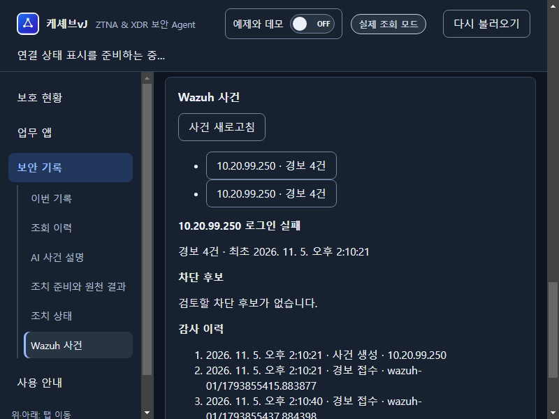
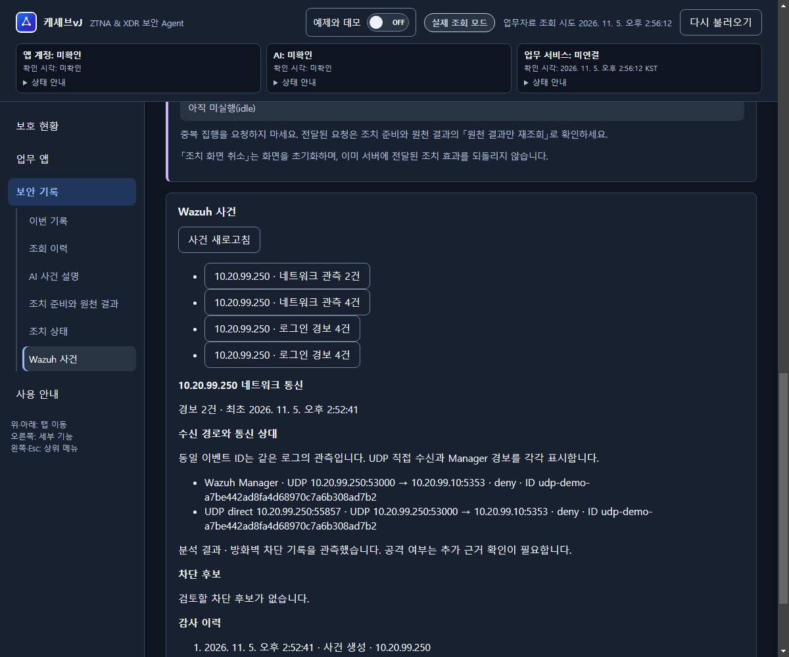

# 케셰브 시연 화면

2026-11-05 실습에서 저장한 화면을 2026-11-06 문서에 반영했습니다. 네트워크 변경 중에 새로 시험한 결과가 아닙니다.

## 실제 Wazuh 로그인 실패 수신

VM 재부팅 후 보안 기록에 실제 Wazuh 로그인 실패 사건과 경보 접수 감사 이력이 표시된 화면입니다. 이 사건은 경보 4건으로 차단 후보가 없는 상태입니다.

## UDP 이중 수신 시연

시연용 JSON syslog를 Wazuh와 케셰브가 각각 UDP로 수신한 화면입니다. 동일 이벤트 ID의 Manager 경보와 UDP 직접 관측, 통신 주소·포트, 분석 결과를 확인할 수 있습니다. 이 이미지는 실제 pfSense 방화벽 로그 검증의 증거가 아닙니다.

실제 SW-SOC 로그의 양쪽 수신은 이전 실습에서 확인했으며, pfSense 실제 로그의 종단 간 검증은 네트워크 업그레이드 후 진행합니다. 승인·반려는 로그인 실패 차단 후보에 적용하고, 실행 결과는 모의 대응입니다.
